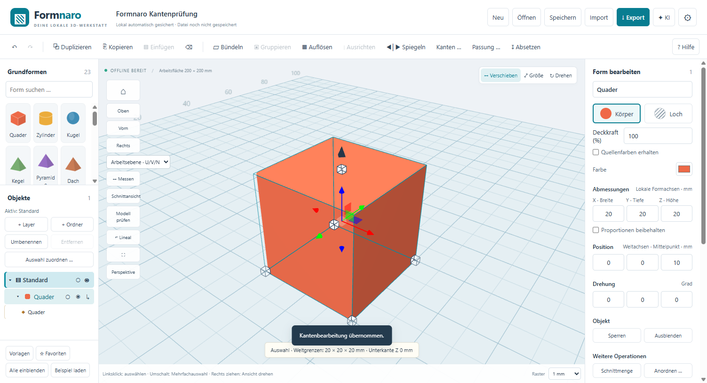

# Formnaro

> Historische ausführliche Projektbeschreibung aus dem privaten Original.
> Der aktuelle Projektstand ist 0.111.0-r2. Aktuelle Downloads und Einstieg:
> [öffentliche Startseite](README.md). Ältere Versionsangaben und Verweise auf
> das ursprüngliche Repository sind im folgenden Text als Historie erhalten.

Aktueller Quellstand: **0.108.0**, Stand **26.10.2026**. Lokaler CAD- und Netzmodellierer für Windows mit Vorschau, editierbaren Quellen und Rückgängig.

Sicherheitsaktualisierung: Pillow 13.0.0 und setuptools 84.2.1 im nativen Konverter und der isolierten Python-Analyse; Electron 44.9.3 in Hauptprogramm und beiden Minis, Undici 7.30.1. [Details und Buildherkunft](docs/SICHERHEITSUPDATE-0.103.1.md).

Neu: [Foto-Assistent mit Referenzmaßen und Konturvergleich](docs/FOTO-ASSISTENT.md), [Programm-Assistent mit sichtbarer Bedienhilfe](docs/PROGRAMM-ASSISTENT.md), vollständige lokale [FreeCAD-Python-Werkzeuge](docs/FREECAD-KI.md) sowie Verbrauchsstatistik und Auftragsfehlerhistorie für die KI.

## Windows-Download

**[Formnaro 0.108.0 herunterladen](https://github.com/andyy909/Formnaro/releases/tag/v0.108.0)**

Das vollständige `Formnaro-v0.108.0-Windows.zip` in einen eigenen Ordner entpacken und `App/Formnaro.exe` starten. Anwendung, lokale Konverter-/Sprachlaufzeiten, Anleitungen, Quellenhinweise und Lizenzen zusammenlassen. Beim Wechsel eigene Einstellungen und Werkzeuge über den bisherigen **Datenordner** mitnehmen. Persönliche Modelle, Profile und Zugangsdaten sind nicht im Download enthalten.

Der Release enthält außerdem den zugehörigen Repository-Quellcode, Prüfergebnisse und SHA-256-Prüfsummen. Bisherige Ausgaben bleiben erhalten.

## Verbesserungen seit 0.55.0

| Bereich | Aktueller Stand |
| --- | --- |
| Bedienung | Easy Tinker, Normal, [Solid](docs/SOLID-MODUS.md) und [Fusion 360](docs/FUSION-MODUS.md); getrennte Optionen und anpassbare Rechtsklickmenüs |
| CAD-Konstruktion | Erweiterte Skizzen und Bedingungen, native Flächenwerkzeuge, Loft/Sweep, [gemeinsame Parameter und Varianten](docs/PROJEKTPARAMETER.md), verknüpfte Konturen |
| Zeichnung und Baugruppen | [Technische Zeichnungen](docs/TECHNISCHE-ZEICHNUNGEN.md), automatische Bemaßung, PDF/SVG/DXF, Gelenke und Bewegung, gezielte Baugruppenanzeige und [indiziertes FNPACK](docs/FNPACK.md) |
| KI und Python | [ChatGPT-Abo-Anmeldung](docs/CHATGPT-ANMELDUNG.md), getrennte Anbieter-Kontexte, lokale Python-Laufzeit, zusätzliche [FreeCAD-Engine](docs/FREECAD-KI.md), adaptive Mess-/Korrekturschleife und geprüfte Fehlervorschauen |
| KI-Arbeitsumgebung | [Offline-Analysebibliotheken und vollständige gespeicherte Werkzeuge](docs/KI-ARBEITSUMGEBUNG.md), gemeinsamer Zugang für GPT/DeepSeek, lokaler Arbeitsbereich mit vollständigen großen Messergebnissen, gezielte Quellenverweise und konkrete FreeCAD-Diagnose, datierter API-Gegenwert bei GPT |
| Foto-Assistent | Dauerhafte Originalfotos mit Herkunft/Messpunkten im Projekt, vierpunktige Rechteckentzerrung ebener Fotos, bestätigungspflichtige Kantenvorschläge, Pixelraster und Foto/Vorschau-Vergleich; Projektfotozugang in allen vier Bedienmodi; geführte technische Drei-Ansichten-Rekonstruktion mit gemeinsamen Maßen, nativen Funktionsprüfungen und editierbaren Profilquellen |
| Programm-Assistent | Fragen zu Formnaro, sichtbare Menüführung mit Zeiger/Pause/Stop und schrittweise CAD-Vorführungen als normale Vorschau; eigene begrenzte Kontextnotizen |
| KI-Verbrauch und Rückmeldungen | Anbieterbezogene Tagesstatistik, lokale Kontextgrößen und kumulative Fehlerbelege; native Sollmaße und der bessere geprüfte Entwurf bleiben während Korrekturen erhalten |
| Netze und Darstellung | Robuster Netzimport, Modellierpinsel/Symmetrie, Schnittkonturen, Original-/Oberflächenvergleich, verbesserte Maße und Arbeitsgeschwindigkeit |
| Eigenständige Minis | [Mini Mesh 0.9.1](mini/README.md) und [Mini CAD 0.4.1](mini-cad/README.md) als getrennte Codebasen mit eigenen Formaten und Datenordnern |

Die lokale KI arbeitet ausschließlich über die angebotenen Modellier- und Analysefunktionen. Ihre Skripte erhalten keinen Zugriff auf Programmdateien, Anmeldedaten oder das Betriebssystem. FreeCAD nutzt eine zusätzlich installierte lokale Ausgabe. Cloud-Anbieter werden nur bei beauftragten KI-Anfragen angesprochen.

**Prüfung von 0.108.0:** 285 Tests am eingefrorenen Quellstand und 738 Prüfgruppen an der tatsächlichen Windows-EXE bestanden. Darunter je 37 Mehransichtenprüfungen mit gerader und schräger Vorderansicht: gemeinsame Nullpunkte, native Maße, Freiraum-/Bohrungsfehler, editierbare Profile, unverändertes gesperrtes Original, Berichtexport, .ocad/.fnpack und exaktes Undo/Redo. Alle 138 geschützten früheren EXE-/ASAR-Dateien unverändert; keine externen Testanfragen. [Prüfbericht und Prüfsummen](https://github.com/andyy909/Formnaro/releases/tag/v0.108.0). [Ausbauplan](docs/AUSBAUPLAN-AB-0.106.md): Pakete 0–2 abgeschlossen, 3–10 offen. Drei Silhouetten bestimmen keine unbekannte Innengeometrie oder Fertigungspassung.

**Vorherige Prüfung von 0.107.0:** 276 Tests am eingefrorenen Quellstand und 664 Prüfgruppen an der tatsächlichen Windows-EXE bestanden. Frontaler und schräger Foto-KI-Ablauf mit beiden simulierten Anbieterprotokollen, nachgewiesener abschließender Bildprüfung, nativen Maßen und exaktem Undo. Projektfotos, .ocad/.fnpack/Autosave, direkte Bedienung in allen vier Modi und kleine/dunkle Ansichten geprüft. Alle 136 geschützten älteren EXE-/ASAR-Dateien unverändert. [Prüfbericht und Prüfsummen](https://github.com/andyy909/Formnaro/releases/tag/v0.107.0). [Weiterer Ausbauplan](docs/AUSBAUPLAN-AB-0.106.md): Damals Pakete 0 und 1 abgeschlossen.

**Vorherige Prüfung von 0.106.0:** 232 Tests am eingefrorenen Quellstand und 567 Prüfgruppen an der tatsächlichen Windows-EXE bestanden, darunter 54 Foto-Prüfgruppen. Beide Anbieterprotokolle wurden mit simulierten Antworten durch den tatsächlichen Mess-/Korrektur-/CAD-/Vorschau-/Apply-/Undo-Ablauf geprüft. Keine Rendererfehler oder externen Testanfragen; alle 134 geschützten früheren EXE-/ASAR-Dateien unverändert. Fotoähnlichkeit beweist keine verdeckte Geometrie, Bohrungstiefe oder Fertigungspassung. [Prüfbericht und Prüfsummen](https://github.com/andyy909/Formnaro/releases/tag/v0.106.0).

**Frühere Sicherheitsprüfung von 0.103.1:** 199 Tests und 471 Prüfgruppen an der tatsächlichen Haupt-EXE bestanden; Mini Mesh 117 und Mini CAD 123 EXE-Prüfgruppen. GitHub meldete bei dieser Sicherheitsabnahme 0 offene Dependabot-Warnungen; alle vorherigen 48 Einträge sind behoben, keiner ausgeblendet. Die drei npm-Audits und die Prüfung von 68 nativen Python-Paketen melden 0 bekannte Funde. [Prüfbericht und Prüfsummen](https://github.com/andyy909/Formnaro/releases/tag/v0.103.1).

**Vorherige Prüfung von 0.103.0:** 182 gezielte Tests und 395 Prüfgruppen an der tatsächlichen Windows-EXE bestanden. Drei neue Gruppen prüfen große vollständige Messberichte in der echten Python-Sandbox; 120 bisherige EXE-/ASAR-Dateien blieben unverändert. Zwei zusätzliche Regressionstests prüfen konkrete Limitfehler und die FreeCAD-Operandendiagnose. Die Anbieterabläufe wurden mit simulierten Antworten durch den tatsächlichen Desktop-/Sandbox-/CAD-Ablauf geprüft. Dies ist kein Genauigkeitsnachweis für beliebige STL-Rekonstruktionen.

CAD-Projektformate bis 19, FNPACK v1 und lokale KI-API 1; ältere Projektformate bleiben lesbar. Details: [Bedienung](LIES-MICH.txt), [technischer Projektkontext](docs/PROJEKTKONTEXT.md). Lokale Entwicklungshistorie und persönliche Daten bleiben außerhalb von Git.

## Entwicklungshistorie


Formnaro 0.99.0: **Solid** ist ein zusätzlicher Bedienmodus neben Easy Tinker und Normal. Werkzeugregister, klassisches Menü, Modellbaum und Eigenschaften links sowie passende Maus- und Tastenkürzel erleichtern den Umstieg von SolidWorks. Rechtsklick bietet passende Teil-/Featurebefehle; die Belegung lässt sich in allen drei Modi getrennt anpassen, einschließlich Funktions-Plugins. [Bedienung](docs/SOLID-MODUS.md). Die portable Freigabe ist durch die zugehörige Abnahme belegt.

Formnaro 0.92.1: Automatische Korrekturen erhalten zusätzlich den vollständigen fehlgeschlagenen Python-/JavaScript-Code als Referenz. Funktionierende Geometrie soll erhalten bleiben; bestehender Inputkontext bleibt unverändert.

Formnaro 0.92.0 ergänzt vollständige STL-Schnittkonturen als native Skizzen und einen Oberflächenvergleich des Entwurfs vor der Übernahme. Der bisherige Modellierkontext bleibt erhalten. [Werkzeuge und Grenzen](docs/KI-REKONSTRUKTION.md).

DeepSeek-Antwortbudget: automatisch131.072Tokens, einstellbar bis393.216. Strukturierte Desktopfehler erhalten automatische Korrekturen auch bei abgeschnittenen Antworten.

Formnaro 0.91.0 ergänzt einen dauerhaften KI-Modellierkontext: bearbeitbare
Hinweise unter Daten/KI-Modellierkontext.md und ein begrenztes strukturiertes
Erfahrungsprotokoll. Beides wird bei neuen CAD-Anfragen erneut gelesen und dem
gewählten Anbieter mitgegeben. Ergebnisse bleiben anhand aktueller Geometrie
zu prüfen. Anleitung: [KI-Modellierkontext](docs/KI-MODELLIERKONTEXT.md).


Neu im Quellcode: **0.90.0 Python-Modellierung** mit mitgelieferter lokaler Laufzeit, Python-Bereich in der KI-Werkstatt und gemeinsamer Python-Bibliothek für externe Skripte. Native Quellen, Vorschau/Übernahme und Undo bleiben erhalten. [Anleitung](docs/PYTHON-SCHNITTSTELLE.md). Die portable Freigabe wird erst durch ihre vollständigen Abnahmebelege bestätigt.

Zuvor: **0.89.0 Automatische Bemaßung** mit Grund- und Detailvorschlägen, geometrischen Gesamt-/Bohrungsabständen, Platzierung auf dem Blatt und gemeinsamer PDF-/SVG-/DXF-Ausgabe. [Bedienung und Grenzen](docs/TECHNISCHE-ZEICHNUNGEN.md). Die separate portable Freigabe wird durch ihre eigenen Abnahmebelege bestätigt. Der CAD-Ausbau mit sieben Paketen ist seit 0.88 abgeschlossen.

Zuvor abgenommen: **0.83.0 Projektparameter und Varianten** mit gemeinsamen Maßformeln, ausdrücklichen Bindungen und gesammelter gezielter Aktualisierung. Parameter und aktive Geometrie werden gemeinsam mit einem Undo bestätigt. [Bedienung und Grenzen](docs/PROJEKTPARAMETER.md), [weiterer CAD-Ausbau](docs/CAD-AUSBAUPLAN.md). Paket 2; die separate portable Abnahme ist im jeweiligen Ausgabeverzeichnis dokumentiert. Weitere Pakete siehe Ausbauplan.

Abgenommen in **0.82.0**: [Technische Zeichnungen](docs/TECHNISCHE-ZEICHNUNGEN.md) mit A4/A3, nativen Ansichten und Schnitten, ausgewählten Maßen und lokaler PDF-/SVG-/DXF-Ausgabe. Paket 1 des CAD-Ausbaus.

Seit **0.81.0**: [CAD-Werkzeuge auf Abruf](docs/CAD-MODELLIERWERKZEUGE.md): CAD-Flächenkonturen als Skizzen übernehmen, geeignete Flächen versetzen, CAD-Körper aushöhlen sowie Loft und Sweep. Originalquellen, Vorschau und Rückgängig bleiben erhalten; Berechnung auf Anforderung. Neue Rezepte benötigen Projektformat11.

Vorher in **0.80.0**: [Flüssiger arbeiten](docs/ARBEITSGESCHWINDIGKEIT.md). Skizzenansichten verwenden bereits berechnete Konturen und Fangpunkte weiter; Netzauswahl und Hintergrundberechnungen vermeiden zusätzliche Arbeit und Datenkopien. Gleiche CAD-Anzeigepuffer werden je Antwort nur einmal übertragen. Eine bereits vorhandene, geringfügig feinere CAD-Darstellung kann bei gleicher Winkelgrenze weiterverwendet werden. Modellgeometrie, Qualitätsvorgaben, Export und Rückgängig behalten ihre bisherigen Verträge.

Neu in **0.79.0**: [Kernwerkzeuge direkt in Formnaro](docs/FORMNARO-KERNWERKZEUGE.md). Der zusätzliche SolidCraft-Gesamteditor entfällt. Skizzen mit Öffnungen und echten Bögen, lokale Maßformeln, Konturwerkzeuge, Anbauten und Ausschnitte sowie die technische Netzwerkstatt bleiben direkt in Formnaro verfügbar. Vorhandene CAD-Geometrie und eingebettete ältere Entwürfe bleiben beim Öffnen und Speichern erhalten.

Neu in **0.78.0**: [Schneller gruppieren](docs/GRUPPIEREN-TEMPO.md). Ausgewogene CAD-Vereinigungen und gemeinsame Verarbeitung nachweislich getrennter Teilmengen verkürzen die Berechnung großer Gruppen. Originalquellen und Rückgängig bleiben erhalten.

Neu in **0.77.0**: [Blauer Drehkreis wie in der Mini-Version](docs/BLAUER-DREHKREIS.md). X-/Y-/Z-Griff ziehen; im Kreis 15°, außerhalb 1°, mit Shift immer 15°. Mit Winkelanzeige, Abbrechen und einem Rückgängig-Schritt für CAD, Netzteile, Gruppen und Quellen.

Historisch in **0.66.0**: zusätzlicher SolidCraft-Editor. Er wird ab 0.79.0 nicht mehr mitgeliefert oder gestartet. [Umgang mit bestehenden Entwürfen](docs/OFFLINE-MODELLIEREN.md).


Neu in **0.62.0**: Seitlich bleiben nur Startansicht, Oben, Vorn, Rechts und Einpassen. Alle weiteren Ansichts- und Prüfwerkzeuge stehen oben unter **Ansicht & Prüfen**, in Normal und Easy Tinker. Die scrollende Werkzeugleiste über dem Modell entfällt.

Neu in **0.61.0**: [STEP-Baugruppen mit Teilebaum, Namen und Farben sowie eine farbige Wanddickenkarte](docs/STEP-BAUGRUPPEN-UND-WANDDICKEN.md). Vollständig offline; die Karte wird nur auf Anforderung berechnet und kennzeichnet ungeprüfte Bereiche grau.

Neu in **0.58.0**: [Modellierpinsel und Symmetrie](docs/MODELLIERPINSEL-UND-SYMMETRIE.md)
im großen Formnaro. Netzoberflächen auftragen, abtragen, verschieben, abflachen
und glätten; Striche an einer wählbaren Weltebene spiegeln. Mit geprüfter Vorschau,
Originalvergleich, Schutzbereichen und einem gemeinsamen Rückgängig-Schritt.
Die Pinsel verformen vorhandene Dreiecke; grobe Netze vorher unterteilen.
Die unabhängigen Mini-Ausgaben bleiben erhalten.

Seit **0.57.0**: [beschleunigtes Bewegen und Drehen von CAD](docs/CAD-TINKER-TEMPO.md),
seit **0.56.0**: [automatische CAD-/Netzformen](docs/NEUE-FORMEN.md).

Frühere Abnahme **0.55.0**: [flüssigeres Easy Tinker](docs/EASY-TINKER-LEISTUNG.md).
Im Vergleichstest mit einem Netz aus 49.152 Dreiecken sank die Zeit für
wiederholte Auswahl von 12,5 auf 1,2 ms. Aufwendige Geometrieberechnungen
bleiben modellabhängig. 56 gezielte Kernprüfungen sowie jeweils 210
Prüfpunkte an Quelle und tatsächlicher Windows-EXE bestanden.

Seit 0.49.2 hinzugekommen: [STL-Deckel](docs/KI-DECKEL.md),
[KI-Werkzeuge und isolierte Skripte](docs/KI-WERKZEUGE.md),
[Formerkennung und Gegenstücke](docs/FORMERKENNUNG.md),
[Messebenen und Radialspielprüfungen](docs/KI-MESSUNGEN.md) sowie eine
feste Bearbeitungsleiste und deckende Netzansicht.
[Formnaro Mini 0.6.1](mini/README.md) liegt als eigenständige Anwendung
unter `mini/`; die Android-Tablet-Testausgabe ist dort separat dokumentiert.


Paket 26: [Aushöhlen mit Wandstärke und Ablauföffnungen](docs/AUSHOEHLEN.md) erstellt aus einem geschlossenen Netzkörper eine neue Hülle. Weltmaße, bis zu acht geprüfte Ablauföffnungen sowie Original-, Ergebnis- und Anschnittvergleich unterstützen die Kontrolle. Das Original bleibt vollständig erhalten; geschützte oder ungeeignete Quellen werden abgewiesen. Easy Tinker wird erneut mitgeprüft.

Paket 25: [Make Solid mit Originalvergleich](docs/MAKE-SOLID.md) erstellt eine neue geschlossene Annäherung und behält das Original als eigenes Objekt. Auflösung, Schließradius und Versatz beeinflussen Maße, Öffnungen und Details; Original, Ergebnis und Überlagerung zeigen mögliche Änderungen. Teile mit Schutzbereichen werden abgewiesen. Easy Tinker wird erneut mitgeprüft.

Paket 21: [Netze formtreu vereinfachen](docs/NETZE-VEREINFACHEN.md) reduziert zusätzliche Dreiecke ebener Bereiche. Bohrungskonturen, Kanten und Kurvenfacetten bleiben fest; markierte Anlageflächen behalten ihre Dreiecke exakt. Mit Teilflächenauswahl, Zielzahl, Maßvergleich, Vorschau, Abbrechen, Rückgängig und erhaltener Originalquelle. Easy Tinker wird mitgeprüft.

Paket 20: [Passstifte und passende Aufnahmen](docs/STECKVERBINDER.md) für zwei Netzteile, mit einstellbarem Spiel, Material- und Kollisionsprüfung sowie gemeinsamer Vorschau und Rückgängig. Easy Tinker bleibt enthalten und wird mitgeprüft.

Paket 19: [Netze teilen und Materialkörper prüfen](docs/NETZE-TEILEN-UND-KOERPER.md) mit numerischer Schnittposition, getrennten Vorschauen und ursprünglicher Übernahmelage. Easy Tinker mit CAD-/Netzbereichen und automatischem Netzreparaturversuch bleibt enthalten.

Lokale 3D-Werkstatt für Modellbau und 3D-Druck. Formnaro läuft als portable
Windows-Anwendung und speichert Modelle, Vorlagen und Einstellungen auf dem
eigenen Rechner. Der CAD-Betrieb funktioniert ohne Internetzugang.

Historischer Projektstand **0.82.0**, damals Projekt-/Bibliotheksformat bis **12**, Arbeitsplatzformat **4**. Ältere Formate einschließlich **9** mit eingebetteten parametrischen Quellen bleiben lesbar; der Zusatzeditor ist dafür nicht erforderlich. Frühere Namen: Tinkoff und OfflineCAD. CAD-Körper, bearbeitbare Netze und Ansichtsvorlagen teilen sich Projekt, Arbeitsfläche, Objektbaum und Änderungshistorie. CAD-Netzkopien, direkte Netz-zu-CAD-Umwandlung und der integrierte STL-STEP-Konverter sind enthalten. Die Netzauswahl umfasst Pinsel, Lasso und Schutzbereiche; Netzinspektor und gezielte Reparaturen unterstützen technische Teile. **Öffnung schließen …** ergänzt einzeln gewählte einfache ebene Ränder mit Vergleichsvorschau, Übernehmen und Abbrechen. Bisherige Ausgaben bleiben erhalten.

**Easy Tinker** reduziert die Oberfläche auf Grundformen rechts, einfache Werkzeuge
oben und eine kompakte Auswahlkarte. Ein Schalter **CAD / Netz** beschränkt
Erstellen, Auswahl und Export auf den gewählten Bereich; die anderen Teile
bleiben im Projekt gespeichert. **Normal** ordnet die Werkzeuge in sechs
Kategorien ohne horizontale Scrollpflicht. Unter **Einstellungen → Layout →
Oberfläche anordnen …** lassen sich jetzt auch Netz-/Umwandlungswerkzeuge bewegen,
Werkzeuge ausblenden und Seitenleistenabschnitte umsortieren.
[Bedienung und eigene Layouts](docs/EASY-TINKER-UND-LAYOUT.md).
Die erweiterte Easy-Prüfung umfasst alle 23 Grundformen in CAD und Netz,
Bearbeitung, Gruppieren/Auflösen, Ausrichten, Lineal, Arbeitsebene, Maus/Tastatur
und die verfügbaren Exportformate. Netz-Ausrichten, Netz-Gewindemutter und
Schließen des Spiegel-Menüs mit Escape wurden dabei korrigiert.

Im Easy-Netzbereich versucht Formnaro beschädigte Netze automatisch zu reparieren,
ohne Rückfrage. Nur ein erfolgreich geprüftes Ergebnis wird übernommen;
Rückgängig stellt das Original wieder her. Auch kleine Lücken können dabei
geschlossen werden. Gesperrte Teile und Schutzbereiche bleiben erhalten.

[Öffnungen schließen](docs/NETZ-OEFFNUNGEN-SCHLIESSEN.md), [gezielte Reparaturen](docs/NETZREPARATUR.md), [Netzinspektor](docs/NETZINSPEKTOR.md).

Anleitungen: [gemeinsamer Konverter](docs/GEMEINSAMER-KONVERTER.md),
[Eigenschaften und Werkzeuge](docs/EIGENSCHAFTEN-UND-WERKZEUGE.md),
[gemeinsame Arbeitsfläche](docs/GEMEINSAME-ARBEITSFLAECHE.md),
[Netzverfahren](docs/NETZ-WERKZEUGE.md),
[Projektgrundlage](docs/GEMEINSAME-PROJEKTGRUNDLAGE.md).
[Umsetzungsstand](docs/FORMNARO-UMSETZUNGSSTAND.md) und
[technischer Projektkontext](docs/PROJEKTKONTEXT.md) dokumentieren Umfang und
Prüfungen der einzelnen Pakete.

Version 0.12.2 erweitert die lokale Anbindung auf die geprüfte Engine 0.10.
Der Konverterdialog ergänzt Flächenfarben und auswählbare Bereiche, Teilen,
Zusammenführen, Typvorgaben, Schutz, Rückgängig/Wiederholen sowie Korrektur-JSON.
Eine eigene Vorschau zeigt Original, Ergebnis, Überlagerung und eine begrenzte
Abweichungsansicht in Millimetern. Reparierte STL/3MF und Ergebnisnetze lassen
sich getrennt speichern. Konvertieren und Speichern erhalten das aktuelle
Projekt; die native CAD-Übernahme bleibt rückgängig machbar. Abnahme und ein
neues separates Windows-Paket werden auf diesen erweiterten Stand gebunden.
Details zum Vertrag und seinen Grenzen stehen in [converter/README.md](converter/README.md).

Version 0.12.1 integriert die native STL-Konverter-Engine 0.6.0 lokal:
„Funktionen → STL → STEP“ bietet Toleranz, Einheiten, Reparatur, Verfahren,
Facettenrückfall, Prüfbericht und „Als CAD übernehmen“. Auch der direkte
STL-Import als CAD-Körper nutzt dieselbe Engine. Pythoninstallation und
Cloudschlüssel sind beim Anwender nicht nötig; den ganzen Programmordner mit
`resources/converter` zusammenlassen. Konvertieren/Speichern erhalten das
Projekt; Übernahme erzeugt einen Undo-Schritt. Geeignete Profile/Rundungen/
Senkungen/Fasen werden rekonstruiert, schwierige Modelle können facettiert
bleiben. Messungen bleiben Stichproben gegen die Original-STL.
Details zu Architektur, Build und Grenzen: [Konverter](converter/README.md).
Die neue lokale Ausgabe ist zunächst separat zur bisherigen 0.12.0-Ausgabe;
eine laufende ältere Anwendung wird dabei nicht ersetzt.



## Frühere Downloads

Die vorherigen [0.55.0](https://github.com/andyy909/Formnaro/releases/tag/v0.55.0), [0.49.2](https://github.com/andyy909/Formnaro/releases/tag/v0.49.2), [0.12.0](https://github.com/andyy909/Formnaro/releases/tag/v0.12.0) und [0.10.0](https://github.com/andyy909/Formnaro/releases/tag/v0.10.0) bleiben als historische Ausgaben erhalten. Die aktuelle Ausgabe steht oben.

## Funktionen

- 23 parametrische Grundformen, Löcher, boolesche Gruppen und editierbare Quellen.
- Freie Kantenrundungen und Fasen mit Kantenauswahl, Vorschau und Undo.
- Allgemeine Passungshilfe mit Spiel je Seite, Loch-Gegenstücken und Vorlagen.
- Arbeitsebenen, Lineal, Messwerkzeuge, Ausrichten, Muster, Layer und Ordner.
- Schnittansicht, Kollisionsprüfung und Wandstärken-Stichproben.
- Import von STL, OBJ, SVG und STEP/STP; Export von STL, OBJ, 3MF, GLTF, SVG und STEP.
- STL-Gehäuse und Deckel wahlweise als native CAD-Körper rekonstruieren,
  mit geprüften Abweichungsgrenzen und konkreten Ablehnungsgründen.
- Deutsch/Englisch, helle/dunkle Darstellung, Autosicherung und lokale Bibliothek.
- 64 mitgelieferte Schriften, TTF/OTF-Import und anpassbare Seitenleisten.
- Projektverwaltung mit Speichern/Öffnen, Arbeitsplatzwiederherstellung und Schutz ungespeicherter Änderungen.
- STL-Reparatur und separater STL-STEP-Konverter im Bereich Funktionen.
- Optionale KI-Werkstatt und lokale MCP-Schnittstelle mit geprüfter Vorschau.

Der produktive CAD-Einstieg verwendet einen gemeinsamen Open-CASCADE-WASM-Kern
für native Formen, boolesche Gruppen und Kantenoperationen. Reguläre STL-/OBJ-
Importe bleiben Referenznetze; für geschlossene STL-Gehäuse ist zusätzlich die
geprüfte CAD-Rekonstruktion verfügbar. Ihre einzelnen Flächen sind glatt,
Übergänge jedoch nicht allgemein tangentenstetig. Originalradien, Skizzen und
Konstruktionshistorie werden nicht wiederhergestellt. Allgemeine dauerhafte Maßabhängigkeiten, freie Loft-/Sweep-
Werkzeuge und bewegliche Baugruppen sind noch offen.

## Aktuelle Programmabnahme (16.10.2026)

Version **0.49.2** wurde mit **194 Quell-Prüfgruppen / 2588 Prüfpunkten** und
**37 Prüfgruppen / 1530 Prüfpunkten an der tatsächlichen EXE** abgenommen.
Enthalten sind 157 Kernsuiten mit 1056 Tests, Easy Tinker, Dateirundläufe,
Neustart und Autosicherungswiederherstellung, verkettete Arbeitsabläufe sowie
je ein 30-Minuten-Wiederholungslauf mit 60 vollständigen Zyklen.
Die Programm- und Quellarchive wurden vollständig auf ZIP-CRC und Einzeldatei-Hashes
geprüft; zusätzlich wurde die EXE aus einer frisch entpackten Kopie gestartet.

Die Version korrigiert einen falschen Selbstschnittbefund beim Aushöhlen gültiger
Make-Solid-Netze. Die seit 0.12 hinzugekommenen CAD-/Netzwerkzeuge, Easy Tinker,
gemeinsame Arbeitsfläche, Konverter und lokale KI-Ergebnisprüfung sind enthalten.
Prüfverfahren und Grenzen: [Gesamtprüfung](docs/GESAMTPRUEFUNG.md).
Zwei kleine Anzeigehinweise bleiben: „Sechseck“ in der englischen Palette und ein
Wortumbruch bei „Pyramide“ bei 1000 Pixel Fensterbreite. Paket 27 (Druckprüfung)
wurde am 18.10.2026 auf Nutzerwunsch gestrichen; Überhänge und Druckausrichtung
bleiben beim Slicer. Große Rekonstruktionen können viel Zeit und mehrere GiB RAM benötigen.

## STL-CAD-Prüfung 2 (vorangegangene Abnahme)

25 lokale STL-Beispiele geprüft: 17 erfolgreich konvertiert, acht wegen
Netzkriterien oder Größenlimits abgewiesen. Alle sechs verbindlichen Gehäuse
und das zusätzliche Referenzmodell bestanden; fünf Transformations-/ASCII-
Varianten ebenfalls. Nachgewiesene Oberflächengrenze im erfolgreichen Bestand:
unter **0,0201 mm**, Vorgabe höchstens 0,25 mm. 34 Programm-Prüfgruppen,
25 Prüfungen an der echten EXE sowie 30 Importwiederholungen bestanden.
Sieben erforderliche STEP-Ergebnisse wurden außerdem mit einem separaten
nativen FreeCAD-Reader als gültige geschlossene Einzelkörper eingelesen.

Limits: 50 MiB Datei, 40.000 Dreiecke, 12 MiB BRep. Große Rekonstruktionen können
mehrere GiB Arbeitsspeicher benötigen. Methodik, vollständige Zusammenfassung
und Grenzen stehen in [CAD-STL-ABNAHME.md](docs/CAD-STL-ABNAHME.md).
Persönliche Modelle und Einzelfallberichte bleiben außerhalb des Repositorys.

## Entwicklung

Für ortsunabhängige Entwicklung im Browser siehe
[Cloud-Entwicklung mit GitHub Codespaces](docs/CLOUD-ENTWICKLUNG.md).

Voraussetzung: Node.js 22.12 oder neuer und npm. Der Windows-Build wurde mit
Node.js 22.16.0 geprüft. Alle npm-Abhängigkeiten sind im Lockfile festgelegt.

```sh
git clone https://github.com/andyy909/Formnaro.git
cd Formnaro
npm ci
npm run build
npm start
```

Für die Browser-Entwicklung: `npm run dev`. Native Dateidialoge, lokale
KI-Anbindung und geschützte Schlüsselspeicherung stehen in Electron bereit.

```sh
npm test
npm run test:cad-foundation
npm run test:cad-stl
npm run test:cad-release
npm run package
```

Desktop-Tests benötigen zuvor `npm run build`. Sie verwenden getrennte
Testprofile. Weitere Tests stehen in `package.json`. `npm run package` erzeugt
einen älteren, spezialisierten CAD-Paketweg. Für die aktuelle Gesamtprüfung
und getrennte Quell-/EXE-Abnahme gilt [GESAMTPRUEFUNG.md](docs/GESAMTPRUEFUNG.md);
die versionsgebundene Paketierung liegt in `scripts/package-all-functions.mjs`.
`node scripts/package-stl-preview.mjs` baut stattdessen die separate geprüfte
STL-Vorschau unter `release-formnaro-stl-cad-preview2/`.
Build-Ausgaben und lokale Testdaten bleiben außerhalb von Git.

## Anleitungen und Projektaufbau

| Pfad | Inhalt |
| --- | --- |
| [LIES-MICH.txt](LIES-MICH.txt) | Aktuelle Bedienungsanleitung für 0.12 |
| [AENDERUNGEN-v0.10.txt](AENDERUNGEN-v0.10.txt) | Historische Änderungen der Ausgabe 0.10 |
| [ai/LIES-MICH-KI.txt](ai/LIES-MICH-KI.txt) | KI-Werkstatt, lokale API und MCP-Adapter |
| [docs/PROJEKTKONTEXT.md](docs/PROJEKTKONTEXT.md) | Architektur, Kompatibilität und offene Ausbauten |
| [docs/CAD-STL-ABNAHME.md](docs/CAD-STL-ABNAHME.md) | Vorangegangene STL-CAD-Abnahme |
| [docs/STL-REPARATUR.md](docs/STL-REPARATUR.md) | Integrierte Reparatur und optionales Python-Vergleichswerkzeug |
| [docs/PRUEFBERICHT-v0.10.txt](docs/PRUEFBERICHT-v0.10.txt) | Historischer Prüfstand der Ausgabe 0.10 |
| [docs/Beispiele](docs/Beispiele) | Eigene synthetische `.ocad`-/STEP-Beispiele |
| [docs/Tinkoff-Handbuch-DE.pdf](docs/Tinkoff-Handbuch-DE.pdf) | Bebilderte historische Grundlagen bis 0.8 |
| `src/` | Oberfläche, Geometrie, CAD-Werkzeuge und Worker |
| `backend/`, `electron.cjs`, `preload.cjs` | Desktop-Dateizugriff und lokale KI-Anbindung |
| `scripts/`, `tests/` | MCP-Client, Dokumentationsgenerator und Prüfungen |

Python 3.10 oder neuer wird ausschließlich für den optionalen externen
MCP-Adapter benötigt. Normale Modellierung und die lokale Codex-Verbindung
benötigen keinen Cloud-API-Schlüssel. Die optionale Anbieter-KI verwendet einen
eigenen Anbieterzugang.

Lizenztexte zu Drittanbieterbibliotheken stehen in
[THIRD-PARTY-LICENSES.txt](THIRD-PARTY-LICENSES.txt) und [licenses/](licenses).
Der aktuelle gemeinsame CAD-Kern und seine Buildhinweise stehen unter
[`cad-kernel-build/`](cad-kernel-build/) und
[licenses/CAD-Quellen-und-Build.txt](licenses/CAD-Quellen-und-Build.txt).
Das veröffentlichte Release 0.10 enthält seine damaligen CAD-Quellen als ZIP.

Die Nutzung der Drittkomponenten erlaubt grundsätzlich kommerziellen Vertrieb,
unter den jeweiligen Bedingungen. CAD-LGPL-Komponenten erfordern entsprechende
Quellen und Austauschmöglichkeiten. Im unveränderten RapidJSON-Quellarchiv sind
zusätzlich JSON_checker-Testdateien unter der nicht freien JSON-Lizenz enthalten;
eine Verwendung dieser Tests im produktiven CAD-Kern wurde nicht festgestellt.
Die vollständige Verkaufs-Compliance der Electron-/Chromium-/FFmpeg-Auslieferung
ist noch nicht abschließend geprüft.

Der eigene aktuelle Anwendungscode steht unter **PolyForm Noncommercial 1.0.0**,
mit den zusätzlichen LGPL-Berechtigungen aus [LICENSE.txt](LICENSE.txt).
Rechteinhaber: **Andreas Klisch (privat)**. Nutzung, Änderungen und Weitergabe sind
für die im Lizenztext erlaubten Zwecke gestattet. Die Originalbedingungen und
besonderen Erlaubnisse für die dort genannten Einrichtungen sind maßgeblich.
Der Quellcode ist zugänglich; wegen der nichtkommerziellen Beschränkung ist dies
keine Open-Source-Lizenz nach der [OSI-Definition](https://opensource.org/osd).
Separat lizenzierte Bestandteile, insbesondere die bisherige MIT-Bridge und
Fremdkomponenten, behalten ihre bisherigen Rechte und Hinweise. Historische
veröffentlichte Pakete behalten ihre damaligen Lizenzhinweise.


## Frühere Bedienungsanleitungen (Stand 0.12.x)

Das neue deutsche CAD-Handbuch beschreibt die ausgelieferte Version 0.12.1
mit Schnitt-Fix und STL-Konverter 0.6. Der noch nicht ausgelieferte Quellstand
0.12.2 / Engine 0.10 wird in einem eigenen Anhang als Entwicklungsstand erläutert.
PDF: `output/pdf/Formnaro-CAD-Handbuch-DE.pdf` (29 Seiten).
Bearbeitbarer Inhalt: [docs/Formnaro-CAD-Handbuch-DE.txt](docs/Formnaro-CAD-Handbuch-DE.txt).
Sechs eigene aktuelle Abbildungen liegen unter `docs/handbuch-bilder`.
Der Ersteller `scripts/build-handbooks.py` erzeugt beide getrennten Handbücher;
er verwendet lokale Abbildungen oder die gespeicherten Dokumentationsbilder.

Das Netz-Handbuch 0.13.3 (27 Seiten) liegt im Schwesterprojekt und zusätzlich
unter `output/pdf/Formnaro-Netz-Handbuch-DE.pdf`. Das separate Dokumentenpaket
`output/Formnaro-Anleitungen-DE-2026-10-13.zip` enthält beide PDFs, Textquellen,
Abbildungen und je ein synthetisches Beispielprojekt. Alte Programmarchive werden
dadurch nicht ersetzt.


CAD 0.13.0 · Übersicht: temporäre Auswahlisolation und bedarfsgerechte
Projektminiaturen. Anleitung: [Isolation und Miniaturen](docs/CAD-ISOLATION-UND-MINIATUREN.md).
Separate portable Etappe; vorhandene Installation bleibt erhalten.


CAD 0.14.0 · Paket 2 ergänzt **Auf Fläche legen** mit nativer Auflageprüfung,
Vorschau und erhaltenen affinen Transformationen.
[Anleitung](docs/CAD-AUF-FLAECHE-LEGEN.md). Paket 1 bleibt enthalten.


CAD 0.15.0 · Paket 3: native Bezugspunkte, Translation an einen Bezug und
bearbeitbare native Bohrungsquellen mit Vorschau.
[Anleitung](docs/CAD-BEZUGSPUNKTE-UND-BOHRUNGEN.md). Pakete 1 und 2 enthalten.

CAD Paket 4 (0.16.0): bearbeitbare native Skizzen und Maßformeln. Anleitung: docs/CAD-SKIZZEN-UND-MASSFORMELN.md. Neue Skizzen speichern als CAD 7, gewöhnliche Projekte bleiben CAD 5; getrennte CAD7-Sicherungen mit validiertem CAD5-Rückfall bei fehlendem neuen Bestand.

CAD Paket 5 (0.17.0): Körper nativ mit einer Ebene teilen, beide Seiten mit unabhängigen Originalquellen in ursprünglicher Lage. Anleitung: docs/CAD-KOERPER-MIT-EBENE-TEILEN.md. Anzeigeabstand wirkt nur in der Vorschau; Teilungsrezepte verwenden CAD 7.

CAD Paket 6 (0.18.0): getrennte native Volumenkörper herauslösen, mit erhaltenen Hohlräumen und unabhängigen Originalquellen. Lage, Farbe und Kantenbearbeitung bleiben bearbeitbar; Originalgeometrieänderungen benötigen erneutes Herauslösen. Anleitung: docs/CAD-KOERPER-HERAUSLOESEN.md. Extraktionsrezepte verwenden CAD 7.

CAD Paket 7 (0.19.0): gespeicherte KI-Markierungen mit nativ geprüften Flächenbezügen und sichtbaren veralteten Hinweisen. Modellbild direkt als Canvas-PNG an den vorhandenen Chat anhängen, ohne zu senden. Anleitung: docs/CAD-KI-MARKIERUNGEN-UND-MODELLBILD.md. Markierungen verwenden CAD 7.

CAD Paket 8 (0.20.0): Darstellung bei Änderungen mit vollständig auslaufender Kameradämpfung. Im Stillstand keine GPU-Zeichnungen oder Anzeigeaktualisierungen; bestehende native CAD-Caches und gecachte Serialisierung bleiben erhalten. Anleitung und CAD-Messungen: docs/CAD-DARSTELLUNG-UND-LEISTUNG.md. Alle Pakete 1–7 enthalten.


15.10.2026 – Version 0.23.0: 3MF-, GLB- und glTF-Import mit getrennten Teilen, Objektfarben, Einheiten und Baugruppenpositionen. GLB-Export als einzelne Datei. glTF-Binärbegleitdateien zusammen mit der Modelldatei auswählen. In Netz werden geschlossene Körper, in CAD getrennte Netzreferenzen übernommen. 3MF/GLB/glTF in CAD exportieren auch Netzreferenzen. Details und Grenzen: docs/AUSTAUSCHFORMATE-3MF-GLB-GLTF.md.

Paket 22: Neuvernetzen mit Zielkantenlaenge, konservativer ebener Umverteilung, separater Unterteilung und Original-/Ergebnis-/Dreiecksvergleich. Anleitung: [Netze neu vernetzen](docs/NETZE-NEUVERNETZEN.md). Separate Ausgabe 0.45.0; Nachweise unter work/mesh-remesh/checks.

Paket23: Ausgewaehlte Netzbereiche begrenzt glaetten, Schutzflaechen und Aussenbereich exakt erhalten; echter Original-/Ergebnis-/Verschiebungsvergleich. Anleitung: [Netzbereiche glaetten](docs/NETZBEREICHE-GLAETTEN.md). Separate Ausgabe0.46.0; Nachweise work/mesh-smooth/checks.

Paket24: Ausdrücklich ausgewählte beschädigte Netzbereiche entfernen und bei geeignetem einfachen ebenen Rand durch eine neue Füllfläche ersetzen. Alle ungewählten und geschützten Flächen exakt erhalten; Original-/Ergebnisvergleich mit roten entfernten und grünen Ersatzflächen. Anleitung: [Netzbereiche ersetzen](docs/NETZBEREICHE-ERSETZEN.md). Separate Ausgabe0.47.0 auf F:; Nachweise work/mesh-erase-fill/checks.


### KI-CAD-Regeln und Ergebnisprüfung (0.49.1)

Die API-KI erhält präzisere CAD-Arbeitsregeln und kann Sollmaße, Lage, Volumen, Körperanzahl, Abstände und freie Bohrungskorridore lokal am Vorschaukörper prüfen lassen. Fehler verwerfen den Kandidaten und gehen in die begrenzte Nachbesserung; Sollprüfungen werden dabei nicht abgeschwächt. Bericht und Grenzen: [CAD-KI-Ergebnisprüfung](docs/CAD-KI-ERGEBNISPRUEFUNG.md).


### Gemeinsame Funktions- und Stabilitätsprüfung (0.49.2)

Der neue Entwicklungsbefehl `npm run test:all-functions` verbindet die aktuellen Kern- und Oberflächenprüfungen einschließlich Easy Tinker, kontrollierter Wiederherstellung und Wiederholungslauf. Quellprogramm und tatsächliche EXE werden getrennt geprüft; jeder Lauf erhält neue Nachweise. Umfang, Ressourcenregeln und einzelne Prüfgruppen: [GESAMTPRUEFUNG.md](docs/GESAMTPRUEFUNG.md). Eine Freigabe setzt vollständige aktuelle erfolgreiche Berichte voraus.

Schnittebene und Klickmessung der großen Ausgabe 0.59.0: [Bedienung und lokale Prüfung](docs/SCHNITTEBENE-UND-KLICKMESSUNG.md).


### Maßlinien beim Verschieben (0.75.0)
Beim Ziehen von CAD- und Netzobjekten erscheinen X-/Y-Abstände relativ zum
Gestenbeginn auf der aktiven Arbeitsebene, mit Pfeilen, Vorzeichen und
Millimeterwerten. Gilt für Normal und Easy Tinker, Mehrfachauswahl und Quellen.
[Bedienung und Technik](docs/VERSCHIEBEMASSE.md).


Ab 0.86.0: Feste Verbindungen, Dreh- und Schiebegelenke mit Grenzen und gespeicherten Bezugssystemen. Die Bewegungsvorschau verwendet nur Anzeigematrizen; gemeinsames Übernehmen erzeugt einen Undo-Schritt. Kollisionsprüfungen werden ausdrücklich angefordert und gelten nur für eine Stellung. Anleitung: [Gelenke und geführte Bewegung](docs/GELENKE-BEWEGUNG.md).


Ab 0.87.0: Vereinfachte Baugruppenanzeige mit Auswahl vollständig darstellen, Teilenachladen und vollständigem Ladeset. Übrige sichtbare Teile erscheinen als auswählbare Begrenzungsrahmen. Sichtbarkeit und Gesamtexport bleiben getrennt vom Ladeset; alle Quelldaten bleiben erhalten. Anleitung: [Baugruppenanzeige](docs/BAUGRUPPENANZEIGE.md). Ab 0.88.0 ergänzt das eigenständige [Geometriepaket .fnpack](docs/FNPACK.md) das bedarfsgerechte Lesen deduplizierter Geometrieblöcke.
