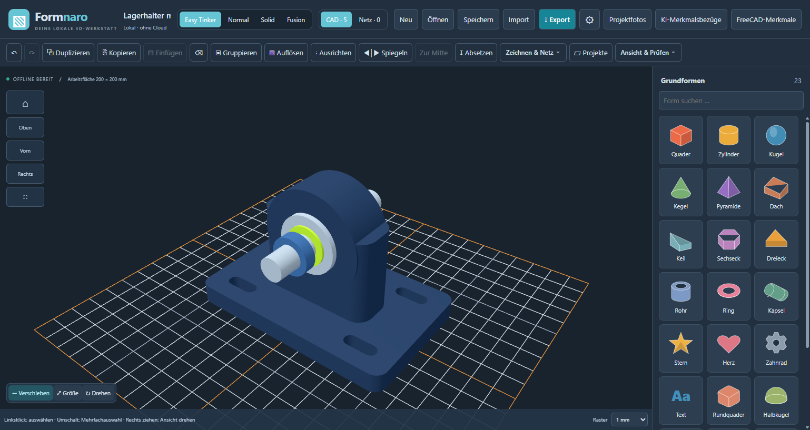
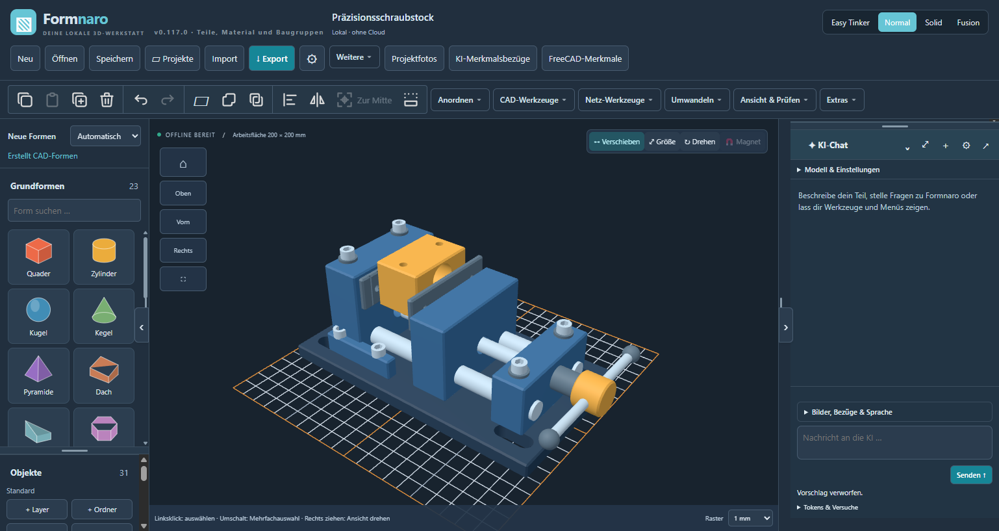
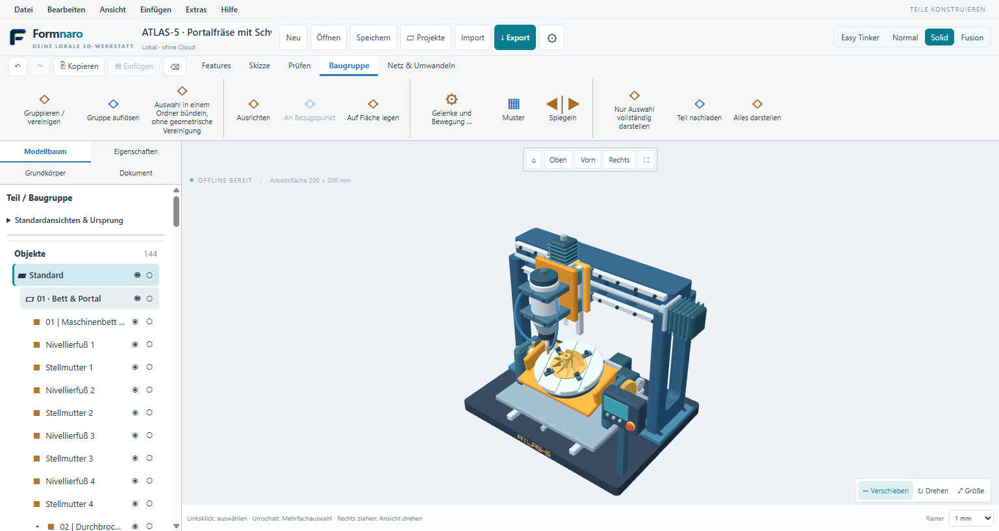
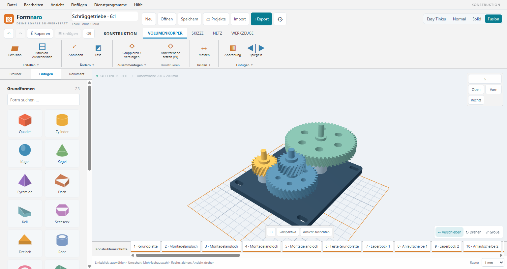
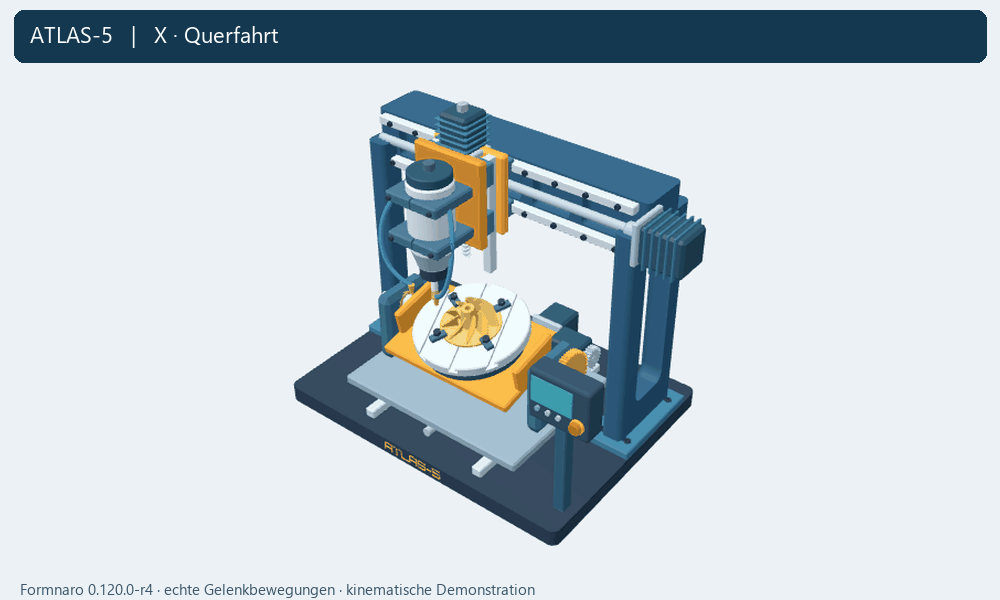
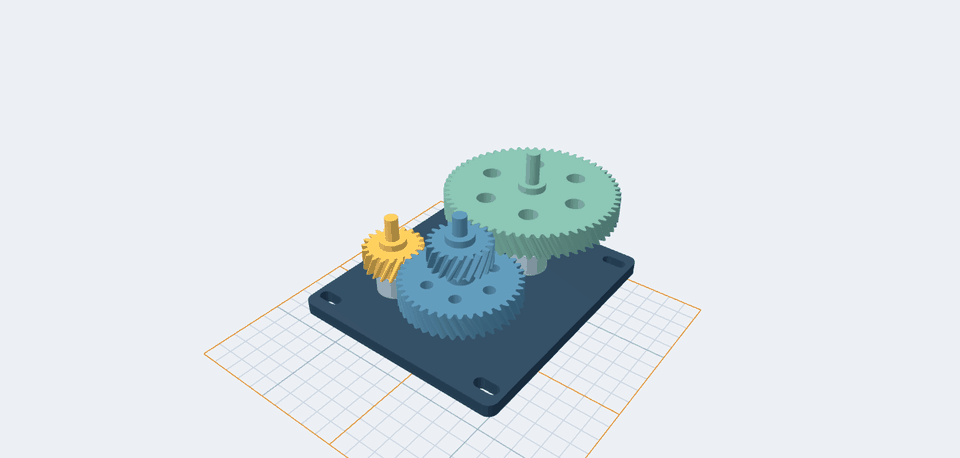
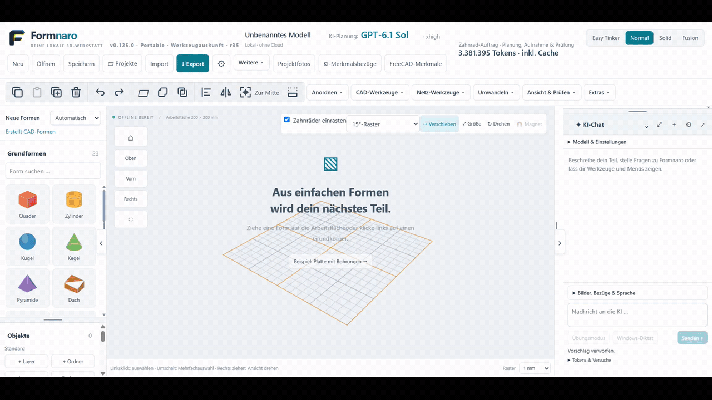

<p align="center">
  
</p>

# Formnaro

[English](README.md) | **Deutsch**

**CAD und Netzbearbeitung für Modellbau und 3D-Druck.** Konstruiere Bauteile, bearbeite 3D-Modelle und erstelle technische Zeichnungen. Formnaro läuft lokal unter Windows; die normale Modellierung funktioniert offline.

**Windows 64 Bit · portabel – Programm und separate Quellen:**

| Download | Version | Größe | Inhalt |
| --- | --- | --- | --- |
| **[Programm herunterladen](https://github.com/andyy909/Formnaro-cad/releases/download/v0.137.4-r2/Formnaro-v0.137.4-r2-Windows-x64.zip)** | **0.137.4-r2** | siehe Release | Portables Programm, benötigte Laufzeiten, Lizenzen und Startanleitung. |
| [Separate Quellarchive](https://github.com/andyy909/Formnaro-cad/releases/tag/v0.137.4-r2) | **0.137.4-r2** | siehe Release | Formnaro-, FreeCAD- und CAD-Kern-Quellen; optionale Downloads zum Weiterentwickeln. |

**Neu:** Vollständiger Bohrungsablauf und automatische Token-Erneuerung im KI-Labor. DeepSeek 16/16, Sol 14/16 und Sol 15/16 bleiben unverändert; Zeichnungsnachtests 2/2 und Bohrungsnachtest 1/1 stehen als eigene Serien. [Versionshinweise](https://github.com/andyy909/Formnaro-cad/releases/tag/v0.137.4-r2).

## Neuer vollständiger Sol-Benchmark: 16/16

GPT-6.1 Sol/high bestand alle sechzehn frischen Versuche auf der veröffentlichten **0.137.4-r2 / Suite 1.0.4** (acht feste CAD-Aufgaben, je zweimal; Überwacher aus). DeepSeeks ursprüngliche **16/16 auf 0.137.0-r1 / Suite 1.0.2** bleiben unverändert. Unterschiedliche Programm-, Werkzeug- und Promptstände sind ausdrücklich beschriftet; dies ist keine Modellrangliste auf gleichem Stand. Sols frühere 14/16 und 15/16 sowie Zeichnungsnachtests 2/2 und Bohrungsnachtest 1/1 bleiben erhalten.


[Sol-Beleg](docs/benchmarks/core-sol-01374-2026-11-08.json) · [Vergleichsdaten](docs/benchmarks/sol-deepseek-16-vergleich-2026-11-08.json) · [Alle Originalergebnisse](docs/benchmarks/README.md)

[Passende Programmquellen](https://github.com/andyy909/Formnaro-cad/releases/download/v0.137.4-r2/Formnaro-Quellcode-v0.137.4-r2.zip) · [STL-zu-CAD-Anleitung](docs/GEMEINSAMER-KONVERTER.md).

Für die normale Nutzung genügt die Programm-ZIP. Die Quellarchive werden immer als separate Release-Dateien angeboten. [Paketregel](docs/PORTABLE-PAKETE.md).

[Anleitungen](#anleitungen) · [Versionshinweise](https://github.com/andyy909/Formnaro-cad/releases) · [Feedback](https://github.com/andyy909/Formnaro-cad/issues)

| **Easy Tinker** · Lagerhalter (Dark Mode) | **Normal** · Schraubstock (Dark Mode) |
| :---: | :---: |
| [](docs/bilder/formnaro-easy-lagerhalter-dark.png) | [](docs/bilder/formnaro-normal-schraubstock-dark.png) |
| **Solid** · ATLAS-5-Portalfräse (Light Mode) | **Fusion** · zweistufiges Schräggetriebe (Light Mode) |
| [](docs/bilder/formnaro-solid-atlas5.png) | [](docs/bilder/formnaro-fusion-getriebe.png) |

*Echte Programmaufnahmen: Easy Tinker und Normal im Dark Mode aus 0.117.0-r8; Solid mit ATLAS-5 im Light Mode aus 0.120.0-r4; Fusion im Light Mode aus 0.119.0-r2. Zum Vergrößern auf ein Bild klicken.*

## Schnell starten

1. Windows-ZIP herunterladen und vollständig in einen eigenen Ordner entpacken.
2. Alle Unterordner zusammenlassen und **Formnaro.exe** doppelklicken.
3. Ein neues Projekt anlegen oder ein vorhandenes Modell öffnen.

Die Portable-ZIP enthält das Programm, benötigte Laufzeiten, Lizenzen und Startanleitungen. FreeCAD und Python sind enthalten; eine separate Installation ist nicht nötig. Das optionale Modell für Offline-Sprache wird bei Bedarf im Programm heruntergeladen. Die Quellarchive stehen separat auf der Release-Seite.

## Funktionen

- **Bauteile konstruieren:** Grundformen, Skizzen, Bohrungen, Ausschnitte, Rundungen, Loft und Sweep.
- **Maße bearbeiten:** Parameter, Formeln und Varianten für zusammengehörige Teile.
- **Netze bearbeiten:** Modelle importieren, prüfen, reparieren und gezielt verändern.
- **Zeichnungen erstellen:** Ansichten, Schnitte und Bemaßungen als PDF, SVG oder DXF ausgeben.
- **Baugruppen organisieren:** Gelenke, Zahnradkopplungen, Material, Masse, Stücklisten und Explosionsansichten.

STEP, STL, OBJ, 3MF und GLB/glTF ermöglichen den Modellaustausch. Vier Bedienmodi stehen zur Wahl: **Easy Tinker, Normal, Solid und Fusion**. Änderungen lassen sich in der Vorschau prüfen und rückgängig machen.

**Optionale KI-Unterstützung** hilft bei Modellieraufträgen, Referenzfotos und Bedienfragen. Cloud-Anfragen benötigen einen Anbieterzugang und Internet; je nach Anbieter können Kosten entstehen. Python- und FreeCAD-Werkzeuge rechnen lokal.

### ATLAS-5 in Bewegung



**144 Bauteile, 78 Gelenke und fünf Achsen.** Das kurze GIF zeigt die tatsächlichen Gelenkbewegungen in Formnaro 0.120.0-r4. Wiege und Ritzel sind mit **48:20** gekoppelt und werden gemeinsam vom Y-Träger mitgenommen. [Bearbeitbares Beispiel herunterladen](https://github.com/andyy909/Formnaro-cad/releases/download/v0.120.0-r4/atlas-5.ocad). Das Modell wurde mit Codex (Astra) über die lokale MCP-Schnittstelle von Formnaro konstruiert. Die Animation wurde anschließend in einer getrennten Modellkopie aufgenommen, ohne eine erneute KI-Anfrage während der Aufnahme. Sie demonstriert Kinematik, keine Kontaktkräfte oder Fertigungsfreigabe.

### Getriebe in Bewegung



Zwei Stufen, vier Räder, **6:1 Untersetzung** – ein offenes Getriebekonzept etwa für einen langsamen Drehteller. Nur die Antriebswelle wird bewegt; die übrigen folgen der Kopplung. [Beispielprojekt herunterladen](https://github.com/andyy909/Formnaro-cad/releases/download/v0.119.0-r3/schraeggetriebe-6zu1.ocad). Kinematische Demonstration aus 0.119.0-r2, keine Kontakt- oder Belastungssimulation.

### Übungsmodus



Im eigenen Übungsfenster werden drei Funktionen mit den Bedienelementen von Formnaro gezeigt:

1. **Zahnräder erstellen:** drei Evolventenzahnräder aus der Bibliothek einfügen und ihre Parameter einstellen.
2. **Automatisch einrasten:** die Räder durch Ziehen zusammenführen; dabei entstehen Drehgelenke und Zahnradkopplungen.
3. **Gekoppelt bewegen:** den Antrieb auf −90°, 0° und +90° stellen und die letzte Stellung übernehmen. Das mittlere Rad dreht gegenläufig mit halber Drehzahl.

[Video in voller Qualität mit Modell- und Tokenanzeige (MP4, 1:52)](bilder/formnaro-uebungsmodus-zahnraeder.mp4)

**Von Codex formulierte Aufgabenbeschreibung (GPT-6.1 Sol, xhigh):**

> Zeige im Übungsmodus drei echte Evolventenzahnräder mit 20, 40 und 20 Zähnen, Modul 1,5 mm und Breite 6 mm. Führe das automatische Einrasten durch sichtbares Ziehen vor, zeige anschließend die gekoppelte Bewegung bei Antrieb -90°, 0°, +90° und übernimm die letzte Stellung. Die beiden kleinen Räder laufen gleichsinnig, das mittlere gegenläufig mit halber Drehzahl. Zeige alles gut sichtbar.

Der vorab von Codex erstellte Plan wird im Übungsfenster über die echten Bedienelemente ausgeführt; die Wiedergabe benötigt keine weiteren Modellanfragen. Die eingeblendeten **3.381.395 Tokens inklusive Cache** beziehen sich auf den gesamten Zahnradauftrag mit Planung, Aufnahme und Prüfung.

Aufgenommen mit dem lokal getesteten Entwicklungsstand **0.125.0-r35**. Der aktuelle Download enthält 0.137.4-r2.

## Anleitungen

| Thema | Weiterlesen |
| --- | --- |
| Bedienung | [Kurzstart](LIES-MICH.txt) · [Handbuch (EN)](docs/USER-GUIDE.md) · [Beispiele](beispiele/README.md) · [Solid](docs/SOLID-MODUS.md) · [Fusion](docs/FUSION-MODUS.md) |
| Konstruktion | [Parameter und Varianten](docs/PROJEKTPARAMETER.md) · [Kurven, Loft und Sweep](docs/CAD-KURVEN.md) |
| Zeichnungen und Baugruppen | [Technische Zeichnungen](docs/TECHNISCHE-ZEICHNUNGEN.md) · [Teile, Material und Stücklisten](docs/TEILE-MATERIAL-BAUGRUPPEN.md) |
| KI-Unterstützung | [KI-Aufträge](docs/KI-AUFTRAEGE.md) · [Foto-Assistent](docs/FOTO-ASSISTENT.md) · [Programm-Assistent](docs/PROGRAMM-ASSISTENT.md) |
| Entwicklung | [Bauanleitung](docs/BUILD.md) · [Architektur](docs/ARCHITECTURE.md) |

<!-- formnaro-development-status:start -->
## Aktuelle Ausgabe: 0.137.4-r2

Die KI erhält jetzt die vollständigen Bedienelemente und den Ablauf des Zeichnungswerkzeugs. Die ursprünglichen Benchmarks bleiben unverändert: [DeepSeek 16/16 auf 0.137.0-r1](docs/benchmarks/core-deepseek-2026-11-08.json) und [GPT-6.1 Sol 14/16 auf 0.137.2-r1](docs/benchmarks/core-sol-2026-11-08.json). Nur die beiden fehlgeschlagenen Sol-Zeichnungsversuche wurden auf 0.137.3-r2 erneut geprüft: [2/2 bestanden](docs/benchmarks/sol-drawing-retests-2026-11-08.json). Die vierzehn erfolgreichen Sol-Originale bleiben erhalten. Die gezielte Abdeckung über verschiedene Programmstände ist kein neuer vollständiger 16er-Benchmark.

Lokal geprüft: 128 Standardtests, gezielte Regressionen, echte Zeichnungsprüfungen im fertigen Paket, Anzeige gespeicherter Ergebnisse und regulärer Fensterschluss. Die CAD-Laufzeitdateien werden vor und nach dem Paketieren geprüft. Für die Veröffentlichung startet kein weiterer Cloud-Benchmark; Messversionen und ursprüngliche Hashes bleiben an jedem Ergebnis erhalten.

[Release und Prüfsummen](https://github.com/andyy909/Formnaro-cad/releases/tag/v0.137.4-r2) · [Passender Quelltag](https://github.com/andyy909/Formnaro-cad/tree/v0.137.4-r2) · [Programmquellen](https://github.com/andyy909/Formnaro-cad/releases/download/v0.137.4-r2/Formnaro-Quellcode-v0.137.4-r2.zip) · [Abnahmebericht](docs/ABNAHME-0.137.4-r2.md)

<!-- formnaro-development-status:end -->

<details>
<summary>Aus dem Quellcode starten</summary>

Mit Node.js 22.16 oder neuer und npm:

```sh
git clone https://github.com/andyy909/Formnaro-cad.git
cd Formnaro-cad
npm ci
npm run build
npm start
```

Für FreeCAD-Funktionen im Entwicklungscheckout: `npm run setup:cad-runtime`. Weitere Laufzeiten, Tests und Paketierung beschreibt die [Bauanleitung](docs/BUILD.md).

</details>

## Mitmachen und Lizenz

Fehler oder Ideen? Erstelle ein [Issue](https://github.com/andyy909/Formnaro-cad/issues). Bei Fehlern helfen die verwendete Version und nachvollziehbare Schritte.

Der eigene Anwendungscode steht unter **[MIT](LICENSE.txt)**. Fremdkomponenten behalten ihre [eigenen Lizenzen](THIRD-PARTY-LICENSES.txt); der kombinierte CAD-Kern ist nicht insgesamt MIT-lizenziert. [Lizenzdetails](docs/LIZENZ-MIT.md) · [CAD-Quellen und Build](licenses/CAD-Quellen-und-Build.txt).

