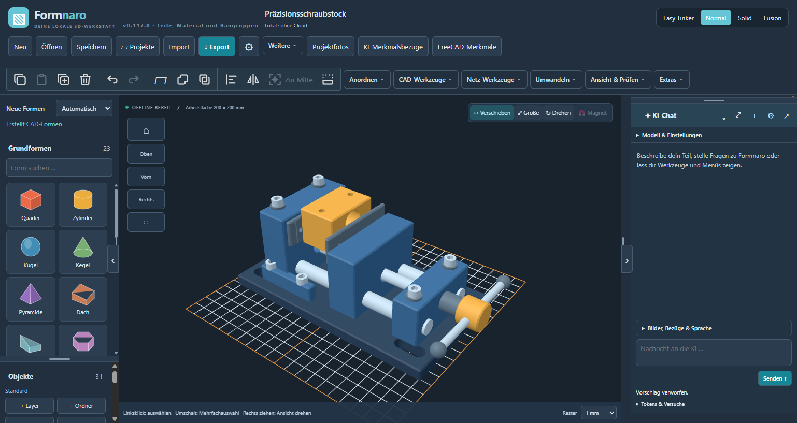
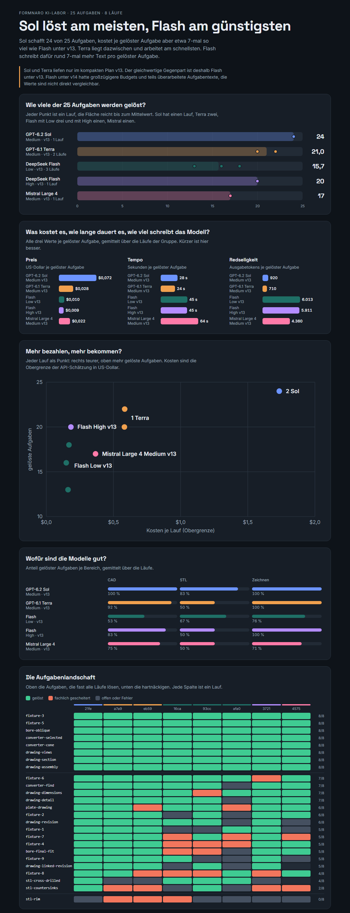

# Formnaro

**3D-CAD für deine Werkstatt.** Konstruiere Bauteile, repariere Netze und setze Baugruppen in Bewegung.

[Webseite](https://formnaro.de/) · [English](README.md)

## Download

**[Für Windows herunterladen (ZIP)](https://github.com/andyy909/Formnaro-cad/releases/download/v0.150.0-r2/Formnaro-v0.150.0-r2-Windows.zip)** · **[Für Android herunterladen (APK)](https://github.com/andyy909/Formnaro-Android/releases/download/v0.4.0/Formnaro-CAD-0.4.0.apk)**

Die Windows-Version ist portabel und enthält FreeCAD und Python. Zum Modellieren brauchst du weder ein Konto noch Internet.

<details>
<summary>Versionen, Prüfsummen und Quellarchive</summary>

| Version | Inhalt | Download |
| --- | --- | --- |
| **0.150.0-r2** · regulär | Direkte Skizzenmaße, Tablet-Übertragung und gemeinsamer Agenten-Chat | **[Windows x64 ZIP](https://github.com/andyy909/Formnaro-cad/releases/download/v0.150.0-r2/Formnaro-v0.150.0-r2-Windows.zip)** (ca. 742 MB) · [Versionshinweise](https://github.com/andyy909/Formnaro-cad/releases/tag/v0.150.0-r2) · [SHA-256](https://github.com/andyy909/Formnaro-cad/releases/download/v0.150.0-r2/SHA256SUMS.txt) |
| **0.148.0-r5** · Nightly | Tablet-Kopplung, direkter Teiletransfer mit Android-Pilot 35 r32 und Korrektur der Orca-3MF-Naht | [Windows x64 ZIP](https://github.com/andyy909/Formnaro-cad/releases/download/v0.148.0-r5/Formnaro-v0.148.0-r5-Windows.zip) · [Versionshinweise](https://github.com/andyy909/Formnaro-cad/releases/tag/v0.148.0-r5) · [SHA-256](https://github.com/andyy909/Formnaro-cad/releases/download/v0.148.0-r5/SHA256SUMS.txt) |
| **Android 0.4.0** · Tablet | Am Tablet zeichnen, am PC weiterbauen – Android 10 oder neuer | [APK](https://github.com/andyy909/Formnaro-Android/releases/download/v0.4.0/Formnaro-CAD-0.4.0.apk) (ca. 19 MB) · [Versionshinweise](https://github.com/andyy909/Formnaro-Android/releases/tag/v0.4.0) |

[Alle Ausgaben](https://github.com/andyy909/Formnaro-cad/releases) · [Ausgaben und Abnahme](docs/AKTUELLER-STAND.md) · [Paketregel](docs/PORTABLE-PAKETE.md)

**Quellarchive**

| Version | Formnaro | FreeCAD | CAD-Kern |
| --- | --- | --- | --- |
| **0.150.0-r2** | [Formnaro](https://github.com/andyy909/Formnaro-cad/releases/download/v0.150.0-r2/Formnaro-Quellcode-v0.150.0-r2.zip) | [FreeCAD](https://github.com/andyy909/Formnaro-cad/releases/download/v0.150.0-r2/Formnaro-FreeCAD-Quellen-1.1.4.zip) | [CAD-Kern](https://github.com/andyy909/Formnaro-cad/releases/download/v0.150.0-r2/Formnaro-CAD-Quellen.zip) |
| **0.148.0-r5** | [Formnaro](https://github.com/andyy909/Formnaro-cad/archive/refs/tags/v0.148.0-r5.zip) | [FreeCAD](https://github.com/andyy909/Formnaro-cad/releases/download/v0.148.0-r5/Formnaro-FreeCAD-Quellen-1.1.4.zip) | [CAD-Kern](https://github.com/andyy909/Formnaro-cad/releases/download/v0.148.0-r5/Formnaro-CAD-Quellen.zip) |

</details>

## Schnell starten

1. Windows-ZIP herunterladen und vollständig in einen eigenen, beschreibbaren Ordner entpacken.
2. Alle Unterordner zusammenlassen und **Formnaro starten** öffnen.
3. Auf der Startseite ein Beispiel auswählen oder mit **Öffnen** ein Projekt laden. Eine vorhandene Autosicherung lässt sich dort wiederherstellen.

<p align="center">
  <a href="https://formnaro.de/"></a>
</p>

## ATLAS-5 in Bewegung


**144 Bauteile · 78 Gelenke · fünf Achsen.** Echte Gelenkbewegungen in Formnaro: Wiege und Ritzel sind mit **48:20** gekoppelt und fahren mit dem Y-Träger mit. Das Modell wurde mit Codex (Astra) über die lokale MCP-Schnittstelle von Formnaro konstruiert; die Aufnahme entstand in einer getrennten Kopie ohne weitere KI-Anfrage. Sie zeigt Kinematik, keine Kontaktkräfte oder Fertigungsfreigabe.

[Bearbeitbares Modell laden (.ocad)](https://github.com/andyy909/Formnaro-cad/releases/download/v0.120.0-r4/atlas-5.ocad) · *aufgenommen mit 0.120.0-r4*

## Am Tablet zeichnen, am PC weiterbauen

Auf dem Tablet entsteht eine Skizze für eine Platte mit fünf Bohrungen. Das fertige 3D-Teil geht über das lokale Netzwerk an Formnaro unter Windows – ohne Cloud. Die Aufnahme zeigt einen Entwicklungsbuild der Android-App.

[](https://formnaro.de/#tablet)

[Video ansehen](https://formnaro.de/#tablet) · [Videodatei auf GitHub](https://github.com/andyy909/Formnaro-cad/blob/gh-pages/tablet-an-pc.webm)

## Welcher Modus passt zu dir?

Ein Programm, vier Oberflächen. Du kannst jederzeit wechseln; dein Modell bleibt dasselbe.

| **Easy Tinker** · Lagerhalter | **Normal** · Präzisionsschraubstock |
| :---: | :---: |
| [](docs/bilder/formnaro-easy-lagerhalter-dark.png) | [](docs/bilder/formnaro-normal-schraubstock-dark.png) |
| **Solid** · ATLAS-5-Portalfräse | **Fusion** · zweistufiges Schräggetriebe |
| [](docs/bilder/formnaro-solid-atlas5.png) | [](docs/bilder/formnaro-fusion-getriebe.png) |
| [Solid-Anleitung](docs/SOLID-MODUS.md) | [Fusion-Anleitung](docs/FUSION-MODUS.md) |

<sub>Echte Programmaufnahmen aus 0.117.0-r8 (Easy Tinker, Normal), 0.120.0-r4 (Solid) und 0.119.0-r2 (Fusion). Zum Vergrößern anklicken.</sub>

## Die KI zeigt es vor. Du entscheidest.

Die KI ist **optional**. Sie arbeitet an einer Kopie deines Projekts und zeigt eine Vorschau – Änderungen landen erst nach deiner Freigabe im Modell, und jeder Schritt lässt sich rückgängig machen. Cloud-Anfragen benötigen einen Anbieterzugang und Internet; je nach Anbieter können Kosten entstehen. Python- und FreeCAD-Werkzeuge rechnen immer lokal.

[](https://formnaro.de/practice-pattern-100.mp4)

**Übungsmodus: Bohrung und Kreismuster.** Aus einem Zylinder entstehen acht getrennte Hülsen mit echten Durchgangsbohrungen, ein unbeteiligtes Teil bleibt erhalten – 22 sichtbare Schritte, 5/5 native Prüfungen bestanden, **13.758 Tokens ≈ 0,004 Euro** mit DeepSeek Flash/high.

[Video ansehen (1:06)](https://formnaro.de/practice-pattern-100.mp4) · [MP4 herunterladen](bilder/formnaro-uebungsmodus-muster-100.mp4) · [Prompt, Verbrauch und Preisberechnung](docs/demos/muster-100.md) · [KI-Anbindung einrichten](https://formnaro.de/ki/)

<details>
<summary><b>Genauer Prompt und Kostendetails</b></summary>

Aufgenommen mit Formnaro 0.139.1-r1. Genauer Prompt (66 Wörter):

> Bohre den vorhandenen Zylinder Ø10×12 mm, Mitte (37,7,9), koaxial durchgehend Ø4. Erzeuge daraus insgesamt acht getrennte identische Hülsen einschließlich des gebohrten Originals. Die Mittelpunkte liegen auf Radius30 um die Welt-Z-Achse X7,Y7, Z-Mitte9, gleichmäßig alle45°. Das Original bei (37,7,9) gibt den Startwinkel0° vor. Jede Hülse reicht von Z3 bis15 und muss dieselbe echte Durchgangsbohrung besitzen. Alle unbeteiligten Teile einschließlich Schutzteil vollständig erhalten. Modellierung ausschließlich mit sichtbaren Übungswerkzeugen.

**13.758 Tokens:** 7.354 Eingabe (davon 6.912 Cache) + 6.404 Ausgabe (davon 5.705 Denktokens). Eine ursprüngliche Anbieteranfrage. Die 100-%-Aufnahme wiederholt denselben Plan in Echtzeit ohne weitere KI-Tokens; sie ist kein neuer KI-Benchmark.

**Geschätzter Preis des KI-Auftrags: 0,00393 US-Dollar ≈ 0,00356 Euro.** [DeepSeek-Wochenendtarif](https://api-docs.deepseek.com/quick_start/pricing/), geprüft am 14.11.2026; [EZB-Kurs](https://www.ecb.europa.eu/stats/policy_and_exchange_rates/euro_reference_exchange_rates/html/eurofxref-graph-usd.en.html) vom 13.11.2026: 1 Euro = 1,1052 US-Dollar. Tarifschätzung, keine bestätigte Kontobelastung. Codex-Arbeit und Videoerstellung sind nicht enthalten.

</details>

### KI-Labor und Modellvergleich

Öffne **Einstellungen → KI / API → KI-Testlabor**. Unter **Einfach** startet der Entwicklungscheck mit 15 Aufgaben auf Low, gezielten Wiederholungen auf High und optional Max; CAD-Alltag, STL-Konvertierung und Fotomodus lassen sich separat prüfen. Unter **Erweitert** stellst du eigene Versuche zusammen, unter **Ergebnisse** siehst du Erfolge im ersten Versuch und nach Prüferhinweisen.

Im Benchmark v13 (acht Läufe, 25 Aufgaben aus CAD, STL und technischem Zeichnen) löste **GPT-6.2 Sol** die meisten Aufgaben (24/25), **GPT-6.1 Terra** war pro gelöster Aufgabe am schnellsten, und **DeepSeek Flash High** hatte die niedrigsten geschätzten API-Kosten pro gelöster Aufgabe.

[](docs/benchmarks/modellvergleich-v13.png)

<sub>Ein bis drei Läufe je Modell und Denkstufe. Plan v14 hat andere Budgets und wird separat ausgewertet.</sub>

[Ergebnistabellen und Datengrundlage](docs/benchmarks/modellvergleich-v13.md) · [KI-Labor auf formnaro.de](https://formnaro.de/ki-labor/#benchmark-v13) · [Frühere Läufe und Nachtests](docs/benchmarks/README.md)

## Was du damit erledigst

| | |
| --- | --- |
| **Bauteile konstruieren** | Bemaßte Skizzen, Extrudieren, Bohrungen, Rundungen, Fasen, Muster, Loft und Sweep |
| **Maße steuern** | Parameter, Formeln und Varianten für zusammengehörige Teile |
| **STL in STEP umwandeln** | Der lokale Konverter baut aus Dreiecksnetzen wieder Ebenen und Zylinder auf. [Konverter-Anleitung](docs/GEMEINSAMER-KONVERTER.md) |
| **Netze bearbeiten** | Offene Kanten finden, Löcher schließen, Dreiecke reduzieren und Bereiche glätten |
| **Baugruppen bewegen** | Gelenke, Zahnradkopplungen, Material, Masse, Stücklisten und Explosionsansichten |
| **Zeichnungen erstellen** | Ansichten, Schnitte und Bemaßungen als PDF, SVG oder DXF; Stücklisten als CSV |
| **Modelle austauschen** | STEP, STL, OBJ, 3MF und GLB/glTF |

<details>
<summary><b>Getriebe in Bewegung</b> – zwei Stufen, vier Schrägzahnräder, 6:1</summary>


Ein offenes Getriebekonzept etwa für einen langsamen Drehteller. Nur die Antriebswelle wird bewegt; die übrigen folgen der Kopplung. Kinematische Demonstration aus 0.119.0-r2, keine Kontakt- oder Belastungssimulation. [Beispielprojekt herunterladen](https://github.com/andyy909/Formnaro-cad/releases/download/v0.119.0-r3/schraeggetriebe-6zu1.ocad)

</details>

## Was du wissen solltest

| | |
| --- | --- |
| **Aktuelle Version** | Formnaro 0.150.0-r2 für Windows x64 · Formnaro CAD 0.4.0 für Android 10+ |
| **Installation** | Keine – portables ZIP, FreeCAD und Python enthalten |
| **Internet** | Zum Modellieren nicht nötig; nur für optionale Cloud-KI |
| **Kosten** | Kostenlos und quelloffen (MIT), kein Konto |
| **Beispiele** | Drei mitgelieferte Beispiele auf der Startseite · [weitere Beispielmodelle](beispiele/README.md) |

## Anleitungen

| Thema | Weiterlesen |
| --- | --- |
| Bedienung | [Kurzstart](LIES-MICH.txt) · [Handbuch (EN)](docs/USER-GUIDE.md) · [Beispiele](beispiele/README.md) · [Solid](docs/SOLID-MODUS.md) · [Fusion](docs/FUSION-MODUS.md) |
| Konstruktion | [Parameter und Varianten](docs/PROJEKTPARAMETER.md) · [Kurven, Loft und Sweep](docs/CAD-KURVEN.md) · [STL zu CAD](docs/GEMEINSAMER-KONVERTER.md) |
| Zeichnungen und Baugruppen | [Technische Zeichnungen](docs/TECHNISCHE-ZEICHNUNGEN.md) · [Teile, Material und Stücklisten](docs/TEILE-MATERIAL-BAUGRUPPEN.md) |
| KI-Unterstützung | [KI-Aufträge](docs/KI-AUFTRAEGE.md) · [Foto-Assistent](docs/FOTO-ASSISTENT.md) · [Programm-Assistent](docs/PROGRAMM-ASSISTENT.md) · [Spracheingabe im KI-Chat](docs/SPRACHEINGABE.md) · [AI guide (EN)](docs/AI-GUIDE.md) |
| Entwicklung | [Bauanleitung](docs/BUILD.md) · [Architektur](docs/ARCHITECTURE.md) · [Mitwirken](CONTRIBUTING.md) · [Build-Status](https://github.com/andyy909/Formnaro-cad/actions/workflows/build.yml) |

<!-- formnaro-development-status:start -->
## Neu in 0.150.0-r2

Skizzenmaße lassen sich direkt eingeben, Teile gehen vom Android-Tablet über das lokale Netzwerk an den PC, und der Agenten-Chat läuft auf beiden Geräten weiter.

[Versionshinweise](https://github.com/andyy909/Formnaro-cad/releases/tag/v0.150.0-r2) · [Source-Tag](https://github.com/andyy909/Formnaro-cad/tree/v0.150.0-r2) · [Ausgaben und Abnahme](docs/AKTUELLER-STAND.md)

<!-- formnaro-development-status:end -->

<details>
<summary><b>Aus dem Quellcode starten</b></summary>

Mit Node.js 22.16 oder neuer und npm:

```sh
git clone https://github.com/andyy909/Formnaro-cad.git
cd Formnaro-cad
npm ci
npm run build
npm start
```

Für FreeCAD-Funktionen im Entwicklungscheckout: `npm run setup:cad-runtime`. Weitere Laufzeiten, Tests und Paketierung beschreibt die [Bauanleitung](docs/BUILD.md).

</details>

## Mitmachen, Unterstützen und Lizenz

Fehler oder Ideen? Erstelle ein [Issue](https://github.com/andyy909/Formnaro-cad/issues) mit der verwendeten Version und nachvollziehbaren Schritten. Wenn dir Formnaro hilft, kannst du die Entwicklung [über PayPal unterstützen](https://www.paypal.com/donate/?hosted_button_id=TPZ9RQ242TJES).

Der eigene Anwendungscode steht unter **[MIT](LICENSE.txt)**. Fremdkomponenten behalten ihre [eigenen Lizenzen](THIRD-PARTY-LICENSES.txt); der kombinierte CAD-Kern ist nicht insgesamt MIT-lizenziert. [Lizenzdetails](docs/LIZENZ-MIT.md) · [CAD-Quellen und Build](licenses/CAD-Quellen-und-Build.txt)

<p align="center"><sub><a href="https://formnaro.de/">formnaro.de</a> · Gemacht für Werkstatt, Modellbau und 3D-Druck</sub></p>
