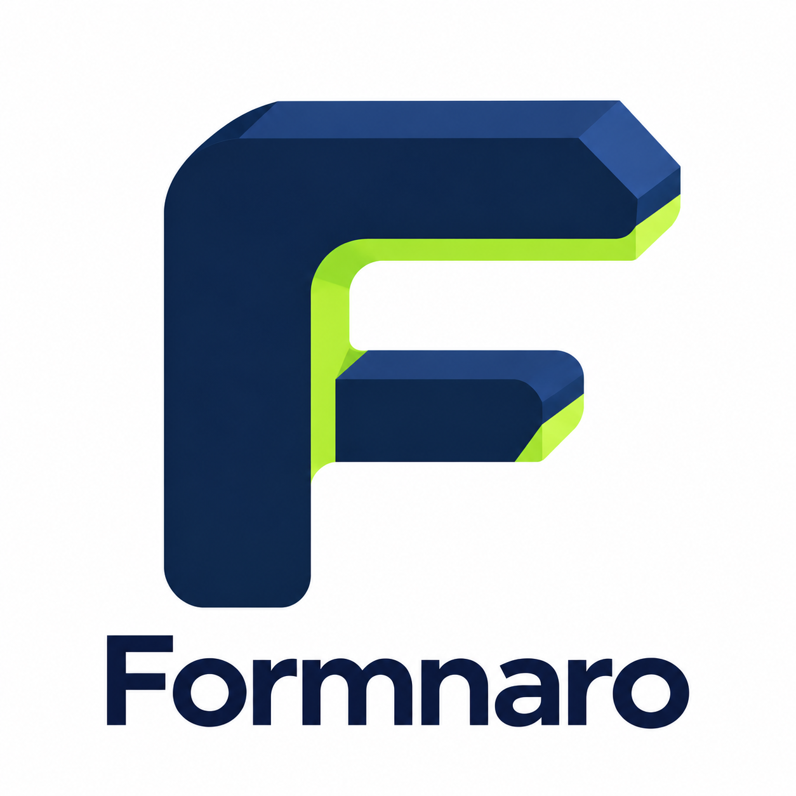
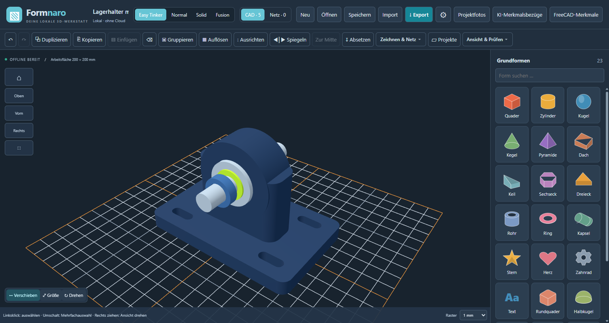
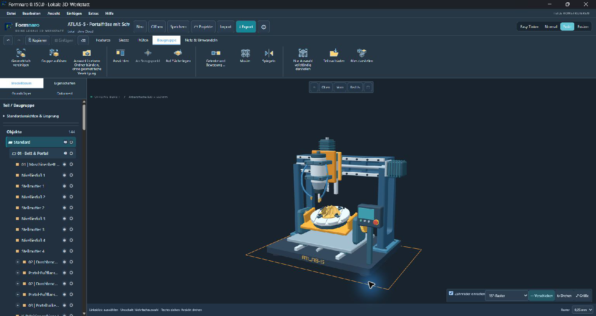
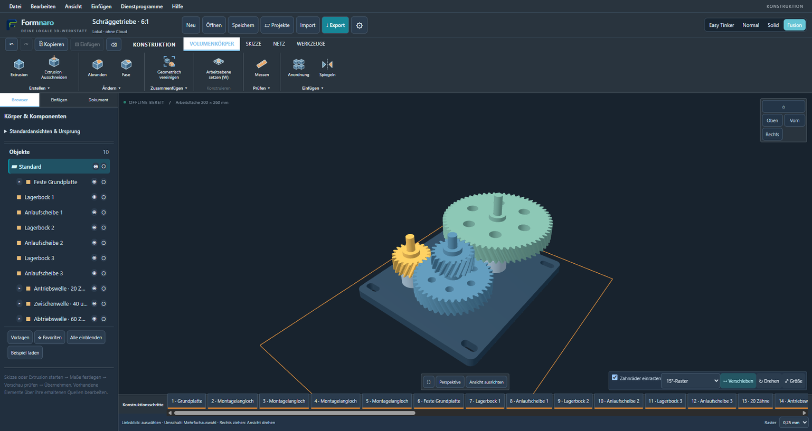
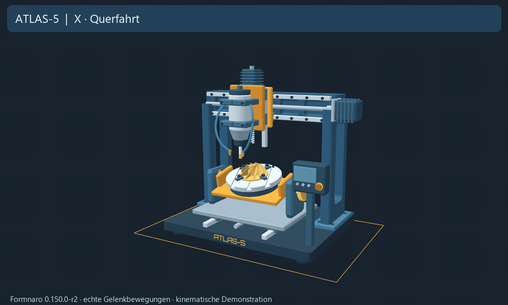
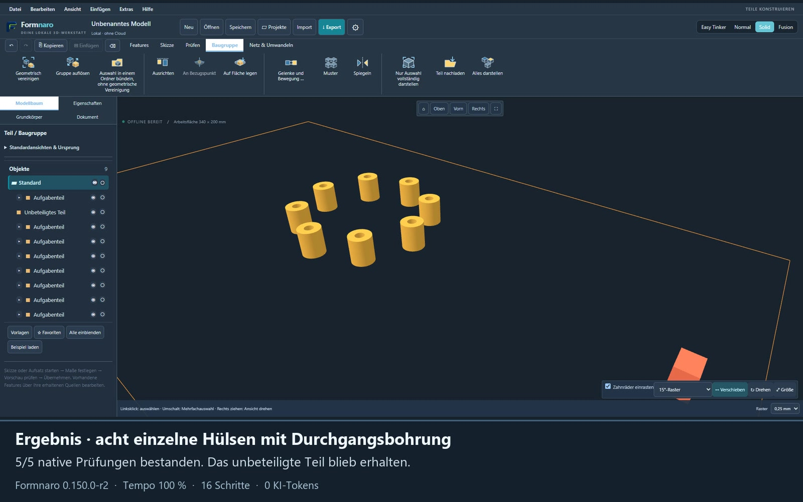

<p align="center">
  
</p>

# Formnaro

[English](README.md) | **Deutsch** | [Formnaro über PayPal unterstützen](https://www.paypal.com/donate/?hosted_button_id=TPZ9RQ242TJES)

**CAD und Netzbearbeitung für Modellbau und 3D-Druck.** Konstruiere Bauteile, bearbeite 3D-Modelle und erstelle technische Zeichnungen. Formnaro läuft lokal unter Windows; die normale Modellierung funktioniert offline.

**Windows 64 Bit · portabel – Programm und separate Quellen:**

[Formano Mini für Android](https://github.com/andyy909/Formnaro-Android) ist frisch und wird aktiv weiterentwickelt. Im Android-Repo gibt es die APK als Vorabversion. Dort steht auch, mit welchem Windows-Begleitbuild sie geprüft wurde.

| Download | Version | Größe | Inhalt |
| --- | --- | --- | --- |
| **[Programm herunterladen](https://github.com/andyy909/Formnaro-cad/releases/download/v0.144.0-r1/Formnaro-v0.144.0-r1-Windows-x64.zip)** | **0.144.0-r1** · reguläre Ausgabe | ca. 673 MB | Portables Programm, benötigte Laufzeiten, Lizenzen und Startanleitung. |
| [Separate Quellarchive](https://github.com/andyy909/Formnaro-cad/releases/tag/v0.144.0-r1) | **0.144.0-r1** | siehe Release | Formnaro-, FreeCAD- und CAD-Kern-Quellen zum Weiterentwickeln. |
| **[Windows-x64-ZIP](https://github.com/andyy909/Formnaro-cad/releases/download/v0.147.1-r2/Formnaro-v0.147.1-r2-Windows.zip)** · [Versionshinweise und Quellen](https://github.com/andyy909/Formnaro-cad/releases/tag/v0.147.1-r2) · [SHA-256-Prüfsummen](https://github.com/andyy909/Formnaro-cad/releases/download/v0.147.1-r2/SHA256SUMS.txt) | **0.147.1-r2** · Windows Nightly | ca. 741 MB | Solid-Befehlssuche, gezielte Auswahl überlagerter Körper und Bearbeitung gespeicherter Radien und Fasen. |

Formnaro startet mit leerer Arbeitsfläche. Die Startseite zeigt drei mitgelieferte Beispiele, bis zu drei zuletzt verwendete Projekte und bei vorhandener Autosicherung eine eigene Wiederherstellungsschaltfläche. [Versionshinweise](https://github.com/andyy909/Formnaro-cad/releases/tag/v0.144.0-r1) · [SHA-256-Prüfsummen](https://github.com/andyy909/Formnaro-cad/releases/download/v0.144.0-r1/SHA256SUMS.txt) · [Aktueller Prüfstand](docs/AKTUELLER-STAND.md)

## KI-Labor

Öffne **Einstellungen → KI / API → KI-Testlabor**. In der regulären Ausgabe 0.144.0-r1 startet unter **Einfach** der Entwicklungscheck mit 15 Aufgaben auf Low, gezielten Wiederholungen auf High und optional Max. CAD-Alltag, STL-Konvertierung und Fotomodus lassen sich separat prüfen. Unter **Erweitert** kannst du eigene Versuche zusammenstellen.

Unter **Ergebnisse** siehst du Erfolge im ersten Versuch und nach Prüferhinweisen. Der Export dokumentiert auch frühere Stufen, Kontextlücken, wiederkehrende Muster und Erstreaktionen.

Die [Vorabversion 0.145.0-r1](https://github.com/andyy909/Formnaro-cad/releases/tag/v0.145.0-r1) bietet den Standardtest v13, den ausführlichen Prüfplan v14, die STL-Diagnose und den Passungsbenchmark mit Skill-Vergleich. In dieser Version kann die automatische Kampagne stehen bleiben. Zwei offene Referenzfälle betreffen die Öffnungsrichtung von Senkungen beim STL-Nachbau und die namensabhängige Endanschlagprüfung.

### KI-Modellvergleich im Benchmark v13

Acht Läufe mit 25 Aufgaben aus CAD, STL und technischem Zeichnen. GPT-6.2 Sol löste mit 24 von 25 die meisten Aufgaben. GPT-6.1 Terra hatte die kürzeste mittlere Zeit pro gelöster Aufgabe. DeepSeek Flash High hatte die niedrigste ausgewiesene API-Kostenschätzung pro gelöster Aufgabe.

[](docs/benchmarks/modellvergleich-v13.png)

Die Stichprobe umfasst ein bis drei Läufe je Modell und Denkstufe. Plan v14 hat andere Budgets und teilweise überarbeitete Aufgaben und wird separat ausgewertet.

[Ergebnistabellen und Datengrundlage](docs/benchmarks/modellvergleich-v13.md) · [KI-Labor auf formnaro.de](https://formnaro.de/ki-labor/#benchmark-v13) · [Archiv mit früheren 16er-Läufen und Nachtests](docs/benchmarks/README.md)

[Programmquellen zu 0.144.0-r1](https://github.com/andyy909/Formnaro-cad/releases/download/v0.144.0-r1/Formnaro-Quellcode-v0.144.0-r1.zip) · [STL-zu-CAD-Anleitung](docs/GEMEINSAMER-KONVERTER.md).

Für die normale Nutzung genügt die Programm-ZIP. Die Quellarchive werden immer als separate Release-Dateien angeboten. [Paketregel](docs/PORTABLE-PAKETE.md).

[Anleitungen](#anleitungen) · [Versionshinweise](https://github.com/andyy909/Formnaro-cad/releases) · [Feedback](https://github.com/andyy909/Formnaro-cad/issues)

| **Easy Tinker** · Lagerhalter (Dark Mode) | **Normal** · Schraubstock (Dark Mode) |
| :---: | :---: |
| [](docs/bilder/formnaro-easy-lagerhalter-dark.png) | [](docs/bilder/formnaro-normal-schraubstock-dark.png) |
| **Solid** · ATLAS-5-Portalfräse (Light Mode) | **Fusion** · zweistufiges Schräggetriebe (Light Mode) |
| [](docs/bilder/formnaro-solid-atlas5.png) | [](docs/bilder/formnaro-fusion-getriebe.png) |

*Echte Programmaufnahmen: Easy Tinker und Normal im Dark Mode aus 0.117.0-r8; Solid mit ATLAS-5 im Light Mode aus 0.120.0-r4; Fusion im Light Mode aus 0.119.0-r2. Zum Vergrößern auf ein Bild klicken.*

## Schnell starten

1. Windows-ZIP herunterladen und vollständig in einen eigenen Ordner entpacken.
2. Alle Unterordner zusammenlassen und **Formnaro starten** öffnen.
3. Auf der Startseite ein Beispiel auswählen oder mit **Öffnen** ein vorhandenes Projekt laden.

Die Portable-ZIP enthält das Programm, benötigte Laufzeiten, Lizenzen und Startanleitungen. FreeCAD und Python sind enthalten; eine separate Installation ist nicht nötig. Das optionale Modell für Offline-Sprache wird bei Bedarf im Programm heruntergeladen. Die Quellarchive stehen separat auf der Release-Seite.

## Funktionen

- **Bauteile konstruieren:** Grundformen, Skizzen, Bohrungen, Ausschnitte, Rundungen, Loft und Sweep.
- **Maße bearbeiten:** Parameter, Formeln und Varianten für zusammengehörige Teile.
- **Netze bearbeiten:** Modelle importieren, prüfen, reparieren und gezielt verändern.
- **Zeichnungen erstellen:** Ansichten, Schnitte und Bemaßungen als PDF, SVG oder DXF ausgeben.
- **Baugruppen organisieren:** Gelenke, Zahnradkopplungen, Material, Masse, Stücklisten und Explosionsansichten.

STEP, STL, OBJ, 3MF und GLB/glTF ermöglichen den Modellaustausch. Vier Bedienmodi stehen zur Wahl: **Easy Tinker, Normal, Solid und Fusion**. Änderungen lassen sich in der Vorschau prüfen und rückgängig machen.

**Optionale KI-Unterstützung** hilft bei Modellieraufträgen, Referenzfotos und Bedienfragen. Cloud-Anfragen benötigen einen Anbieterzugang und Internet; je nach Anbieter können Kosten entstehen. Python- und FreeCAD-Werkzeuge rechnen lokal.

### ATLAS-5 in Bewegung



**144 Bauteile, 78 Gelenke und fünf Achsen.** Das kurze GIF zeigt die tatsächlichen Gelenkbewegungen in Formnaro 0.120.0-r4. Wiege und Ritzel sind mit **48:20** gekoppelt und werden gemeinsam vom Y-Träger mitgenommen. [Bearbeitbares Beispiel herunterladen](https://github.com/andyy909/Formnaro-cad/releases/download/v0.120.0-r4/atlas-5.ocad). Das Modell wurde mit Codex (Astra) über die lokale MCP-Schnittstelle von Formnaro konstruiert. Die Animation wurde anschließend in einer getrennten Modellkopie aufgenommen, ohne eine erneute KI-Anfrage während der Aufnahme. Sie demonstriert Kinematik, keine Kontaktkräfte oder Fertigungsfreigabe.

### Getriebe in Bewegung


Zwei Stufen, vier Räder, **6:1 Untersetzung** – ein offenes Getriebekonzept etwa für einen langsamen Drehteller. Nur die Antriebswelle wird bewegt; die übrigen folgen der Kopplung. [Beispielprojekt herunterladen](https://github.com/andyy909/Formnaro-cad/releases/download/v0.119.0-r3/schraeggetriebe-6zu1.ocad). Kinematische Demonstration aus 0.119.0-r2, keine Kontakt- oder Belastungssimulation.

### Übungsmodus: Bohrung und Kreismuster

[](https://formnaro.de/practice-pattern-100.mp4)

**Formnaro 0.139.1-r1 · DeepSeek Flash/high · 22 sichtbare Schritte · 5/5 native Prüfungen bestanden.** Aus einem Zylinder entstehen acht getrennte Hülsen mit echten Durchgangsbohrungen; ein unbeteiligtes Teil bleibt erhalten.

[Video ansehen: 100 % Tempo, 1:06](https://formnaro.de/practice-pattern-100.mp4) · [MP4 herunterladen](bilder/formnaro-uebungsmodus-muster-100.mp4) · [Prompt, Verbrauch und Preisberechnung](docs/demos/muster-100.md)

**Genauer Prompt (66 Wörter):**

> Bohre den vorhandenen Zylinder Ø10×12 mm, Mitte (37,7,9), koaxial durchgehend Ø4. Erzeuge daraus insgesamt acht getrennte identische Hülsen einschließlich des gebohrten Originals. Die Mittelpunkte liegen auf Radius30 um die Welt-Z-Achse X7,Y7, Z-Mitte9, gleichmäßig alle45°. Das Original bei (37,7,9) gibt den Startwinkel0° vor. Jede Hülse reicht von Z3 bis15 und muss dieselbe echte Durchgangsbohrung besitzen. Alle unbeteiligten Teile einschließlich Schutzteil vollständig erhalten. Modellierung ausschließlich mit sichtbaren Übungswerkzeugen.

**13.758 Tokens:** 7.354 Eingabe (davon 6.912 Cache) + 6.404 Ausgabe (davon 5.705 Denktokens). Eine ursprüngliche Anbieteranfrage. Die 100-%-Aufnahme wiederholt denselben Plan in Echtzeit ohne weitere KI-Tokens; sie ist kein neuer KI-Benchmark.

**Geschätzter Preis des KI-Auftrags: 0,00393 US-Dollar ≈ 0,00356 Euro.** [DeepSeek-Wochenendtarif](https://api-docs.deepseek.com/quick_start/pricing/), geprüft am 14.11.2026; [EZB-Kurs](https://www.ecb.europa.eu/stats/policy_and_exchange_rates/euro_reference_exchange_rates/html/eurofxref-graph-usd.en.html) vom 13.11.2026: 1 Euro = 1,1052 US-Dollar. Tarifschätzung, keine bestätigte Kontobelastung. Codex-Arbeit und Videoerstellung sind nicht enthalten; Einzelheiten im Bericht.

## Anleitungen

| Thema | Weiterlesen |
| --- | --- |
| Bedienung | [Kurzstart](LIES-MICH.txt) · [Handbuch (EN)](docs/USER-GUIDE.md) · [Beispiele](beispiele/README.md) · [Solid](docs/SOLID-MODUS.md) · [Fusion](docs/FUSION-MODUS.md) |
| Konstruktion | [Parameter und Varianten](docs/PROJEKTPARAMETER.md) · [Kurven, Loft und Sweep](docs/CAD-KURVEN.md) |
| Zeichnungen und Baugruppen | [Technische Zeichnungen](docs/TECHNISCHE-ZEICHNUNGEN.md) · [Teile, Material und Stücklisten](docs/TEILE-MATERIAL-BAUGRUPPEN.md) |
| KI-Unterstützung | [KI-Aufträge](docs/KI-AUFTRAEGE.md) · [Foto-Assistent](docs/FOTO-ASSISTENT.md) · [Programm-Assistent](docs/PROGRAMM-ASSISTENT.md) |
| Entwicklung | [Bauanleitung](docs/BUILD.md) · [Architektur](docs/ARCHITECTURE.md) |

<!-- formnaro-development-status:start -->
## Frühere Ausgabe 0.142.0-r1

Übungen bleiben im gewählten Solid- oder Fusion-Modus. Eine neue native Grundform erzeugt Trapezgewinde mit Längeneingaben bis 3.000 mm.

[Release](https://github.com/andyy909/Formnaro-cad/releases/tag/v0.142.0-r1) · [Abnahme / acceptance](docs/VEROEFFENTLICHUNG-0.142.0-r1.md)

## Frühere Ausgabe: 0.139.1-r1

0.139.1-r1 bündelte die Laborverbesserungen aus 0.139.0 und Korrekturen beim Beenden von Prozessen und beim Verarbeiten von JSON. Der damalige Releasebericht dokumentiert vier gezielte Live-Nachtests.

[Release](https://github.com/andyy909/Formnaro-cad/releases/tag/v0.139.1-r1) · [Source tag](https://github.com/andyy909/Formnaro-cad/tree/v0.139.1-r1) · [ZIP](https://github.com/andyy909/Formnaro-cad/releases/download/v0.139.1-r1/Formnaro-Quellcode-v0.139.1-r1.zip) · [Abnahme / acceptance](docs/VEROEFFENTLICHUNG-0.139.1-r1.md)

<!-- formnaro-development-status:end -->

<details>
<summary>Aus dem Quellcode starten</summary>

Mit Node.js 22.16 oder neuer und npm:

```sh
git clone https://github.com/andyy909/Formnaro-cad.git
cd Formnaro-cad
npm ci
npm run build
npm start
```

Für FreeCAD-Funktionen im Entwicklungscheckout: `npm run setup:cad-runtime`. Weitere Laufzeiten, Tests und Paketierung beschreibt die [Bauanleitung](docs/BUILD.md).

</details>

## Mitmachen und Lizenz

Fehler oder Ideen? Erstelle ein [Issue](https://github.com/andyy909/Formnaro-cad/issues). Bei Fehlern helfen die verwendete Version und nachvollziehbare Schritte.

Der eigene Anwendungscode steht unter **[MIT](LICENSE.txt)**. Fremdkomponenten behalten ihre [eigenen Lizenzen](THIRD-PARTY-LICENSES.txt); der kombinierte CAD-Kern ist nicht insgesamt MIT-lizenziert. [Lizenzdetails](docs/LIZENZ-MIT.md) · [CAD-Quellen und Build](licenses/CAD-Quellen-und-Build.txt).
