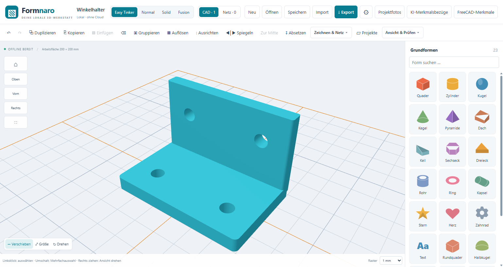
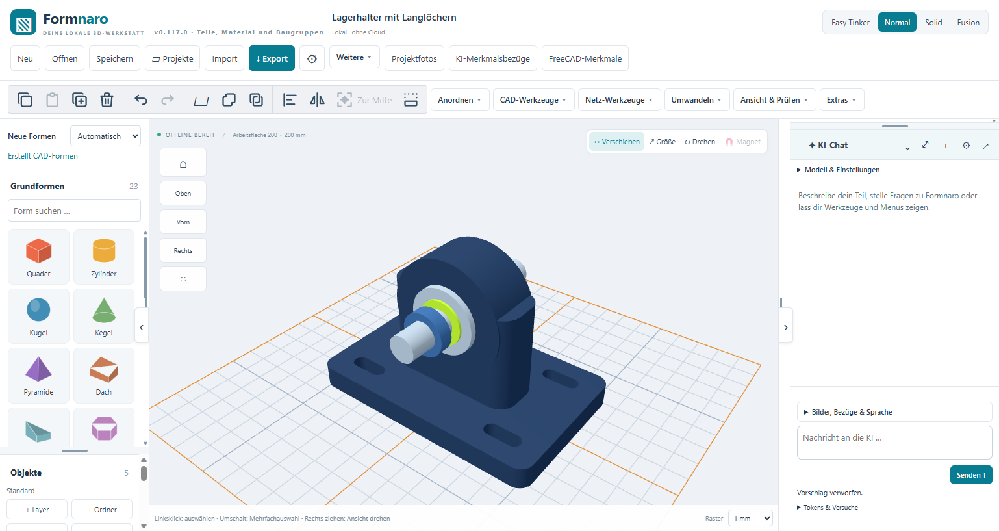
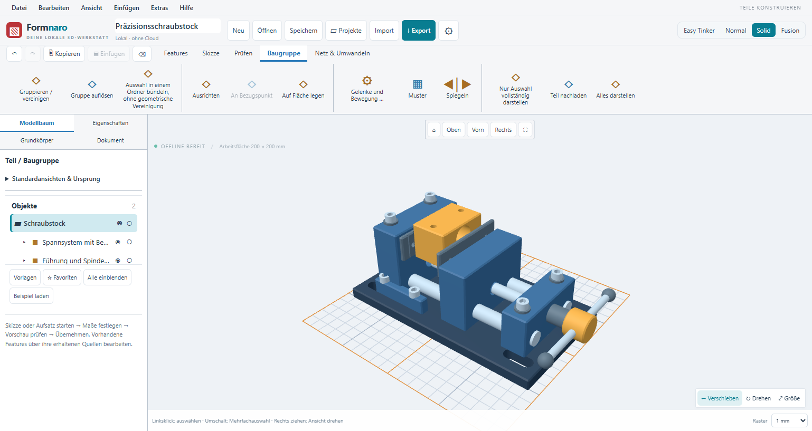

<p align="center">
  
</p>

# Formnaro

**CAD und Netzbearbeitung für Modellbau und 3D-Druck.** Konstruiere Bauteile, bearbeite 3D-Modelle und erstelle technische Zeichnungen. Formnaro läuft lokal unter Windows; die normale Modellierung funktioniert offline.

**[Für Windows herunterladen](https://github.com/andyy909/Formnaro-cad/releases/download/v0.119.0-r3/Formnaro-v0.119.0-r3-Windows.zip)** · [Anleitungen](#anleitungen) · [Versionshinweise](https://github.com/andyy909/Formnaro-cad/releases) · [Feedback](https://github.com/andyy909/Formnaro-cad/issues)

Windows 64 Bit · portabel · Download **0.119.0-r3** · ca. **1,9 GB**

| **Easy Tinker** · einfacher Winkelhalter | **Normal** · Lagerhalter mit Langlöchern |
| :---: | :---: |
| [](docs/bilder/formnaro-easy-winkelhalter.png) | [](docs/bilder/formnaro-normal-lagerhalter.png) |
| **Solid** · Schraubstock als Baugruppe | **Fusion** · zweistufiges Schräggetriebe |
| [](docs/bilder/formnaro-solid-schraubstock.png) | [](docs/bilder/formnaro-fusion-getriebe.png) |

*Echte Programmaufnahmen: Easy Tinker, Normal und Solid aus 0.117.0-r8; Fusion aus 0.119.0-r2. Zum Vergrößern auf ein Bild klicken.*

## Schnell starten

1. Windows-ZIP herunterladen und vollständig in einen eigenen Ordner entpacken.
2. Alle Unterordner zusammenlassen und **„Formnaro starten“** doppelklicken.
3. Ein neues Projekt anlegen oder ein Beispiel öffnen.

FreeCAD und Python sind im Windows-Paket enthalten. Eine separate Installation ist dafür nicht nötig.

## Funktionen

- **Bauteile konstruieren:** Grundformen, Skizzen, Bohrungen, Ausschnitte, Rundungen, Loft und Sweep.
- **Maße bearbeiten:** Parameter, Formeln und Varianten für zusammengehörige Teile.
- **Netze bearbeiten:** Modelle importieren, prüfen, reparieren und gezielt verändern.
- **Zeichnungen erstellen:** Ansichten, Schnitte und Bemaßungen als PDF, SVG oder DXF ausgeben.
- **Baugruppen organisieren:** Gelenke, Zahnradkopplungen, Material, Masse, Stücklisten und Explosionsansichten.

STEP, STL, OBJ, 3MF und GLB/glTF ermöglichen den Modellaustausch. Vier Bedienmodi stehen zur Wahl: **Easy Tinker, Normal, Solid und Fusion**. Änderungen lassen sich in der Vorschau prüfen und rückgängig machen.

**Optionale KI-Unterstützung** hilft bei Modellieraufträgen, Referenzfotos und Bedienfragen. Cloud-Anfragen benötigen einen Anbieterzugang und Internet; je nach Anbieter können Kosten entstehen. Python- und FreeCAD-Werkzeuge rechnen lokal.

### Getriebe in Bewegung


Zwei Stufen, vier Räder, **6:1 Untersetzung** – ein offenes Getriebekonzept etwa für einen langsamen Drehteller. Nur die Antriebswelle wird bewegt; die übrigen folgen der Kopplung. [Beispielprojekt herunterladen](https://github.com/andyy909/Formnaro-cad/releases/download/v0.119.0-r3/schraeggetriebe-6zu1.ocad). Kinematische Demonstration aus 0.119.0-r2, keine Kontakt- oder Belastungssimulation.

### KI in Aktion


*Vorschau des Übungsmodus:* Das GIF zeigt die Wiedergabe eines zuvor von DeepSeek erzeugten Plans, ohne Live-KI-Anfrage während der Aufnahme. Der Übungsmodus ist **nicht im Windows-Download 0.119.0-r3 enthalten**.

## Anleitungen

| Thema | Weiterlesen |
| --- | --- |
| Bedienung | [Grundlagen](LIES-MICH.txt) · [Solid](docs/SOLID-MODUS.md) · [Fusion](docs/FUSION-MODUS.md) |
| Konstruktion | [Parameter und Varianten](docs/PROJEKTPARAMETER.md) · [Kurven, Loft und Sweep](docs/CAD-KURVEN.md) |
| Zeichnungen und Baugruppen | [Technische Zeichnungen](docs/TECHNISCHE-ZEICHNUNGEN.md) · [Teile, Material und Stücklisten](docs/TEILE-MATERIAL-BAUGRUPPEN.md) |
| KI-Unterstützung | [KI-Aufträge](docs/KI-AUFTRAEGE.md) · [Foto-Assistent](docs/FOTO-ASSISTENT.md) · [Programm-Assistent](docs/PROGRAMM-ASSISTENT.md) |
| Entwicklung | [Bauanleitung](docs/BUILD.md) · [Architektur](docs/PROJEKTKONTEXT.md) |

<!-- formnaro-development-status:start -->
## Entwicklungsstand

Der Quellcode **0.120.0** enthält neuere Funktionen als der Windows-Download **0.119.0-r3**, darunter mitwachsende Bohrungen, verknüpfte Muster und direkte Skizzenmaße. Die vollständige gemeinsame GUI-, Windows-Paket-, Dauerlauf- und Wiederherstellungsabnahme dieses Entwicklungsstands steht noch aus.

[Prüfstand und Grenzen](docs/PRUEFSTAND-0.120.0.md) · [Ausbau und offene Punkte](docs/ALLTAGSAUSBAU-UMSETZUNGSSTAND.md) · [Prüfbericht des Windows-Downloads](https://github.com/andyy909/Formnaro-cad/releases/download/v0.119.0-r3/Pruefbericht.txt)
<!-- formnaro-development-status:end -->

<details>
<summary>Aus dem Quellcode starten</summary>

Mit Node.js 22.16 oder neuer und npm:

```sh
git clone https://github.com/andyy909/Formnaro-cad.git
cd Formnaro-cad
npm ci
npm run build
npm start
```

Für FreeCAD-Funktionen im Entwicklungscheckout: `npm run setup:cad-runtime`. Weitere Laufzeiten, Tests und Paketierung beschreibt die [Bauanleitung](docs/BUILD.md).

</details>

## Mitmachen und Lizenz

Fehler oder Ideen? Erstelle ein [Issue](https://github.com/andyy909/Formnaro-cad/issues). Bei Fehlern helfen die verwendete Version und nachvollziehbare Schritte.

Der eigene Anwendungscode steht unter **[MIT](LICENSE.txt)**. Fremdkomponenten behalten ihre [eigenen Lizenzen](THIRD-PARTY-LICENSES.txt); der kombinierte CAD-Kern ist nicht insgesamt MIT-lizenziert. [Lizenzdetails](docs/LIZENZ-MIT.md) · [CAD-Quellen und Build](licenses/CAD-Quellen-und-Build.txt).
