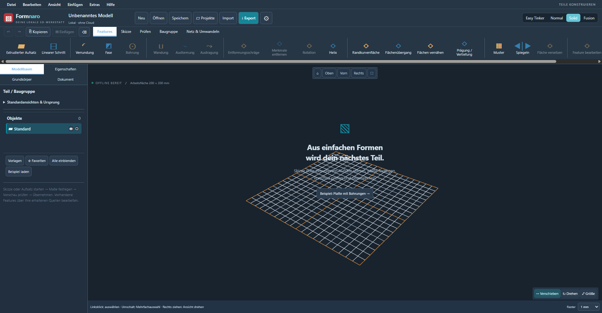

# Formnaro

**Deine lokale 3D-Werkstatt für Windows.**

Mit Formnaro konstruierst du technische Teile, bearbeitest 3D-Modelle und bereitest eigene Ideen für Modellbau und 3D-Druck vor. CAD-Körper, Netze, Skizzen und technische Zeichnungen stehen in einer Anwendung zur Verfügung. Die normale Modellierung funktioniert offline; Projekte bleiben auf deinem Rechner.

## Herunterladen

### [Formnaro 0.114.0-r7 für Windows herunterladen](https://github.com/andyy909/Formnaro-cad/releases/download/v0.114.0-r7/Formnaro-v0.114.0-r7-Windows.zip)

**Windows · 64 Bit · portable**

[Versionshinweise, Prüfbericht und Prüfsummen](https://github.com/andyy909/Formnaro-cad/releases/tag/v0.114.0-r7) · [Alle Versionen](https://github.com/andyy909/Formnaro-cad/releases)

1. ZIP-Datei herunterladen und vollständig in einen eigenen Ordner entpacken.
2. `Formnaro/Formnaro.exe` starten. Alle Unterordner, Laufzeiten und Lizenzen zusammenlassen.
3. Eigene Einstellungen und Werkzeuge bei Bedarf über den bisherigen Datenordner mitnehmen.

Persönliche Modelle, Profile und Zugangsdaten sind nicht enthalten. FreeCAD 1.1.4 und Python 3.11 sind integriert; eine separate Installation oder Pfadeinrichtung entfällt.

## Neu in 0.114.0-r7

- **Ein vollständiger Download:** FreeCAD 1.1.4, Python 3.11 und die benötigten Module werden mit Formnaro ausgeliefert.
- **Automatische Laufzeitwahl:** Python, native FCStd-Merkmale, Kurven- und Flächenwerkzeuge verwenden die integrierte Version.
- **Geprüft auf frischem Windows:** 167 Prüfgruppen in sechs Läufen ohne externe FreeCAD-/Python-Installation bestanden; zusätzlich 92 lokale EXE-Prüfgruppen.
- **Portabel und isoliert:** verschobene Umlautpfade, AppContainer, unsichtbare GUI-Module, alte Quellen, Exporte, Abbruch und Undo geprüft.

Der Download umfasst ungefähr **1,88 GB**, der entpackte Programmordner ungefähr **4,36 GB**. [Abnahme und Einzelheiten](docs/INTEGRIERTE-CAD-LAUFZEIT.md).

Die folgende Aufnahme stammt aus der frischen Windows-Prüf-VM und zeigt einen synthetischen nativen Python-Prüfkörper in 0.114.0-r7.


## Bisherige Oberflächenverbesserungen in 0.113.1-r5

- **Mehr Modellfläche:** kompakte Kopf- und Werkzeugleisten in Solid und Fusion.
- **Dateiaktionen oben:** Neu, Öffnen, Speichern, Projekte, Import, Export und Einstellungen zwischen Modellname und Modusauswahl.
- **Zusatzfunktionen im Menü:** KI-Werkstatt, Projektfotos und Merkmalsfunktionen unter Extras beziehungsweise Dienstprogramme.
- **Eine gemeinsame Zeile:** Schnellaktionen und Werkzeugregister nebeneinander.
- **Modusname Fusion:** vertraute Befehle und bisherige Bedienung erhalten.
- **Fehlerkorrekturen enthalten:** robuster Start, geschützte Speicherdateien, verbesserte Theme-Umschaltung und lokale Skriptausführung.
- **CAD-Erweiterungen seit 0.111:** Bézier-/B-Spline-Kurven, Mehrprofil-Lofts, zusammengesetzte Sweeps sowie Flächen und Prägung/Vertiefung.

Die vorherige Layoutänderung bestand **39 gezielte Prüfgruppen an der tatsächlichen Windows-EXE** und vier visuelle Paketprüfungen. Vorherige Wartungs- und Oberflächenprüfungen sind im Prüfbericht getrennt aufgeführt. Kein erneut ausgeführter allgemeiner Gesamttest für diese Layoutänderung.

### Aktuelle Oberfläche: Solid und Fusion

Diese Aufnahmen stammen aus der geprüften Windows-Ausgabe 0.113.1-r5.




## Was du mit Formnaro machen kannst

- **Einfach einsteigen:** Grundformen platzieren, Maße ändern, Teile verschieben, ausrichten, spiegeln und gruppieren.
- **Technisch konstruieren:** Skizzen, Maßformeln, Projektparameter und Varianten sowie CAD-Werkzeuge für Anbauten, Ausschnitte, Bohrungen und weitere Formänderungen verwenden.
- **3D-Druck-Modelle bearbeiten:** STL- und andere Netzmodelle importieren, prüfen, gezielt reparieren und mit Netzwerkzeugen bearbeiten; CAD über STEP austauschen.
- **Zeichnungen erstellen:** Technische Ansichten und Bemaßungen anlegen und als PDF, SVG oder DXF ausgeben.
- **Mit Referenzbildern arbeiten:** Projektfotos speichern, ebene Bilder entzerren und bestätigte Vorder-, Seiten- und Draufsichten zu einer bearbeitbaren CAD-Variante verbinden.
- **Optional KI nutzen:** Modellieraufträge, Foto-Unterstützung und Programmhilfe über einen eingerichteten Anbieter verwenden. Python und FreeCAD sind im Windows-Download als lokale Laufzeiten enthalten.

Änderungen lassen sich vor der Übernahme in einer Vorschau prüfen und anschließend rückgängig machen. Für KI-Anfragen an einen Cloud-Anbieter wird eine Internetverbindung benötigt; abhängig vom eingerichteten Zugang können Anbietergebühren anfallen.

## Feste Vorgaben für KI-Aufträge

Ziel, Annahmen, geschützte Quellen und native Sollprüfungen bleiben beim gespeicherten Auftrag erhalten. Die folgende Aufnahme stammt aus der geprüften Ausgabe 0.111.0-r2 und zeigt ein synthetisches Testbeispiel.


## Ein Blick ins Programm

Die folgenden Bildschirmbilder stammen aus der geprüften Windows-Ausgabe 0.108.0 und zeigen mitgelieferte Testbeispiele.

### Easy Tinker – Formen und Maße direkt im Blick

Die vereinfachte Oberfläche bietet eine Formenpalette, direkte Größenfelder und Griffe zum Verschieben und Drehen.


### Solid – Werkzeuge und Modellbaum

Vier Bedienmodi stehen zur Wahl: **Easy Tinker, Normal, Solid und Fusion**. Hier ist der Solid-Modus mit dunkler Darstellung zu sehen.


### Skizzen – Konturen, Öffnungen und Formeln

Bearbeitbare Skizzen verbinden technische Konturen mit benannten Maßen und Maßbeziehungen.


### Neu in 0.108.0 – technische Fotoansichten verbinden

Bestätigte Vorder-, Seiten- und Draufsichten teilen sich Nullpunkte und Zielmaße. Aus den Profilen entsteht eine native CAD-Vorschau; jede Ansicht und die Funktionsmaße werden vor der Übernahme geprüft.


Bilder zeigen nur sichtbare Konturen. Verdeckte Innengeometrie und die spätere Passung eines gedruckten Teils müssen gesondert geklärt und geprüft werden.

## Geprüfte Ausgabe

**0.114.0-r7** ist die aktuelle veröffentlichte Programmversion. Paket 6a wurde gezielt mit 92 lokalen EXE-Prüfgruppen und 167 Prüfgruppen in sechs Läufen auf frischem Windows abgenommen. Alle 35.586 CAD-Laufzeitdateien wurden dort vollständig geprüft. Die nativen Quelltests und die abschließenden Integritätsprüfungen sind getrennt per SHA gebunden; überlappende Phasen werden nicht addiert. Aktuelle Paketbilder wurden visuell geprüft. KI-Anbieterantworten wurden simuliert.

Der [Prüfbericht](https://github.com/andyy909/Formnaro-cad/releases/download/v0.114.0-r7/Pruefergebnis.json) beschreibt Umfang und Grenzen. Pakete 0–6, 6a und 7 sind abgeschlossen, 8–10 bleiben offen. Die gemeinsame allgemeine Gesamtprüfung folgt am Ende der beauftragten Folge.

Die Anleitungen liegen im Download unter `Formnaro/docs` und hier im Verzeichnis [docs](docs).

## Vollständiges Projekt und Entwicklung

Dieses Repository enthält außerdem eine eigenständige Kopie des vollständigen Projektstands **0.114.0-r7**: Anwendung, beide Mini-Versionen, CAD-Kern, Tests, Buildskripte, Anleitungen und Lizenzen. Die Kopie ist vom privaten Original unabhängig. Änderungen an diesem Repository verändern das private Original nicht.

| Verzeichnis | Inhalt |
| --- | --- |
| `src`, `backend`, `electron.cjs`, `preload.cjs` | Anwendung und Desktop-Anbindung |
| `cad-kernel-build`, `converter`, `python-runtime`, `speech-runtime` | CAD-Kern sowie Laufzeit- und Buildgrundlagen |
| `mini`, `mini-cad` | Eigenständige Mini-Versionen |
| `tests`, `scripts` | Prüfungen, Build- und Paketwerkzeuge |
| `docs`, `ai`, `licenses` | Anleitungen, Schnittstellen und Lizenztexte |

Für die lokale Entwicklung mit Node.js 22.16 oder neuer:

```powershell
git clone https://github.com/andyy909/Formnaro-cad.git
cd Formnaro-cad
npm ci
npm run build
npm start
```

Für FreeCAD-Funktionen im Entwicklungscheckout bereitet `npm run setup:cad-runtime` die fest gepinnte portable Laufzeit vor. Weitere Bauvoraussetzungen stehen in [BUILD.md](docs/BUILD.md). Wer das fertige Programm nutzen möchte, verwendet den vollständigen Windows-Download oben.

Die [bisherige ausführliche Projektbeschreibung](README-Entwicklung.md) enthält die Entwicklungshistorie; einzelne ältere Versionsangaben sind dort historisch. Der [technische Projektkontext](docs/PROJEKTKONTEXT.md) beschreibt den aktuellen abgenommenen Stand.

Der eigene Anwendungscode steht unter der [PolyForm Noncommercial License 1.0.0](LICENSE.txt). Fremdkomponenten behalten ihre jeweiligen Lizenzen; siehe [Drittanbieterhinweise](THIRD-PARTY-LICENSES.txt). Persönliche Datenordner, Profile, Zugangsdaten und lokale Arbeitsdateien sind nicht Teil der Projektkopie.
