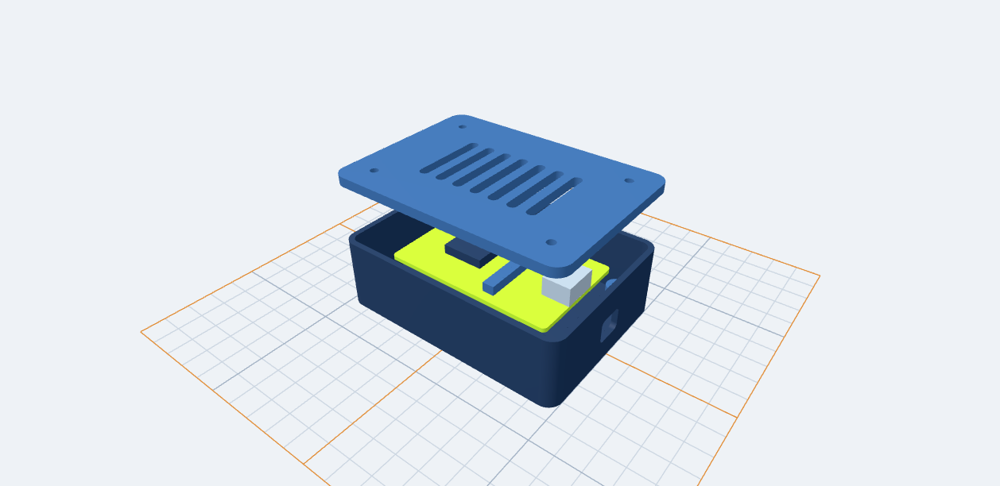
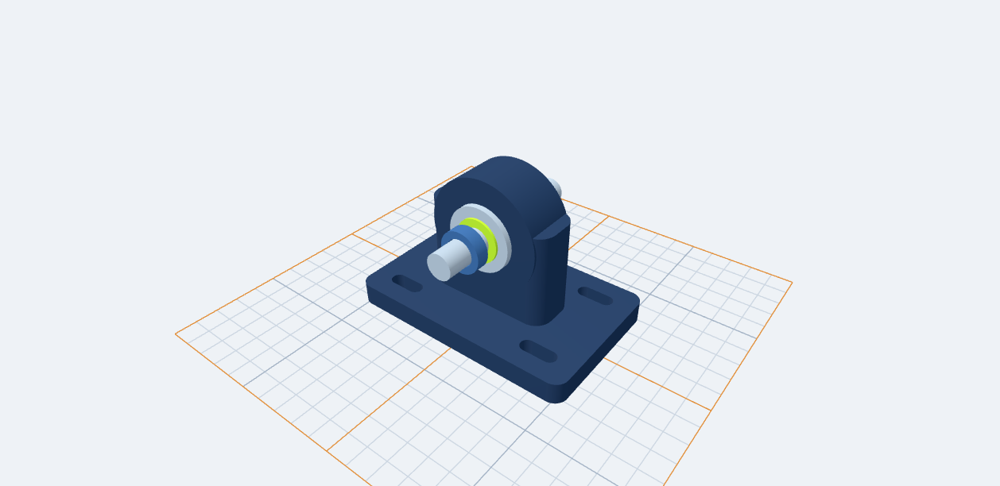
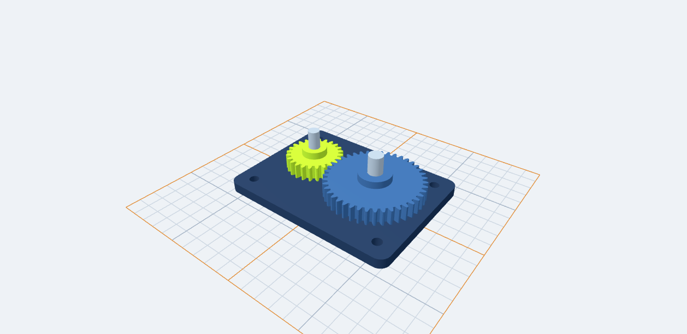
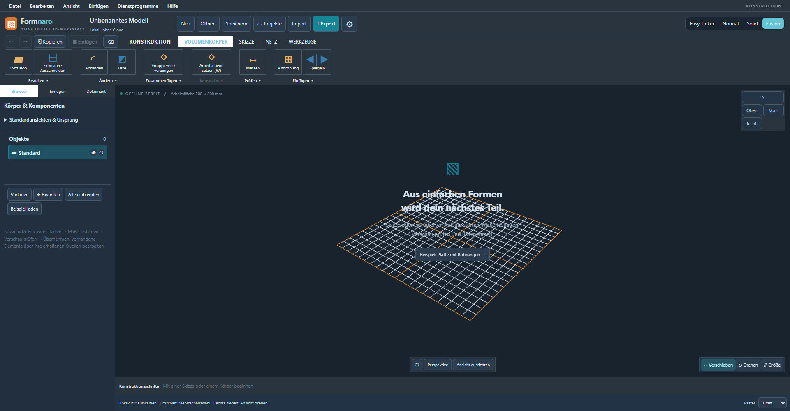
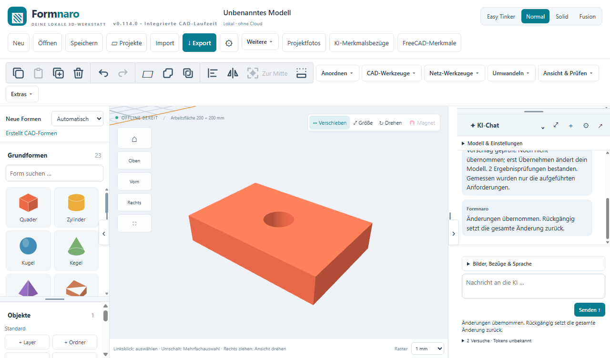

<p align="center">
  
</p>

<p align="center">
  <strong>Von der ersten Form zum eigenen Bauteil.</strong><br>
  CAD, 3D-Modelle und technische Zeichnungen für Modellbau und 3D-Druck.
</p>

<h3 align="center">
  <a href="https://github.com/andyy909/Formnaro-cad/releases/download/v0.117.0-r8/Formnaro-v0.117.0-r8-Windows.zip">↓ Formnaro für Windows herunterladen</a>
</h3>

<p align="center">
  <strong>0.117.0-r8 · Windows 64 Bit · portabel · ca. 1,89 GB · eigener Code: MIT</strong><br>
  FreeCAD und Python sind bereits dabei.
</p>

<p align="center">
  <a href="#in-drei-schritten-starten">Erste Schritte</a> ·
  <a href="https://github.com/andyy909/Formnaro-cad/releases/latest">Versionshinweise</a> ·
  <a href="#anleitungen">Anleitungen</a> ·
  <a href="https://github.com/andyy909/Formnaro-cad/issues">Feedback &amp; Ideen</a>
</p>

---

## Deine Idee. Deine Maße. Dein Modell.

Ein Halter für die Werkbank, ein Gehäuse für die Elektronik oder ein Ersatzteil für den Modellbau: Mit Formnaro baust du eigene Teile auf, passt vorhandene Modelle an und erstellst Zeichnungen dazu.

Beginne mit einfachen Formen oder konstruiere mit Skizzen, Parametern und CAD-Werkzeugen. Die normale Modellierung funktioniert **offline**; deine Projekte speicherst du lokal. Änderungen prüfst du in der Vorschau und übernimmst sie anschließend mit der Möglichkeit, sie rückgängig zu machen.

## Komplexere Bauteile – direkt in Formnaro

Diese drei Demonstrationsmodelle wurden in **Formnaro 0.114.0-r7** konstruiert. Die Bilder stammen direkt aus der 3D-Ansicht des Programms. Die bearbeitbaren Projekte kannst du selbst öffnen.

### Elektronikgehäuse mit abgehobenem Deckel

Ein Gehäuse mit **2,4 mm Wandstärke**, Anschlussausschnitt, vier Schraubdomen und einem Deckel mit Lüftungsschlitzen. Die Platine und die Elektronik-Dummys sind eigenständige Teile. So lassen sich Körper und Ausschnitte kombinieren und eine Baugruppe übersichtlich darstellen.



[Bearbeitbares Gehäuseprojekt](beispiele/elektronikgehaeuse.ocad)

### Lagerhalter mit Langlöchern und Welle

Grundplatte, aufrechter Lagerbock und runde Lageraufnahme werden zu einem CAD-Körper verbunden. **Vier Langlöcher und eine durchgehende Lagerbohrung** entstehen als Ausschnitte. Lagerringe, Distanzring und Welle bleiben separate Teile.



[Bearbeitbares Lagerhalterprojekt](beispiele/lagerhalter.ocad)

### Parametrische Zahnräder und Drehgelenke

Die Getriebestudie kombiniert ein Ritzel mit **24 Zähnen** und ein Zahnrad mit **42 Zähnen**, beide mit Modul **1,5**, Naben und Wellenbohrungen. Grundplatte, Wellen und Distanzhülsen ergänzen den Aufbau.



Das Projekt enthält **zwei unabhängig bedienbare Drehgelenke**. Unter „Gelenke und geführte Bewegung“ kannst du beide Winkel verändern, die Vorschau zurücksetzen oder eine Stellung übernehmen. Eine automatische Zahnradkopplung ist derzeit nicht enthalten.

[Bearbeitbares Getriebeprojekt mit Drehgelenken](beispiele/getriebestudie.ocad) · [Gelenke und Bewegung erklärt](docs/GELENKE-BEWEGUNG.md)

## Was du damit machen kannst

| Dein Vorhaben | Die passenden Werkzeuge |
| --- | --- |
| **Ein eigenes Bauteil konstruieren** | Grundformen, bearbeitbare Skizzen, Bohrungen, Ausschnitte, Rundungen und weitere CAD-Werkzeuge. |
| **Maße und Varianten anpassen** | Benannte Maße, Formeln und gemeinsame Projektparameter für zusammengehörige Teile. |
| **Vorhandene 3D-Modelle bearbeiten** | STL- und andere Netzmodelle importieren, prüfen und gezielt bearbeiten; CAD-Modelle über STEP austauschen. |
| **Komplexere Formen aufbauen** | Bézier- und B-Spline-Kurven, Lofts, Sweeps sowie Flächen, Prägungen und Vertiefungen. |
| **Eine Konstruktion dokumentieren** | Technische Ansichten, Schnitte und Bemaßungen mit Ausgabe als PDF, SVG oder DXF. |
| **Teile und Baugruppen verwalten** | Flächenfarben, Materialgruppen, ausdrücklich eingegebene Dichte, Masse und Schwerpunkt, CSV-Stückliste und gespeicherte Explosionsansicht. |
| **Vorlagen und Fotos verwenden** | Projektfotos, Referenzmaße und bestätigte technische Ansichten als Grundlage für bearbeitbare CAD-Entwürfe. |

## Vier Bedienmodi – ein gemeinsames Projekt

Wähle die Oberfläche, die zu deiner Arbeitsweise passt.

| Modus | So arbeitest du |
| --- | --- |
| **Easy Tinker** | Mit Formenpalette, direkten Maßfeldern und Griffen zum Verschieben und Drehen. |
| **Normal** | Mit der regulären Werkzeugoberfläche für CAD- und Netzbearbeitung. |
| **Solid** | Mit klassischen Menüs, Werkzeugregistern, Modellbaum und Eigenschaften links. |
| **Fusion** | Mit kompakter Werkzeugleiste und nach Aufgaben gegliederten Befehlsgruppen. |

<details>
<summary><strong>Weitere Einblicke: Easy Tinker, Fusion und Skizzen</strong></summary>

### Einfach mit Formen beginnen

Grundformen auswählen, Maße eingeben und Teile anordnen.


*Aufnahme aus Version 0.108.0.*

### Mit Fusion konstruieren

Kompakte Kopfzeile, Dateiaktionen am Modellnamen und zusammengefasste Werkzeuge schaffen Platz für das Modell.



*Aufnahme aus Version 0.113.1-r5.*

### Aus Konturen werden Bauteile

Skizzen verbinden technische Konturen, Öffnungen und benannte Maße.


*Aufnahme aus Version 0.108.0.*

</details>

## KI, wenn du Unterstützung möchtest

Lass dir bei Modellieraufträgen, der Arbeit mit Referenzfotos oder bei Fragen zur Bedienung helfen. Gespeicherte KI-Aufträge behalten ihr Ziel, geschützte Quellen und festgelegte Maßprüfungen. Entwürfe lassen sich vor der Übernahme ansehen und prüfen.

Die KI-Funktionen sind **optional**. Für Anfragen an einen Cloud-Anbieter brauchst du einen eingerichteten Zugang und eine Internetverbindung; mögliche Kosten hängen vom Anbieter ab. Die mitgelieferten Python- und FreeCAD-Werkzeuge rechnen lokal.

<details>
<summary><strong>Einblicke in KI-Aufträge und technische Fotoansichten</strong></summary>

### Vorgaben bleiben am Auftrag

Ziel, Annahmen, geschützte Teile und Maßprüfungen werden mit dem Auftrag gespeichert.


*Synthetisches Prüfbeispiel aus Version 0.111.0-r2.*

### Technische Ansichten als Vorlage

Bestätigte Vorder-, Seiten- und Draufsichten teilen sich Bezugspunkte und Zielmaße. Daraus entsteht eine native CAD-Vorschau mit bearbeitbaren Profilen.


*Synthetisches Prüfbeispiel aus Version 0.108.0. Verdeckte Innengeometrie und die spätere Passung lassen sich aus sichtbaren Konturen allein nicht bestimmen.*

</details>

## In drei Schritten starten

1. **[Windows-ZIP herunterladen](https://github.com/andyy909/Formnaro-cad/releases/download/v0.117.0-r8/Formnaro-v0.117.0-r8-Windows.zip).**
2. **Vollständig entpacken** – in einen eigenen Ordner, mit allen Unterordnern und Lizenzen.
3. **„Formnaro starten“ doppelklicken** und ein neues Projekt anlegen.

Oben liegen drei praktische Verknüpfungen: **Formnaro starten**, **Projekte** und **Bibliothek und Einstellungen**. Die Programmdateien sind im Ordner **Programmdateien** zusammengefasst. Über „Projekte“ erreichst du auch die drei mitgelieferten CAD-Beispiele im Unterordner **Beispiele**. [Ordneraufteilung und Hilfe zum Start](docs/KLARER-START.md).

**Alles für den CAD-Start ist dabei:** FreeCAD 1.1.4 und Python 3.11 sind integriert. Eine separate Installation oder Pfadeinrichtung entfällt. Der Download umfasst etwa **1,89 GB**, der entpackte Programmordner etwa **4,37 GB**.

Vorhandene Einstellungen und eigene Werkzeuge kannst du bei Bedarf über deinen bisherigen Datenordner mitnehmen.

### Neu im aktuellen Download

**0.117.0-r8** enthält die abgeschlossene Ausbaufolge bis Paket 10 und gibt den gesamten eigenen Formnaro-Anwendungscode unter der **MIT-Lizenz** frei, einschließlich kommerzieller Nutzung.

- **Teile & Material:** Materialgruppen und eine ausdrücklich eingegebene Dichte für geeignete CAD- und Netzteile; Volumen, Masse und Schwerpunkt prüfen.
- **Flächenfarben:** eigene Flächengruppen und unterstützte Farbexporte bei erhaltenen Originalquellen.
- **Stückliste:** Teile als CSV ausgeben.
- **Explosionsansicht:** Abstände zur Übersicht speichern, während Montagepositionen und Exporte unverändert bleiben.

Unbekannte Dichte bleibt unbekannt. Massensummen addieren die Teile; sie vereinigen überlappende Körper nicht. Die Explosionsansicht ist eine Anzeige ohne Kollisionssimulation. [Bedienung und Grenzen](docs/TEILE-MATERIAL-BAUGRUPPEN.md).

Auch die gekrümmte Netzbearbeitung und die erweiterten Netzflächenwerkzeuge sind enthalten: [gekrümmte Netze](docs/GEKRUEMMTE-NETZE.md) · [Netzreparatur und Flächen](docs/NETZREPARATUR-FLAECHEN.md).

[Versionshinweise und Downloads](https://github.com/andyy909/Formnaro-cad/releases/tag/v0.117.0-r8) · [Prüfbericht](https://github.com/andyy909/Formnaro-cad/releases/download/v0.117.0-r8/Pruefbericht.txt) · [Prüfergebnis](https://github.com/andyy909/Formnaro-cad/releases/download/v0.117.0-r8/Pruefergebnis.json) · [SHA-256-Prüfsummen](https://github.com/andyy909/Formnaro-cad/releases/download/v0.117.0-r8/SHA256SUMS.txt)

<details>
<summary><strong>Prüfumfang und technische Einzelheiten</strong></summary>

Die vollständige Funktionsabnahme der Ausbaufolge stammt aus **0.117.0-r7**: **2.153 Tests in 352 Testdateien**, **3.312 Windows-Prüfgruppen in 91 erfolgreichen Prozessläufen** und **16 visuell geprüfte Paketbilder**. Dazu gehören ein vollständiger 30-minütiger Dauertest, Wiederherstellung, zwei echte Auftragsneustarts und unabhängige Leser für physische Exportdateien. Die Herkunft der Unit-Belege und die korrigierten Spezialprüfer sind im [Abnahmebericht](docs/GESAMTABNAHME-AUSBAU-0.117.md) ausdrücklich dokumentiert.

**R8 ist die anschließende Lizenzaktualisierung auf MIT.** Der Prüfbericht trennt die gezielten R8-Prüfungen der Lizenzänderung von der R7-Gesamtfunktionsabnahme. Die genannten vollständigen R7-Zahlen sind keine neu ausgeführte vollständige R8-Prüfung.

Die integrierte FreeCAD-/Python-Laufzeit wurde zuvor auch auf frischem Windows ohne externe Installation abgenommen. Bei der Abnahme wurden alle **35.586 CAD-Laufzeitdateien** vollständig auf Integrität geprüft.

Geprüft wurden unter anderem native Exporte, vorhandene Quellen, vier Bedienmodi, Umlautpfade, Abbruch und Rückgängig. Aktuelle Paketbilder wurden visuell geprüft; KI-Anbieterantworten in diesen Prüfungen waren simuliert.



*Synthetisches Prüfbeispiel aus 0.114.0-r7 auf frischem Windows.*

Einzelheiten und Grenzen: [Gesamtabnahme der Ausbaufolge](docs/GESAMTABNAHME-AUSBAU-0.117.md), [integrierte CAD-Laufzeit](docs/INTEGRIERTE-CAD-LAUFZEIT.md) und [maschinenlesbarer Prüfbericht](https://github.com/andyy909/Formnaro-cad/releases/download/v0.117.0-r8/Pruefergebnis.json).

</details>

## Anleitungen

| Du möchtest … | Hier geht es weiter |
| --- | --- |
| **Das Programm kennenlernen** | [Bedienungsanleitung](LIES-MICH.txt) · [Solid](docs/SOLID-MODUS.md) · [Fusion](docs/FUSION-MODUS.md) |
| **Mit Maßen und CAD-Werkzeugen arbeiten** | [Projektparameter und Varianten](docs/PROJEKTPARAMETER.md) · [Kurven, Loft und Sweep](docs/CAD-KURVEN.md) · [Flächen und Prägungen](docs/CAD-FLAECHEN.md) |
| **Zeichnungen und Projekte ausgeben** | [Technische Zeichnungen](docs/TECHNISCHE-ZEICHNUNGEN.md) · [FNPACK-Projekte](docs/FNPACK.md) |
| **Material, Masse und Baugruppen prüfen** | [Teile, Flächenfarben, Stückliste und Explosion](docs/TEILE-MATERIAL-BAUGRUPPEN.md) |
| **KI-Unterstützung einrichten und nutzen** | [KI-Aufträge](docs/KI-AUFTRAEGE.md) · [Foto-Assistent](docs/FOTO-ASSISTENT.md) · [Programm-Assistent](docs/PROGRAMM-ASSISTENT.md) |
| **Das Projekt selbst bauen** | [Bauanleitung](docs/BUILD.md) · [Technischer Projektkontext](docs/PROJEKTKONTEXT.md) |

## Quellcode und Mitmachen

Du hast eine Idee, vermisst eine Funktion oder hast einen Fehler gefunden? Beschreibe dein Anliegen in den **[GitHub Issues](https://github.com/andyy909/Formnaro-cad/issues)**. Bei Fehlern helfen die verwendete Version und die Schritte, mit denen sie sich nachvollziehen lassen.

Dieses Repository enthält den vollständigen veröffentlichten Projektstand **0.117.0-r8** mit Anwendung, beiden Mini-Versionen, Python-SDK, Tests, Buildskripten, Anleitungen und Lizenzen. Der gesamte eigene Anwendungscode ist unter [MIT](LICENSE.txt) nutzbar, veränderbar und weiterverteilbar, auch kommerziell. Copyright- und Lizenzhinweis müssen erhalten bleiben.

[Formnaro-Quellcode dieses Releases herunterladen](https://github.com/andyy909/Formnaro-cad/archive/refs/tags/v0.117.0-r8.zip) · [Vollständige entsprechende CAD-Quellen mit Originalarchiven](https://github.com/andyy909/Formnaro-cad/releases/download/v0.117.0-r8/Formnaro-CAD-Quellen-v0.117.0.zip)

Das zusätzliche CAD-Quellenasset enthält die fünf exakt gepinnten Originalarchive sowie die aktuelle Formnaro-Bridge und Buildeingaben. Es ergänzt den vollständigen Quellcheckout für den Neubuild des CAD-Kerns. [Quellen, Lizenzen und Austausch der Bibliothek](licenses/CAD-Quellen-und-Build.txt).

<details>
<summary><strong>Entwicklungsumgebung und Projektstruktur</strong></summary>

Für die lokale Entwicklung mit **Node.js 22.16 oder neuer**:

```powershell
git clone https://github.com/andyy909/Formnaro-cad.git
cd Formnaro-cad
npm ci
npm run build
npm start
```

Für FreeCAD-Funktionen im Entwicklungscheckout bereitet `npm run setup:cad-runtime` die fest gepinnte portable Laufzeit vor. Weitere Voraussetzungen stehen in der [Bauanleitung](docs/BUILD.md).

| Verzeichnis | Inhalt |
| --- | --- |
| `src`, `backend` | Benutzeroberfläche und Desktop-Funktionen |
| `cad-kernel-build`, `converter` | CAD-Kern und Konverter |
| `python-runtime`, `speech-runtime` | Weitere Laufzeit- und Buildgrundlagen |
| `mini`, `mini-cad` | Eigenständige Mini-Versionen |
| `tests`, `scripts` | Prüfungen und Paketwerkzeuge |
| `docs`, `ai`, `licenses` | Anleitungen, Schnittstellen und Lizenztexte |

</details>

Der eigene Anwendungscode steht unter der **[MIT-Lizenz](LICENSE.txt)**. Die ursprünglichen [Drittanbieterlizenzen](THIRD-PARTY-LICENSES.txt) bleiben unverändert. Insbesondere stehen OpenCascade.js und OCCT weiterhin unter ihren LGPL-Bedingungen einschließlich der OCCT-Ausnahme; der kombinierte CAD-Kern wird nicht insgesamt als MIT bezeichnet.

---

<p align="center">
  <strong>Eine Idee im Kopf? Mach ein Modell daraus.</strong><br>
  <a href="https://github.com/andyy909/Formnaro-cad/releases/latest">Formnaro herunterladen</a> ·
  <a href="https://github.com/andyy909/Formnaro-cad/issues">Feedback geben</a>
</p>

