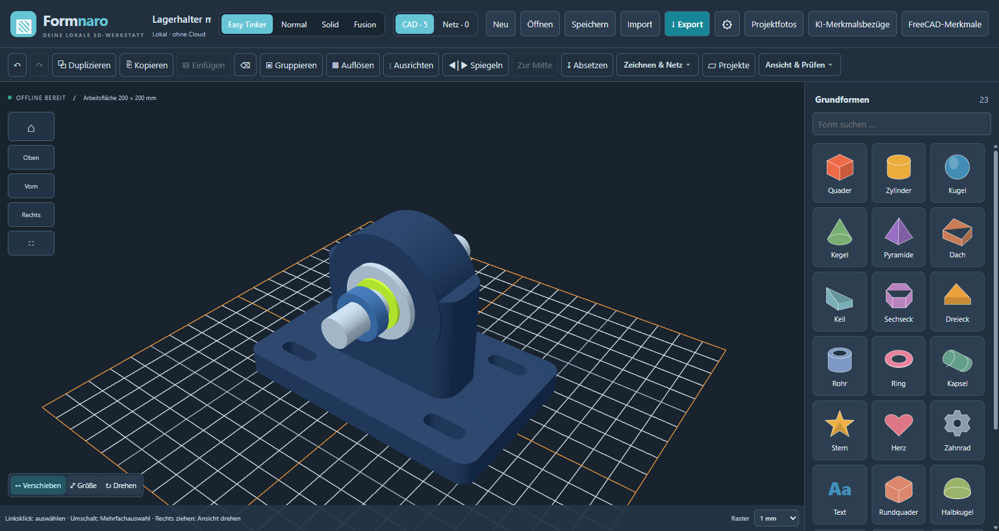
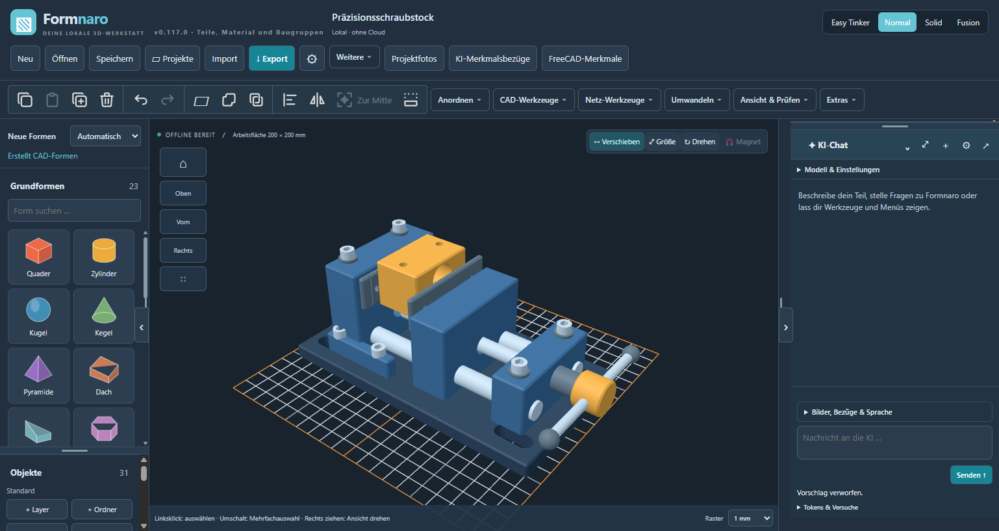
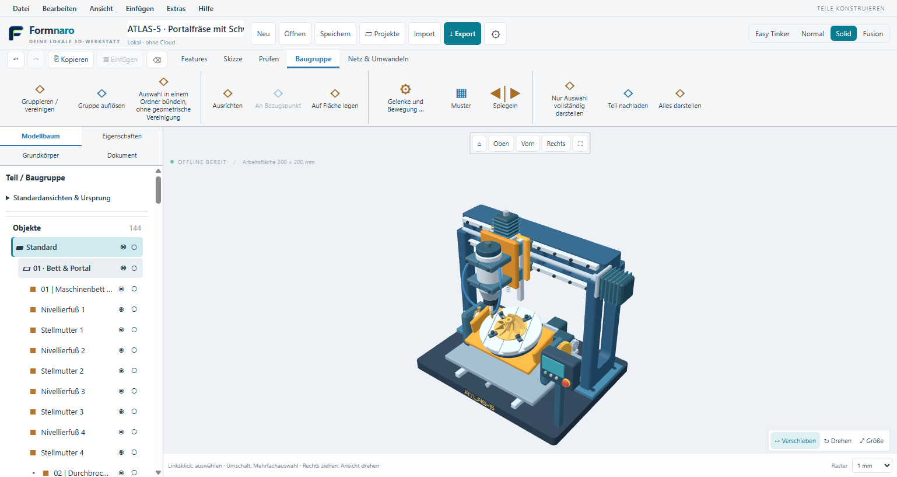
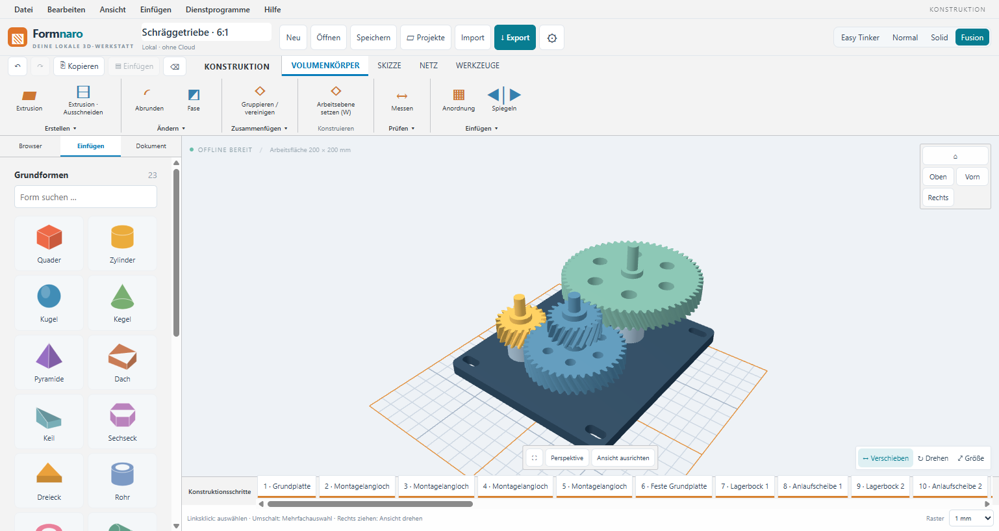
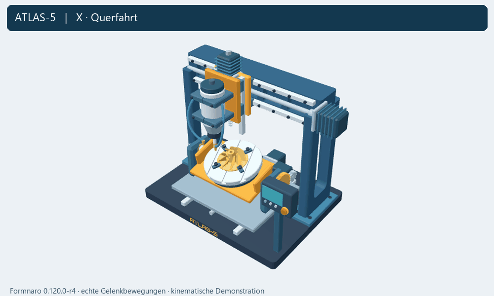
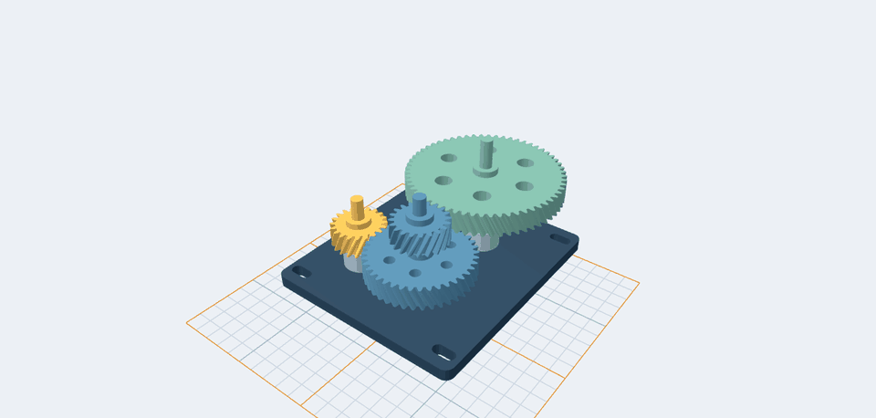
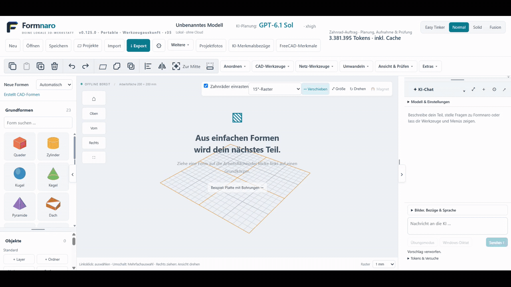

<p align="center">
  
</p>

# Formnaro

**English** | [Deutsch](README.de.md)

**CAD and mesh editing for model making and 3D printing.** Design parts, edit 3D models and create technical drawings. Formnaro runs locally on Windows; regular modelling works offline.

**Windows 64-bit · portable — choose between two downloads:**

| Download | Version | Size | Contents |
| --- | --- | --- | --- |
| **[Download the application](https://github.com/andyy909/Formnaro-cad/releases/download/v0.122.0-r3/Formnaro-v0.122.0-r3-Windows.zip)** | **0.122.0-r3** | approx. **671 MB** | Compact portable package with the required runtimes, licences and examples; without development tools or the project's own tests. |
| **[Download the full development package](https://github.com/andyy909/Formnaro-cad/releases/download/v0.120.0-r4/Formnaro-v0.120.0-r4-Windows.zip)** | **0.120.0-r4** | approx. **1.9 GB** | The previous, untrimmed package, including additional development and test components. |

For everyday use, **“Download the application”** is sufficient. The full package is the older **0.120.0-r4** release; the compact portable package is **0.122.0-r3**. Source archives for further development are also available with each [release](https://github.com/andyy909/Formnaro-cad/releases).

[Documentation](#documentation) · [Release notes](https://github.com/andyy909/Formnaro-cad/releases) · [Feedback](https://github.com/andyy909/Formnaro-cad/issues)

| **Easy Tinker** · bearing bracket (dark mode) | **Normal** · precision vise (dark mode) |
| :---: | :---: |
| [](docs/bilder/formnaro-easy-lagerhalter-dark.png) | [](docs/bilder/formnaro-normal-schraubstock-dark.png) |
| **Solid** · ATLAS-5 gantry mill (light mode) | **Fusion** · two-stage helical gearbox (light mode) |
| [](docs/bilder/formnaro-solid-atlas5.png) | [](docs/bilder/formnaro-fusion-getriebe.png) |

*Actual application screenshots: Easy Tinker and Normal in dark mode from 0.117.0-r8; Solid with ATLAS-5 in light mode from 0.120.0-r4; Fusion in light mode from 0.119.0-r2. Click an image to enlarge it.*

## Quick start

1. Download the Windows ZIP and extract it completely into its own folder.
2. Keep all subfolders together and double-click **“Formnaro starten”** (“Start Formnaro”).
3. Create a new project or open an example.

The compact portable ZIP contains the application, required runtimes, licences and three example models, without development tools or the project's own tests. FreeCAD and Python are included; no separate installation is needed. The optional offline speech model can be downloaded from within the application when needed. Only the Windows ZIP is required to run Formnaro; the separate source archives are for developers.

## Features

- **Design parts:** primitives, sketches, holes, cutouts, fillets, lofts and sweeps.
- **Edit dimensions:** parameters, formulas and variants for related parts.
- **Edit meshes:** import, inspect, repair and selectively modify models.
- **Create drawings:** export views, sections and dimensions as PDF, SVG or DXF.
- **Organise assemblies:** joints, gear couplings, materials, mass, bills of materials and exploded views.

STEP, STL, OBJ, 3MF and GLB/glTF support model exchange. Choose from four interface modes: **Easy Tinker, Normal, Solid and Fusion**. Changes can be checked in a preview and undone.

**Optional AI assistance** helps with modelling tasks, reference photos and application questions. Cloud requests require a provider account or API access and an internet connection; provider charges may apply. Python and FreeCAD tools run locally.

### ATLAS-5 in motion



**144 parts, 78 joints and five axes.** This short GIF shows actual joint movements in Formnaro 0.120.0-r4. The cradle and pinion are coupled at **48:20** and move together with the Y-axis carrier. [Download the editable example](https://github.com/andyy909/Formnaro-cad/releases/download/v0.120.0-r4/atlas-5.ocad). The model was constructed with Codex (Astra) through Formnaro's local MCP interface. The animation was then recorded using a separate model copy, without another AI request during recording. It demonstrates kinematics, not contact forces or approval for manufacturing.

### Gearbox in motion



Two stages, four gears and a **6:1 reduction ratio** — an open gearbox concept, for example for a slow rotary table. Only the input shaft is driven; the others follow through the coupling. [Download the example project](https://github.com/andyy909/Formnaro-cad/releases/download/v0.119.0-r3/schraeggetriebe-6zu1.ocad). This is a kinematic demonstration from 0.119.0-r2, not a contact or load simulation.

### AI in action



The GIF replays a plan previously generated by DeepSeek, without a live AI request during recording. The limited practice mode is included in both Windows packages linked above and runs in a separate practice window.

## Documentation

The linked guides are currently mainly in German.

| Topic | Read more |
| --- | --- |
| Getting around | [Basics](LIES-MICH.txt) · [Solid](docs/SOLID-MODUS.md) · [Fusion](docs/FUSION-MODUS.md) |
| Modelling | [Parameters and variants](docs/PROJEKTPARAMETER.md) · [Curves, lofts and sweeps](docs/CAD-KURVEN.md) |
| Drawings and assemblies | [Technical drawings](docs/TECHNISCHE-ZEICHNUNGEN.md) · [Parts, materials and bills of materials](docs/TEILE-MATERIAL-BAUGRUPPEN.md) |
| AI assistance | [AI tasks](docs/KI-AUFTRAEGE.md) · [Photo assistant](docs/FOTO-ASSISTENT.md) · [Application assistant](docs/PROGRAMM-ASSISTENT.md) |
| Development | [Build instructions](docs/BUILD.md) · [Architecture](docs/PROJEKTKONTEXT.md) |

<!-- formnaro-development-status:start -->
## Development status

The **0.122.0-r3** Windows download reduces the portable ZIP to **671 MB** (about **1.78 GB** extracted). The download is approximately **65% smaller** than 0.120.0-r4. **42 targeted unit checks and 363 UI test steps across r2/r3** are documented; ZIP contents, a fresh extraction and the three example models have been checked. Verification status: an independent check on a fresh Windows installation and a new comprehensive acceptance run remain outstanding.

The matching source is available at [v0.122.0-r3](https://github.com/andyy909/Formnaro-cad/tree/v0.122.0-r3); application code on the `main` branch is still at **0.120.0-r4**.

[Download verification report](https://github.com/andyy909/Formnaro-cad/releases/download/v0.122.0-r3/Paket-Analyse.txt) · [Development progress and open items](docs/ALLTAGSAUSBAU-UMSETZUNGSSTAND.md)
<!-- formnaro-development-status:end -->

<details>
<summary>Run from source</summary>

With Node.js 22.16 or later and npm:

```sh
git clone --branch v0.122.0-r3 https://github.com/andyy909/Formnaro-cad.git
cd Formnaro-cad
npm ci
npm run build
npm start
```

For FreeCAD features in a development checkout, run `npm run setup:cad-runtime`. The [build instructions](docs/BUILD.md) cover additional runtimes, tests and packaging.

</details>

## Contributing and licence

Found a bug or have an idea? Open an [issue](https://github.com/andyy909/Formnaro-cad/issues). For bug reports, include the version you used and steps to reproduce the problem.

The application's own code is licensed under **[MIT](LICENSE.txt)**. Third-party components retain their [own licences](THIRD-PARTY-LICENSES.txt); the combined CAD kernel is not entirely MIT-licensed. [Licence details](docs/LIZENZ-MIT.md) · [CAD sources and build information](licenses/CAD-Quellen-und-Build.txt).
