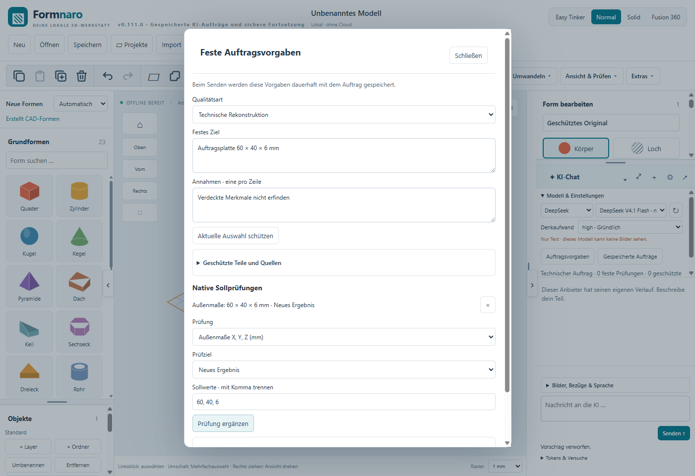
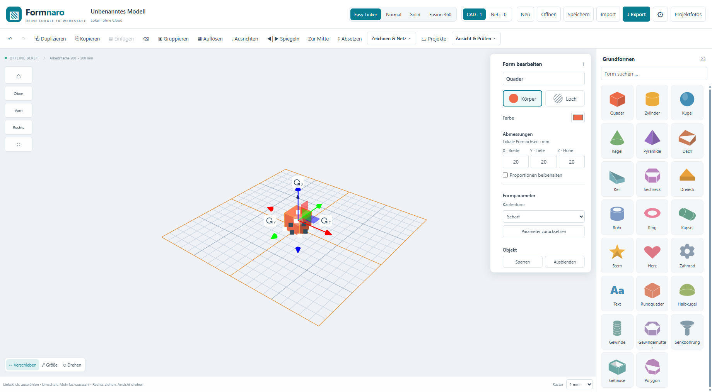
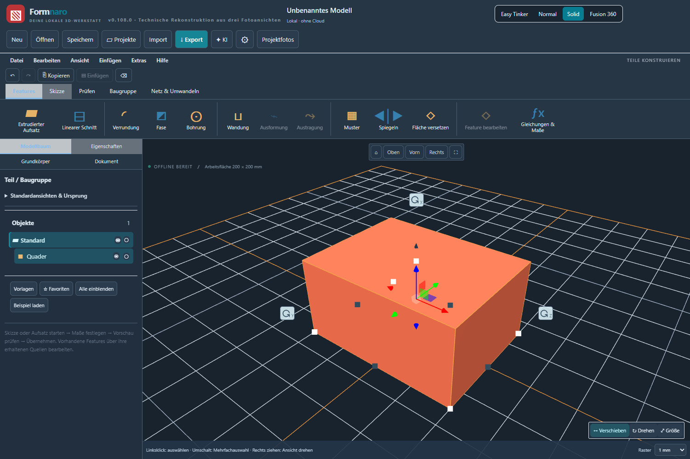
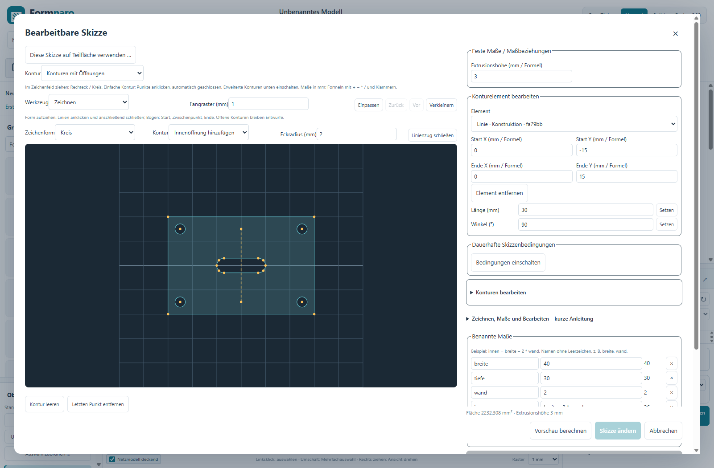
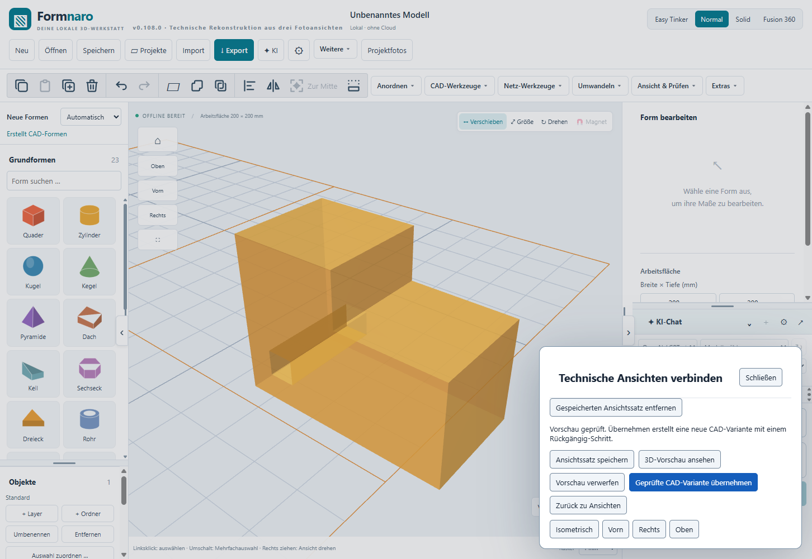

# Formnaro

**Deine lokale 3D-Werkstatt für Windows.**

Mit Formnaro konstruierst du technische Teile, bearbeitest 3D-Modelle und bereitest eigene Ideen für Modellbau und 3D-Druck vor. CAD-Körper, Netze, Skizzen und technische Zeichnungen stehen in einer Anwendung zur Verfügung. Die normale Modellierung funktioniert offline; Projekte bleiben auf deinem Rechner.

## Herunterladen

### [Formnaro 0.111.0-r2 für Windows herunterladen](https://github.com/andyy909/Formnaro-Downloads/releases/download/v0.111.0-r2/Formnaro-v0.111.0-r2-Windows.zip)

**Windows · 64 Bit · portable · ZIP ca, 1,05 GB · entpackt ca, 1,81 GiB**

[Versionshinweise, Prüfbericht und Prüfsummen](https://github.com/andyy909/Formnaro-Downloads/releases/tag/v0.111.0-r2) · [Alle Versionen](https://github.com/andyy909/Formnaro-Downloads/releases)

1. Die ZIP-Datei herunterladen und **vollständig in einen eigenen Ordner entpacken**.
2. Im entpackten Ordner **`App/Formnaro.exe`** starten. Eine Installation ist nicht erforderlich.
3. Die mitgelieferten Unterordner, Laufzeiten, Anleitungen und Lizenzen zusammenlassen. Die EXE allein reicht nicht aus.

Beim Versionswechsel den bisherigen eigenen **Datenordner** mit Einstellungen und Werkzeugen mitnehmen. Persönliche Modelle, Profile und Zugangsdaten sind im Download nicht enthalten.

## Neu in 0.111.0-r2

- **Feste KI-Auftragsvorgaben:** Zielmaße, Annahmen, geschützte Teile und Prüfungen vor dem Senden festlegen und mit dem Auftrag speichern.
- **Unterbrochene Arbeit fortsetzen:** Gespeicherte Aufträge nach einem Neustart mit ihrem verbleibenden Budget wieder aufnehmen.
- **Bessere Entwürfe behalten:** Den letzten besser geprüften Kandidaten erneut prüfen und als Vorschau wiederherstellen; auch nach Budgetende ohne weitere Anbieteranfrage.
- **Bezüge erhalten:** Modellbasis, Fotos, Kalibrierung, Analyseprogramme und Messbefunde sichern. Geänderte Modelle oder Merkmalsbezüge sperren eine unpassende Fortsetzung.
- **Erfolglose Schleifen stoppen:** Wiederholte identische Fehler, fehlender Fortschritt und doppelte Fortsetzung werden abgefangen.

Die Funktionen liegen im KI-Chat unter **Modell & Einstellungen**. Anleitung: `App/docs/KI-AUFTRAEGE.md`. Native FreeCAD-Merkmale, Programmparameter, Varianten, FCStd-Import und die bisherigen Werkzeuge bleiben enthalten. Zusätzliche FreeCAD-Funktionen benötigen eine separate lokale FreeCAD-Installation.

## Was du mit Formnaro machen kannst

- **Einfach einsteigen:** Grundformen platzieren, Maße ändern, Teile verschieben, ausrichten, spiegeln und gruppieren.
- **Technisch konstruieren:** Skizzen, Maßformeln, Projektparameter und Varianten sowie CAD-Werkzeuge für Anbauten, Ausschnitte, Bohrungen und weitere Formänderungen verwenden.
- **3D-Druck-Modelle bearbeiten:** STL- und andere Netzmodelle importieren, prüfen, gezielt reparieren und mit Netzwerkzeugen bearbeiten; CAD über STEP austauschen.
- **Zeichnungen erstellen:** Technische Ansichten und Bemaßungen anlegen und als PDF, SVG oder DXF ausgeben.
- **Mit Referenzbildern arbeiten:** Projektfotos speichern, ebene Bilder entzerren und bestätigte Vorder-, Seiten- und Draufsichten zu einer bearbeitbaren CAD-Variante verbinden.
- **Optional KI nutzen:** Modellieraufträge, Foto-Unterstützung und Programmhilfe über einen eingerichteten Anbieter verwenden. Lokale Python-Werkzeuge sind enthalten; FreeCAD-Funktionen benötigen eine zusätzliche lokale FreeCAD-Installation.

Änderungen lassen sich vor der Übernahme in einer Vorschau prüfen und anschließend rückgängig machen. Für KI-Anfragen an einen Cloud-Anbieter wird eine Internetverbindung benötigt; abhängig vom eingerichteten Zugang können Anbietergebühren anfallen.

## Feste Vorgaben für KI-Aufträge

Ziel, Annahmen, geschützte Quellen und native Sollprüfungen bleiben beim gespeicherten Auftrag erhalten. Die folgende Aufnahme stammt aus der geprüften Ausgabe 0.111.0-r2 und zeigt ein synthetisches Testbeispiel.



## Ein Blick ins Programm

Die folgenden Bildschirmbilder stammen aus der geprüften Windows-Ausgabe 0.108.0 und zeigen mitgelieferte Testbeispiele.

### Easy Tinker – Formen und Maße direkt im Blick

Die vereinfachte Oberfläche bietet eine Formenpalette, direkte Größenfelder und Griffe zum Verschieben und Drehen.



### Solid – Werkzeuge und Modellbaum

Vier Bedienmodi stehen zur Wahl: **Easy Tinker, Normal, Solid und Fusion 360**. Hier ist der Solid-Modus mit dunkler Darstellung zu sehen.



### Skizzen – Konturen, Öffnungen und Formeln

Bearbeitbare Skizzen verbinden technische Konturen mit benannten Maßen und Maßbeziehungen.



### Neu in 0.108.0 – technische Fotoansichten verbinden

Bestätigte Vorder-, Seiten- und Draufsichten teilen sich Nullpunkte und Zielmaße. Aus den Profilen entsteht eine native CAD-Vorschau; jede Ansicht und die Funktionsmaße werden vor der Übernahme geprüft.



Bilder zeigen nur sichtbare Konturen. Verdeckte Innengeometrie und die spätere Passung eines gedruckten Teils müssen gesondert geklärt und geprüft werden.

## Geprüfte Ausgabe

**0.111.0-r2** ist die aktuelle veröffentlichte Programmversion. Die technische Abnahme umfasst **524 Tests am eingefrorenen Quellstand und 929 Prüfgruppen in 21 Läufen der tatsächlichen Windows-Anwendung**, darunter 19 Auftrags-UI- und 41 Neustartprüfungen über zwei echte Anwendungsprozesse. Die ursprüngliche Projektpaketdatei wurde zwischen den Prozessstarts entfernt; die gesicherte Basis und ihre Referenzen bleiben wiederherstellbar. KI-Anbieterantworten wurden simuliert. Der [Prüfbericht](https://github.com/andyy909/Formnaro-Downloads/releases/download/v0.111.0-r2/Pruefergebnis.json) beschreibt Umfang und Grenzen. Die weiteren Ausbaupakete 6–10 sind noch offen.

Die Anleitungen liegen im Download unter `App/docs` und hier im Verzeichnis [docs](docs).

## Vollständiges Projekt und Entwicklung

Dieses Repository enthält außerdem eine eigenständige Kopie des vollständigen Projektstands **0.111.0-r2**: Anwendung, beide Mini-Versionen, CAD-Kern, Tests, Buildskripte, Anleitungen und Lizenzen. Die Kopie ist vom privaten Original unabhängig. Änderungen an diesem Repository verändern das private Original nicht.

| Verzeichnis | Inhalt |
| --- | --- |
| `src`, `backend`, `electron.cjs`, `preload.cjs` | Anwendung und Desktop-Anbindung |
| `cad-kernel-build`, `converter`, `python-runtime`, `speech-runtime` | CAD-Kern sowie Laufzeit- und Buildgrundlagen |
| `mini`, `mini-cad` | Eigenständige Mini-Versionen |
| `tests`, `scripts` | Prüfungen, Build- und Paketwerkzeuge |
| `docs`, `ai`, `licenses` | Anleitungen, Schnittstellen und Lizenztexte |

Für die lokale Entwicklung mit Node.js 22.16 oder neuer:

```powershell
git clone https://github.com/andyy909/Formnaro-Downloads.git
cd Formnaro-Downloads
npm ci
npm run build
npm start
```

Zusätzliche Konverter-, Sprach- und FreeCAD-Funktionen benötigen die in ihren Anleitungen beschriebenen Laufzeiten. Wer das fertige Programm nutzen möchte, verwendet den Windows-Download oben.

Die [bisherige ausführliche Projektbeschreibung](README-Entwicklung.md) enthält die Entwicklungshistorie; einzelne ältere Versionsangaben sind dort historisch. Der [technische Projektkontext](docs/PROJEKTKONTEXT.md) beschreibt den Stand 0.111.0-r2.

Der eigene Anwendungscode steht unter der [PolyForm Noncommercial License 1.0.0](LICENSE.txt). Fremdkomponenten behalten ihre jeweiligen Lizenzen; siehe [Drittanbieterhinweise](THIRD-PARTY-LICENSES.txt). Persönliche Datenordner, Profile, Zugangsdaten und lokale Arbeitsdateien sind nicht Teil der Projektkopie.
