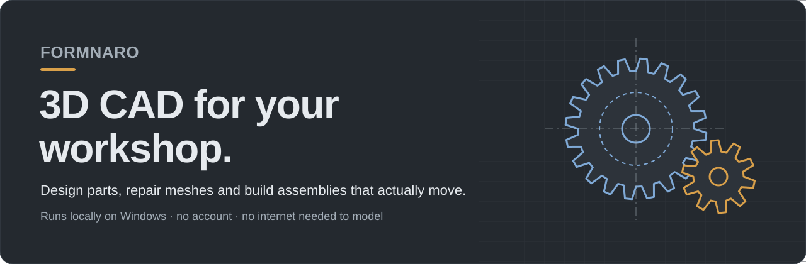
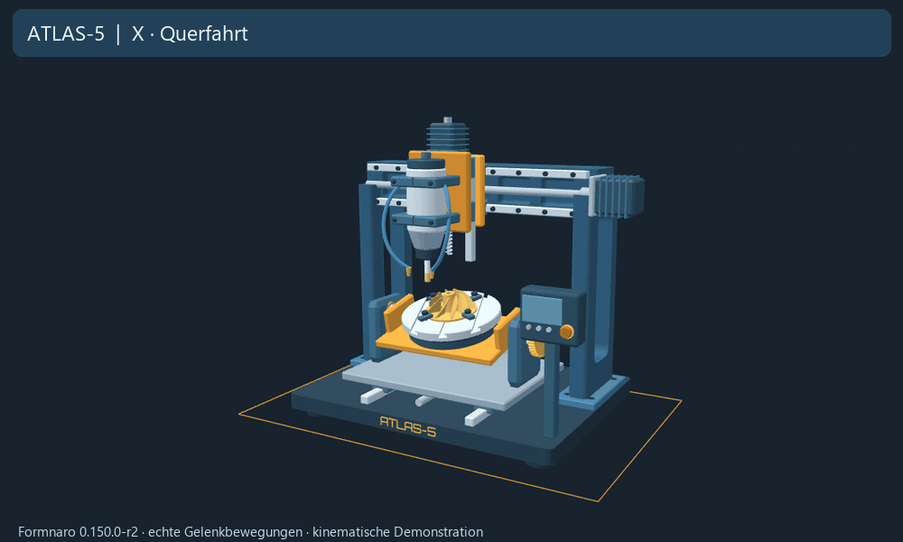
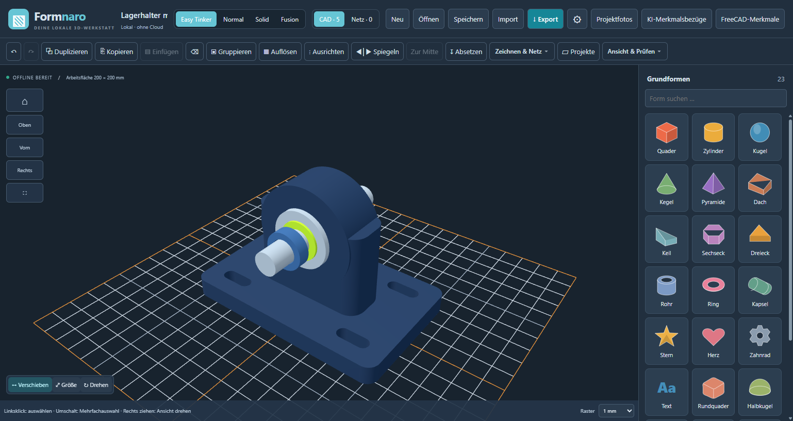
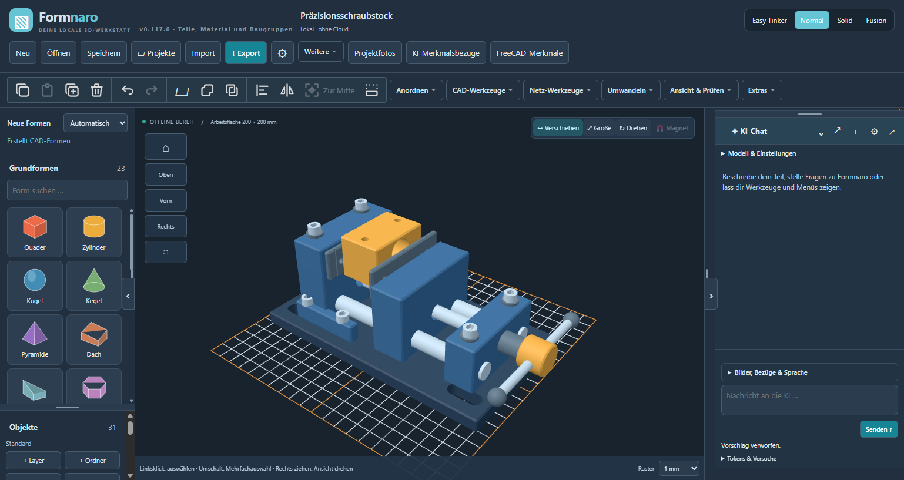
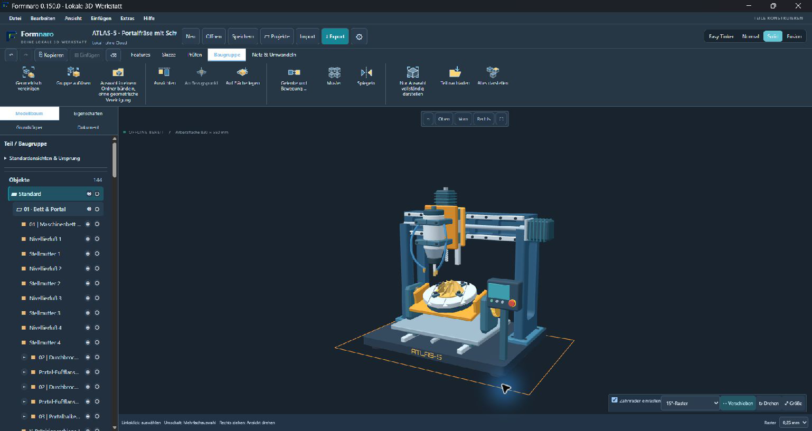
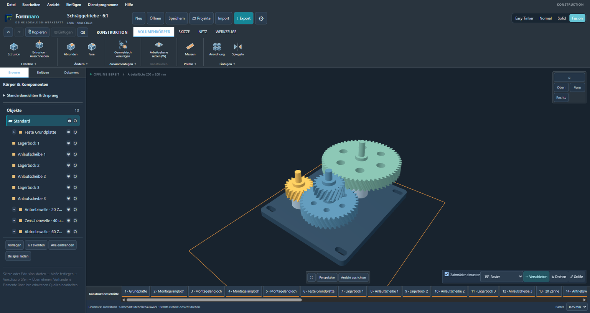
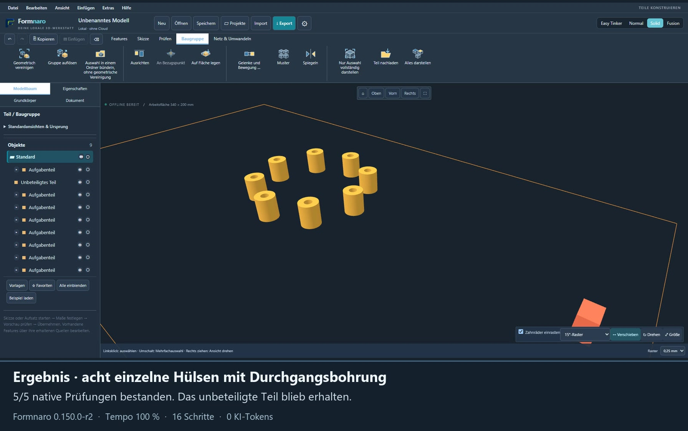
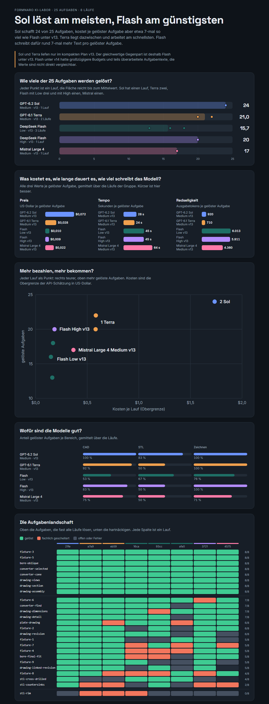

<p align="center">
  <a href="https://formnaro.de/en/">
    
  </a>
</p>

<p align="center">
  <a href="https://github.com/andyy909/Formnaro-cad/releases/download/v0.150.0-r2/Formnaro-v0.150.0-r2-Windows.zip"></a>
  <a href="https://github.com/andyy909/Formnaro-Android/releases/download/v0.4.0/Formnaro-CAD-0.4.0.apk"></a>
</p>

<p align="center">
  <a href="LICENSE.txt"></a>
  
  
  
  <a href="https://github.com/andyy909/Formnaro-cad/actions/workflows/build.yml"></a>
</p>

<p align="center">
  <a href="https://formnaro.de/en/"><b>Website</b></a> ·
  <a href="#which-mode-suits-you">Modes</a> ·
  <a href="https://formnaro.de/en/ai/">AI connection</a> ·
  <a href="https://formnaro.de/en/ai-lab/">AI lab</a> ·
  <a href="docs/USER-GUIDE.md">User guide</a> ·
  <a href="https://www.paypal.com/donate/?hosted_button_id=TPZ9RQ242TJES">Support via PayPal</a> ·
  <a href="README.de.md">Deutsch</a>
</p>

<p align="center">
  <a href="https://formnaro.de/en/"></a>
</p>

---

## Download

Formnaro is a **portable app for Windows x64**. No installer, no account — FreeCAD and Python are bundled, and you don't need an internet connection to model.

| Build | Highlights | Download |
| --- | --- | --- |
| **0.150.0-r2** · stable | Direct sketch dimensions, tablet transfer and a shared agent conversation | **[Windows x64 ZIP](https://github.com/andyy909/Formnaro-cad/releases/download/v0.150.0-r2/Formnaro-v0.150.0-r2-Windows.zip)** (≈ 742 MB) · [Release notes](https://github.com/andyy909/Formnaro-cad/releases/tag/v0.150.0-r2) · [SHA-256](https://github.com/andyy909/Formnaro-cad/releases/download/v0.150.0-r2/SHA256SUMS.txt) |
| **0.148.0-r5** · nightly | Tablet pairing, direct part transfer with Android Pilot 35 r32, and the Orca 3MF seam fix | [Windows x64 ZIP](https://github.com/andyy909/Formnaro-cad/releases/download/v0.148.0-r5/Formnaro-v0.148.0-r5-Windows.zip) · [Release notes](https://github.com/andyy909/Formnaro-cad/releases/tag/v0.148.0-r5) · [SHA-256](https://github.com/andyy909/Formnaro-cad/releases/download/v0.148.0-r5/SHA256SUMS.txt) |
| **Android 0.4.0** · tablet | Sketch on the tablet, continue on the PC — Android 10 or later | [APK](https://github.com/andyy909/Formnaro-Android/releases/download/v0.4.0/Formnaro-CAD-0.4.0.apk) (≈ 19 MB) · [Release notes](https://github.com/andyy909/Formnaro-Android/releases/tag/v0.4.0) |

Extract the whole ZIP into a writable folder and open **Formnaro starten**. [All releases](https://github.com/andyy909/Formnaro-cad/releases) · [Releases and verification](docs/AKTUELLER-STAND.md) · [Packaging policy](docs/PORTABLE-PAKETE.md)

<details>
<summary><b>Source archives</b></summary>

| Version | Formnaro | FreeCAD | CAD kernel |
| --- | --- | --- | --- |
| **0.150.0-r2** | [Formnaro](https://github.com/andyy909/Formnaro-cad/releases/download/v0.150.0-r2/Formnaro-Quellcode-v0.150.0-r2.zip) | [FreeCAD](https://github.com/andyy909/Formnaro-cad/releases/download/v0.150.0-r2/Formnaro-FreeCAD-Quellen-1.1.4.zip) | [CAD kernel](https://github.com/andyy909/Formnaro-cad/releases/download/v0.150.0-r2/Formnaro-CAD-Quellen.zip) |
| **0.148.0-r5** | [Formnaro](https://github.com/andyy909/Formnaro-cad/archive/refs/tags/v0.148.0-r5.zip) | [FreeCAD](https://github.com/andyy909/Formnaro-cad/releases/download/v0.148.0-r5/Formnaro-FreeCAD-Quellen-1.1.4.zip) | [CAD kernel](https://github.com/andyy909/Formnaro-cad/releases/download/v0.148.0-r5/Formnaro-CAD-Quellen.zip) |

</details>

## ATLAS-5 in motion



**144 parts · 78 joints · five axes.** Real joint movements in Formnaro: the cradle and pinion are coupled at **48:20** and ride along with the Y-axis carrier. The model was built with Codex (Astra) through Formnaro's local MCP interface; the recording used a separate copy with no further AI requests. It shows kinematics, not contact forces or manufacturing approval.

[Download the editable model (.ocad)](https://github.com/andyy909/Formnaro-cad/releases/download/v0.120.0-r4/atlas-5.ocad) · *recorded with 0.120.0-r4*

## From tablet to PC

Draw a plate with five holes on the tablet, turn it into a 3D part and send it over your local network to Formnaro on Windows — no cloud involved. The recording uses a development build of the Android app.

[](https://formnaro.de/en/#tablet)

[Watch the video](https://formnaro.de/en/#tablet) · [Video file on GitHub](https://github.com/andyy909/Formnaro-cad/blob/gh-pages/tablet-an-pc.webm)

## Which mode suits you?

One program, four interfaces. Switch at any time; your model stays the same.

| **Easy Tinker** · bearing bracket | **Normal** · precision vise |
| :---: | :---: |
| [](docs/bilder/formnaro-easy-lagerhalter-dark.png) | [](docs/bilder/formnaro-normal-schraubstock-dark.png) |
| **Solid** · ATLAS-5 gantry mill | **Fusion** · two-stage helical gearbox |
| [](docs/bilder/formnaro-solid-atlas5.png) | [](docs/bilder/formnaro-fusion-getriebe.png) |
| [Solid guide](docs/SOLID-MODUS.md) | [Fusion guide](docs/FUSION-MODUS.md) |

<sub>Actual application screenshots from 0.117.0-r8 (Easy Tinker, Normal), 0.120.0-r4 (Solid) and 0.119.0-r2 (Fusion). Click to enlarge.</sub>

## The AI shows you. You decide.

AI assistance is **optional**. It works on a copy of your project and shows a preview — changes are applied only after you approve them, and every step can be undone. Cloud requests need a provider account or API access and an internet connection; provider charges may apply. Python and FreeCAD tools always run locally.

[](https://formnaro.de/practice-pattern-100.mp4)

**Practice mode: drilling and a circular pattern.** One cylinder becomes eight separate sleeves with real through-bores, while an unrelated part stays untouched — 22 visible steps, 5/5 native checks passed, **13,758 tokens ≈ EUR 0.004** with DeepSeek Flash/high.

[Watch (1:06)](https://formnaro.de/practice-pattern-100.mp4) · [Download MP4](bilder/formnaro-uebungsmodus-muster-100.mp4) · [Prompt, usage and cost calculation](docs/demos/muster-100.md) · [AI guide](docs/AI-GUIDE.md) · [Set up the AI connection](https://formnaro.de/en/ai/)

<details>
<summary><b>Exact prompt and cost details</b></summary>

Recorded with Formnaro 0.139.1-r1. Exact prompt (German, 66 words):

> Bohre den vorhandenen Zylinder Ø10×12 mm, Mitte (37,7,9), koaxial durchgehend Ø4. Erzeuge daraus insgesamt acht getrennte identische Hülsen einschließlich des gebohrten Originals. Die Mittelpunkte liegen auf Radius30 um die Welt-Z-Achse X7,Y7, Z-Mitte9, gleichmäßig alle45°. Das Original bei (37,7,9) gibt den Startwinkel0° vor. Jede Hülse reicht von Z3 bis15 und muss dieselbe echte Durchgangsbohrung besitzen. Alle unbeteiligten Teile einschließlich Schutzteil vollständig erhalten. Modellierung ausschließlich mit sichtbaren Übungswerkzeugen.

**13,758 tokens:** 7,354 input (including 6,912 cached) + 6,404 output (including 5,705 reasoning). One original provider request. The 100% recording replays the same plan in real time with no additional AI tokens; it is not a new AI benchmark.

**Estimated AI-request cost: USD 0.00393 ≈ EUR 0.00356.** [DeepSeek weekend rate](https://api-docs.deepseek.com/quick_start/pricing/), checked 14 November 2026; [ECB rate](https://www.ecb.europa.eu/stats/policy_and_exchange_rates/euro_reference_exchange_rates/html/eurofxref-graph-usd.en.html) dated 13 November 2026: EUR 1 = USD 1.1052. Rate-based estimate, not a verified account debit. Codex work and video production are excluded.

</details>

### AI lab and model comparison

Open **Settings → AI / API → AI test lab**. **Simple** runs a 15-task development check at Low, with targeted retries at High and optional Max; everyday CAD, STL conversion and photo mode can be checked separately. **Advanced** sets up custom trials, and **Results** shows first-attempt passes and passes after verifier feedback.

In benchmark v13 (eight runs, 25 CAD, STL and drawing tasks), **GPT-6.2 Sol** solved the most tasks (24/25), **GPT-6.1 Terra** was fastest per solved task, and **DeepSeek Flash High** had the lowest estimated API cost per solved task.

[](docs/benchmarks/modellvergleich-v13.png)

<sub>One to three runs per model and reasoning setting. Plan v14 uses different budgets and is evaluated separately. Chart in German.</sub>

[Result tables and methodology](docs/benchmarks/modellvergleich-v13.md) · [AI lab on formnaro.de](https://formnaro.de/en/ai-lab/#benchmark-v13) · [Earlier runs and retests](docs/benchmarks/README.md)

## What you can do with it

| | |
| --- | --- |
| **Design parts** | Dimensioned sketches, extrude, holes, fillets, chamfers, patterns, loft and sweep |
| **Drive dimensions** | Parameters, formulas and variants for related parts |
| **Convert STL to STEP** | The local converter rebuilds planes and cylinders from triangle meshes. [STL-to-CAD guide](docs/STL-TO-CAD.md) |
| **Edit meshes** | Find open edges, close holes, reduce triangles and smooth areas |
| **Build assemblies** | Joints, gear couplings, materials, mass, bills of materials and exploded views |
| **Create drawings** | Views, sections and dimensions as PDF, SVG or DXF; bills of materials as CSV |
| **Exchange models** | STEP, STL, OBJ, 3MF and GLB/glTF |

<details>
<summary><b>Gearbox in motion</b> — two stages, four helical gears, 6:1</summary>


An open gearbox concept, for example for a slow rotary table. Only the input shaft is driven; the others follow through the coupling. Kinematic demonstration from 0.119.0-r2, not a contact or load simulation. [Download the example project](https://github.com/andyy909/Formnaro-cad/releases/download/v0.119.0-r3/schraeggetriebe-6zu1.ocad)

</details>

## Good to know

| | |
| --- | --- |
| **Current version** | Formnaro 0.150.0-r2 for Windows x64 · Formnaro CAD 0.4.0 for Android 10+ |
| **Installation** | None — portable ZIP, FreeCAD and Python included |
| **Internet** | Not needed for modelling; only for optional cloud AI |
| **Price** | Free and open source (MIT), no account |
| **Examples** | Three bundled examples on the welcome screen · [more example models](beispiele/README.md) |

## Quick start

1. Download the Windows ZIP and extract it completely into its own folder.
2. Keep all subfolders together and open **Formnaro starten**.
3. Pick an example on the welcome screen, or use **Open** to load a project. An autosave can be restored from the welcome screen.

The [user guide](docs/USER-GUIDE.md) covers project files, workspace modes and portable updates. Voice input options are described in the [speech guide](docs/SPRACHEINGABE.md).

## Documentation

Some detailed reference material is available in German.

| Topic | Read more |
| --- | --- |
| Getting around | [User guide](docs/USER-GUIDE.md) · [Examples](beispiele/README.md) · [Solid](docs/SOLID-MODUS.md) · [Fusion](docs/FUSION-MODUS.md) |
| Modelling | [Parameters and variants](docs/PROJEKTPARAMETER.md) · [Curves, lofts and sweeps](docs/CAD-KURVEN.md) · [STL to CAD](docs/STL-TO-CAD.md) |
| Drawings and assemblies | [Technical drawings](docs/TECHNISCHE-ZEICHNUNGEN.md) · [Parts, materials and bills of materials](docs/TEILE-MATERIAL-BAUGRUPPEN.md) |
| AI assistance | [AI guide](docs/AI-GUIDE.md) · [AI tasks](docs/KI-AUFTRAEGE.md) · [Photo assistant](docs/FOTO-ASSISTENT.md) · [Application assistant](docs/PROGRAMM-ASSISTENT.md) |
| Development | [Build instructions](docs/BUILD.md) · [Architecture](docs/ARCHITECTURE.md) · [Contributing](CONTRIBUTING.md) |

<!-- formnaro-development-status:start -->
## What's new in 0.150.0-r2

Sketch dimensions can be entered directly, parts move from the Android tablet to the PC over the local network, and the agent conversation continues on both devices.

[Release notes](https://github.com/andyy909/Formnaro-cad/releases/tag/v0.150.0-r2) · [Source tag](https://github.com/andyy909/Formnaro-cad/tree/v0.150.0-r2) · [Releases and verification](docs/AKTUELLER-STAND.md)

<!-- formnaro-development-status:end -->

<details>
<summary><b>Run from source</b></summary>

With Node.js 22.16 or later and npm:

```sh
git clone https://github.com/andyy909/Formnaro-cad.git
cd Formnaro-cad
npm ci
npm run build
npm start
```

For FreeCAD features in a development checkout, run `npm run setup:cad-runtime`. The [build instructions](docs/BUILD.md) cover additional runtimes, tests and packaging.

</details>

## Contributing, support and licence

Found a bug or have an idea? Open an [issue](https://github.com/andyy909/Formnaro-cad/issues) and include the version you used and steps to reproduce. If Formnaro is useful to you, you can [support it via PayPal](https://www.paypal.com/donate/?hosted_button_id=TPZ9RQ242TJES).

The application's own code is licensed under **[MIT](LICENSE.txt)**. Third-party components keep their [own licences](THIRD-PARTY-LICENSES.txt); the combined CAD kernel is not entirely MIT-licensed. [Licence details](docs/LIZENZ-MIT.md) · [CAD sources and build information](licenses/CAD-Quellen-und-Build.txt)

<p align="center"><sub><a href="https://formnaro.de/en/">formnaro.de</a> · Made for workshops, model making and 3D printing</sub></p>
