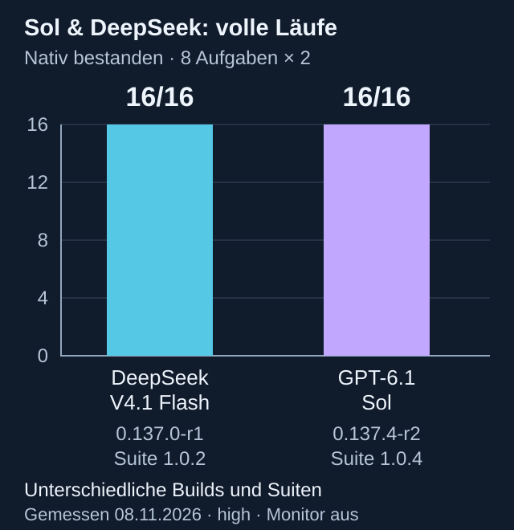

# Benchmark-Ergebnisse / benchmark results

Jeder Vollbenchmark umfasst acht feste Aufgaben mit je zwei Versuchen. Jeder Lauf behält seine Messversion, Suite und Quellhashes. Nachtests stehen separat; sie verändern keinen früheren Benchmarkwert. / Each complete run contains eight tasks repeated twice. Builds, suites and source hashes stay attached to their own runs. Targeted retests never change earlier scores.

| Modell / Serie | Ergebnis | Messstand | Beleg |
| --- | --- | --- | --- |
| DeepSeek V4.1 Flash/high | 16/16 | 0.137.0-r1 · Suite 1.0.2 | [Original](core-deepseek-2026-11-08.json) |
| GPT-6.1 Sol/high | 14/16 | 0.137.2-r1 · Suite 1.0.2 | [Original](core-sol-2026-11-08.json) |
| Sol-Zeichnungsnachtests | 2/2 | 0.137.3-r2 | [Getrennte Serie](sol-drawing-retests-2026-11-08.json) |
| GPT-6.1 Sol/high | 15/16 | 0.137.3-r3 · Suite 1.0.3 | [Original](core-sol-01373-2026-11-08.json) |
| Sol-Bohrungsnachtest | 1/1 | 0.137.4-r1 | [Getrennte Serie](sol-drill-retest-2026-11-08.json) |
| GPT-6.1 Sol/high · neu | 16/16 | 0.137.4-r2 · Suite 1.0.4 | [Neuer vollständiger Lauf](core-sol-01374-2026-11-08.json) |
| DeepSeek V4.1 Flash/high · neuer Lauf | 16/16 | 0.137.4-r2 · Suite 1.0.4 | [Neuer vollständiger Lauf](core-deepseek-01374-2026-11-08.json) |

[Comparison diagram in English](../bilder/benchmark-sol-deepseek-16-2026-11-08-en.svg) · [Daten / chart data with evidence SHA-256](sol-deepseek-16-vergleich-2026-11-08.json)

Die unterschiedlichen Programm-, Werkzeug- und Promptstände schließen eine reine Modellrangfolge auf identischem Stand aus. Die 16/16 beschreiben die beobachteten nativen Prüfungen dieser Aufgaben, keine allgemeine Erfolgsquote. / Different program, tool-reference and prompt states prevent a controlled same-build model ranking. The 16/16 scores describe the observed native checks for these tasks, not general reliability.

Dies ist eine nachträgliche Ergebnisergänzung zur bestehenden Veröffentlichung 0.137.4-r2. Programm, Quellarchive, ältere Ergebnisdateien und deren ursprüngliche Prüfsummen bleiben unverändert. / This is an additive results update to the existing 0.137.4-r2 release. Program and source archives, older result files and their original checksums remain unchanged.

Diagramme reproduzieren / rebuild diagrams: `python scripts/render-benchmark-comparison.py` (Python 3.10+, nur Standardbibliothek). Die JSON-Datei enthält die geprüften zwei Datenzeilen und SHA-256 der Ergebnisbelege.

Der neue Aufbaubenchmark 2.0.0 hat eigene schwierigere Aufgaben. Alle obigen Werte bleiben historische Grundbenchmark-Ergebnisse; es wurden noch keine KI-Aufbau-Ergebnisse gemessen. / Advanced suite 2.0.0 has separate harder tasks. All figures above remain core-benchmark measurements; no advanced AI benchmark has been measured yet.
