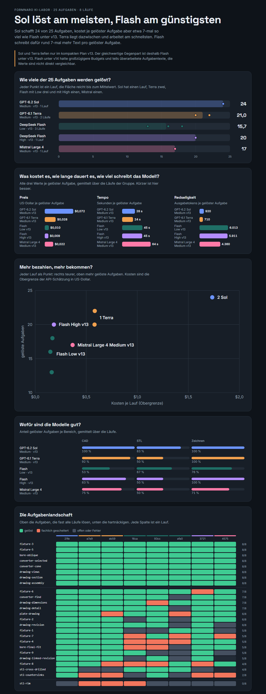

# KI-Modellvergleich im Benchmark v13 / AI model comparison

20. November 2026

25 Aufgaben aus CAD, STL und technischem Zeichnen in acht Läufen. GPT-6.2 Sol löste mit 24 von 25 Aufgaben die meisten. GPT-6.1 Terra benötigte im Mittel die wenigste Zeit je gelöster Aufgabe. DeepSeek Flash High hatte die niedrigste ausgewiesene Kostenschätzung pro gelöster Aufgabe.

Eight runs covered 25 CAD, STL and technical drawing tasks. GPT-6.2 Sol solved the most tasks, at 24 out of 25. GPT-6.1 Terra had the lowest average time per solved task. DeepSeek Flash High had the lowest reported cost estimate per solved task.

[Website DE](https://formnaro.de/ki-labor/modellvergleich/) · [Website EN](https://formnaro.de/en/ai-lab/model-comparison/)

## Datengrundlage / Methodology

Quelle sind die Ergebnis.json-Dateien aus acht Benchmark-Exporten. Zwei Aufgaben des Mistral-Laufs 45754961 wurden vor Ablauf des Zeitbudgets nicht gestartet und zählen als ungelöst. Die Läufe da032db4 (Preislimit), a6042c34 (Denkstufe nicht verfügbar) und 6d73cae2 (Zeitbudget nach 19 von 25 Aufgaben) sind in diesem Vergleich nicht enthalten.

Die Preise sind API-Kostenschätzungen in US-Dollar. Diagramme und Tabellen verwenden die im Export ausgewiesene Obergrenze für gemeldete Nutzung. Für Lauf 16ca7893 enthält der Export zusätzlich eine separate Reserve von 0,2535 USD für einen Aufruf ohne Nutzungsdaten. Ausgabetokens enthalten die ausgewiesenen Denktokens. Kosten, Laufzeit und Ausgabetokens je gelöster Aufgabe werden pro Lauf berechnet und dann pro Modell und Denkstufe gemittelt.

Pro Modell und Denkstufe liegen ein bis drei Läufe vor. Die Zahlen beschreiben diese Stichprobe. Plan v14 hatte andere Budgets und teilweise überarbeitete Aufgaben und ist nur separat auswertbar.

The source is the Ergebnis.json file in each of eight benchmark exports. The Mistral run 45754961 reached its time limit before starting two tasks, which count as unsolved. This comparison excludes runs da032db4 (price limit), a6042c34 (reasoning effort unavailable) and 6d73cae2 (time limit after 19 of 25 tasks).

Prices are API cost estimates in US dollars. Charts and tables use the upper estimate for reported usage. The export for run 16ca7893 also lists a separate USD 0.2535 reserve for a request without usage data. Output tokens include reported reasoning tokens. Cost, elapsed time and output tokens per solved task are calculated per run and then averaged by model and reasoning effort.

Each model and reasoning setting has one to three runs. The results describe this sample. Plan v14 used different budgets and some revised tasks and requires separate analysis.

## Ergebnisse nach Modell und Denkstufe

| Modell | Denkstufe | Läufe | Gelöst von 25 | USD je Lösung | Sekunden je Lösung | Ausgabetokens je Lösung | CAD | STL | Zeichnen |
| --- | --- | --- | --- | --- | --- | --- | --- | --- | --- |
| GPT-6.2 Sol | Medium | 1 | 24,0 | 0,072 | 28 | 920 | 100 % | 83 % | 100 % |
| GPT-6.1 Terra | Medium | 2 | 21,0 | 0,028 | 24 | 710 | 92 % | 50 % | 100 % |
| DeepSeek Flash | Low | 3 | 15,7 | 0,010 | 45 | 6.013 | 53 % | 67 % | 76 % |
| DeepSeek Flash | High | 1 | 20,0 | 0,009 | 45 | 5.911 | 83 % | 50 % | 100 % |
| Mistral Large 4 | Medium | 1 | 17,0 | 0,022 | 64 | 4.360 | 75 % | 50 % | 71 % |

## Alle acht Läufe

| Lauf | Modell | Denkstufe | Gelöst | USD je Lauf | Sekunden | Ausgabetokens |
| --- | --- | --- | --- | --- | --- | --- |
| 21fe9f9e | GPT-6.2 Sol | Medium | 24 | 1,7347 | 679,6 | 22088 |
| a7a9e5b8 | GPT-6.1 Terra | Medium | 22 | 0,5837 | 502,2 | 14719 |
| eb595234 | GPT-6.1 Terra | Medium | 20 | 0,5817 | 513,9 | 15019 |
| 16ca7893 | DeepSeek Flash | Low | 16 | 0,1487 | 675,2 | 85311 |
| 93ccb010 | DeepSeek Flash | Low | 18 | 0,1689 | 645,7 | 100085 |
| afa009ae | DeepSeek Flash | Low | 13 | 0,1618 | 744,9 | 92891 |
| 37215eb6 | DeepSeek Flash | High | 20 | 0,1834 | 893,7 | 118225 |
| 45754961 | Mistral Large 4 | Medium | 17 | 0,3666 | 1.080,0 | 74122 |

## Ergebnisse je Aufgabe

| Aufgabe | 21fe | a7a9 | eb59 | 16ca | 93cc | afa0 | 3721 | 4575 | Gelöst |
| --- | --- | --- | --- | --- | --- | --- | --- | --- | --- |
| fixture-3 | Gelöst | Gelöst | Gelöst | Gelöst | Gelöst | Gelöst | Gelöst | Gelöst | 8/8 |
| fixture-5 | Gelöst | Gelöst | Gelöst | Gelöst | Gelöst | Gelöst | Gelöst | Gelöst | 8/8 |
| bore-oblique | Gelöst | Gelöst | Gelöst | Gelöst | Gelöst | Gelöst | Gelöst | Gelöst | 8/8 |
| converter-selected | Gelöst | Gelöst | Gelöst | Gelöst | Gelöst | Gelöst | Gelöst | Gelöst | 8/8 |
| converter-cone | Gelöst | Gelöst | Gelöst | Gelöst | Gelöst | Gelöst | Gelöst | Gelöst | 8/8 |
| drawing-views | Gelöst | Gelöst | Gelöst | Gelöst | Gelöst | Gelöst | Gelöst | Gelöst | 8/8 |
| drawing-section | Gelöst | Gelöst | Gelöst | Gelöst | Gelöst | Gelöst | Gelöst | Gelöst | 8/8 |
| drawing-assembly | Gelöst | Gelöst | Gelöst | Gelöst | Gelöst | Gelöst | Gelöst | Gelöst | 8/8 |
| fixture-6 | Gelöst | Gelöst | Gelöst | Gelöst | Gelöst | Gelöst | Gescheitert | Gelöst | 7/8 |
| converter-find | Gelöst | Gelöst | Gelöst | Gelöst | Gelöst | Fehler | Gelöst | Gelöst | 7/8 |
| drawing-dimensions | Gelöst | Gelöst | Gelöst | Gelöst | Gescheitert | Gelöst | Gelöst | Gelöst | 7/8 |
| drawing-detail | Gelöst | Gelöst | Gelöst | Gelöst | Gelöst | Fehler | Gelöst | Gelöst | 7/8 |
| plate-drawing | Gelöst | Gelöst | Gescheitert | Gelöst | Gelöst | Gescheitert | Gelöst | Gelöst | 6/8 |
| fixture-2 | Gelöst | Gelöst | Gelöst | Fehler | Gelöst | Fehler | Gelöst | Gelöst | 6/8 |
| drawing-revision | Gelöst | Gelöst | Gelöst | Gelöst | Gelöst | Fehler | Gelöst | Offen | 6/8 |
| fixture-1 | Gelöst | Gelöst | Gelöst | Fehler | Fehler | Gelöst | Gelöst | Fehler | 5/8 |
| fixture-7 | Gelöst | Gelöst | Gelöst | Gescheitert | Gelöst | Gescheitert | Gelöst | Gescheitert | 5/8 |
| fixture-4 | Gelöst | Gelöst | Gelöst | Gescheitert | Gescheitert | Gescheitert | Gelöst | Gelöst | 5/8 |
| bore-final-fit | Gelöst | Gelöst | Gelöst | Gescheitert | Gescheitert | Offen | Gelöst | Gelöst | 5/8 |
| fixture-9 | Gelöst | Gelöst | Gelöst | Gelöst | Fehler | Fehler | Gelöst | Offen | 5/8 |
| drawing-linked-revision | Gelöst | Gelöst | Gelöst | Fehler | Gelöst | Fehler | Gelöst | Ohne Versuch | 5/8 |
| fixture-8 | Gelöst | Gelöst | Gescheitert | Gescheitert | Gescheitert | Gelöst | Gescheitert | Gelöst | 4/8 |
| stl-cross-drilled | Gelöst | Fehler | Fehler | Gelöst | Gelöst | Gelöst | Offen | Ohne Versuch | 4/8 |
| stl-countersinks | Gelöst | Gescheitert | Gescheitert | Offen | Gelöst | Offen | Gescheitert | Gescheitert | 2/8 |
| stl-rim | Fehler | Gescheitert | Gescheitert | Gescheitert | Fehler | Fehler | Offen | Offen | 0/8 |
